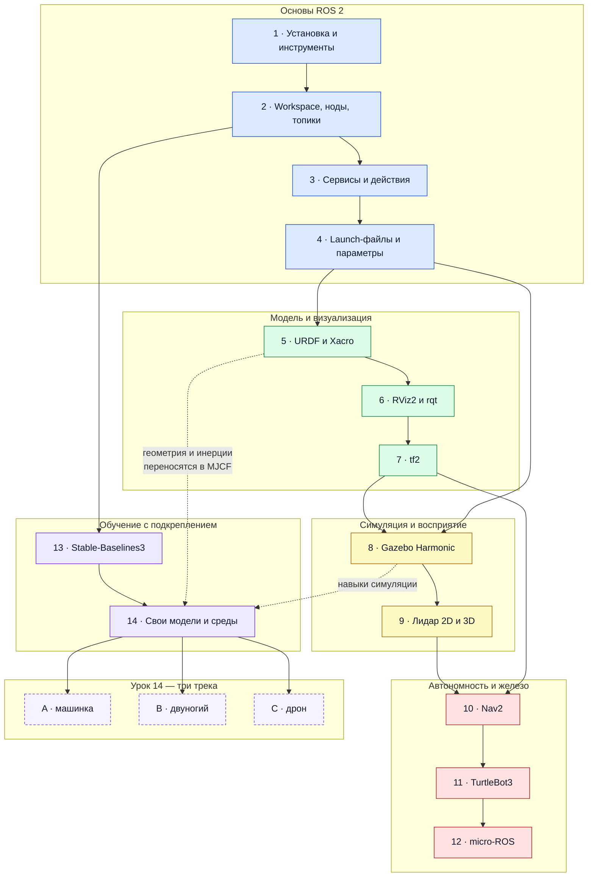

# Основы мобильной робототехники

Практический курс: от установки ROS 2 до собственных сред обучения с подкреплением.
Четырнадцать уроков, каждый — с воспроизводимыми командами, ожидаемым результатом и
контрольными проверками.

Основная конфигурация — **ROS 2 Jazzy на Ubuntu 24.04**. Для части материалов указана
совместимость с **Humble на Ubuntu 22.04**. Уроки 13–14 не требуют ROS вообще: это
чистый Python, их можно пройти на Windows или macOS.

**[Быстрый старт](#быстрый-старт)** · **[Карта курса](#карта-курса)** ·
**[Установка](SETUP.md)** · **[Программа](CURRICULUM.md)** ·
**[Если не работает](TROUBLESHOOTING.md)** · **[Глоссарий](GLOSSARY.md)**

---

## Что вы построите

Не «познакомитесь с темой», а получите работающие вещи:

- **Свой пакет ROS 2** с публикатором, подписчиком, сервисом и действием — и запись
  происходящего в `ros2 bag`.
- **Подвижную модель робота** в URDF/Xacro, которая публикует своё состояние и видна
  в RViz2 вместе с деревом фреймов `tf2`.
- **Робота в Gazebo Harmonic** с дифференциальным приводом, лидаром и IMU.
- **Автономную навигацию**: карта, локализация AMCL, поездка в заданную точку через Nav2.
- **ESP32 в графе ROS 2** — микроконтроллер публикует топики через micro-ROS.
- **Три обученные политики** в уроке 14: машинка паркуется, двуногий идёт, дрон
  сам облетает объект и покрывает его поверхность.

Последний пункт выглядит так — четыре политики урока 14, обученные в средах,
написанных с нуля:

|  |  |
|:--|:--|
| /track_a_car/images/parking.gif>)<br>**A — машинка.** Весь манёвр — 4.3 с. Смотрите на перекладку руля у задней стены: зазоры на месте всего 0.039 и 0.319 м. Обученная политика, 100 % успеха. | /track_b_walk/images/walking.gif>)<br>**B — двуногий.** Команда 0.4 м/с. Смотрите не на корпус, а на стопы: они почти не отрываются от пола. Это семенение — шаг 0.4 см при каденсе 10.8 шагов/с, разбор в главе 08. |
| /track_c_drone/images/hover.gif>)<br>**C1 — дрон, зависание.** Политика правит четырьмя винтами напрямую, без внешнего стабилизатора. Смотрите на удержание курса: его держат чередующиеся знаки момента по рысканью. | /track_c_drone/images/scan.gif>)<br>**C2 — дрон, облёт.** Награда — за покрытие поверхности, а не за позицию. Смотрите на конец ролика: эпизод обрывается сам, как только объект отснят целиком. |

## Кому этот курс

| Вы | Что взять |
|---|---|
| Никогда не запускали ROS 2 | Уроки 1–4, по порядку. Дальше — по карте |
| Знаете ROS 2, нужна симуляция и навигация | Уроки 5–11 |
| Нужен только RL для робототехники | Уроки 13–14. ROS не нужен, Linux не нужен |
| Ведёте занятия | [CURRICULUM.md](CURRICULUM.md) — цели, контрольные вопросы, критерии |

---

## Быстрый старт

Курс двухголовый: дорожка ROS 2 требует Linux, дорожка RL — нет. Начинайте с любой.

**Дорожка ROS 2** (уроки 1–12) — Ubuntu 24.04, WSL2 или ВМ:

```bash
sudo apt install ros-jazzy-desktop
source /opt/ros/jazzy/setup.bash
ros2 doctor            # диагностика установки
ros2 run turtlesim turtlesim_node
```

**Дорожка RL** (уроки 13–14) — любая ОС, ROS не нужен:

```bash
pip install -r requirements.txt
cd "lesson 13 (stable baselines3)/code/01_cartpole"
python train_cartpole.py     # PPO решает CartPole на 500/500
```

Подробная установка, варианты платформ и сборка `ros2_ws` — в **[SETUP.md](SETUP.md)**.

---

## Карта курса



| № | Урок | Статей | Что ставим | Железо | Результат |
|--:|------|-------:|-----------|--------|-----------|
| 1 | [Установка и первые инструменты](<lesson 1 (install ROS2 and testing)/README.md>) | 10 | ROS 2 Jazzy | CPU | `ros2 doctor` без ошибок, turtlesim ездит |
| 2 | [Workspace, ноды и топики](<lesson 2 (nodes and topics)/README.md>) | 8 | colcon, rosdep | CPU | Свои publisher и subscriber, запись `ros2 bag` |
| 3 | [Сервисы и действия](<lesson 3 (actions and services)/README.md>) | 6 | — | CPU | Свои `.srv` и `.action`, сервер и клиент |
| 4 | [Launch-файлы и параметры](<lesson 4 (launches and parameters)/README.md>) | 4 | — | CPU | Вся демонстрация стартует одной командой |
| 5 | [URDF, Xacro, robot_state_publisher](<lesson 5 (URDF and XACRO)/README.md>) | 7 | xacro | CPU | Подвижная модель публикует своё состояние |
| 6 | [RViz2 и rqt](<lesson 6 (RViz2 and rqt)/README.md>) | 2 | rviz2 | CPU + GUI | Модель, фреймы и топики видны в RViz2 |
| 7 | [tf2](<lesson 7 (TF2)/README.md>) | 6 | tf2_ros | CPU | Статический и динамический broadcaster, listener |
| 8 | [Gazebo Harmonic](<lesson 8 (Gazebo)/README.md>) | 9 | Gazebo Harmonic, ros_gz | CPU + GUI | Робот с diff-drive, лидаром и IMU |
| 9 | [Сенсоры: 2D- и 3D-лидар](<lesson 9 (lidar sensors)/README.md>) | 2 | — | CPU | Понятны `LaserScan`, `PointCloud2` и фрейм сенсора |
| 10 | [Nav2](<lesson 10 (Nav2)/README.md>) | 5 | nav2, slam_toolbox | CPU | Карта, AMCL, автономная поездка в точку |
| 11 | [TurtleBot3 simulation](<lesson 11 (turtlebot3 sim)/README.md>) | 3 | turtlebot3 | CPU | Сценарии empty / world / house и teleop |
| 12 | [micro-ROS](<lesson 12 (micro-ros)/README.md>) | 6 | micro-ROS Agent, ESP-IDF | CPU + ESP32 | ESP32 публикует топики в граф ROS 2 |
| 13 | [Stable-Baselines3: введение в RL](<lesson 13 (stable baselines3)/README.md>) | 3 | SB3, gymnasium | CPU | PPO решает CartPole-v1 на 500/500 |
| 14 | [RL: свои модели и среды](<lesson 14 (RL custom models)/README.md>) | — | MuJoCo, SB3 | CPU | Три обученные политики — см. ниже |
| 15 | [RL-политики под управлением ROS 2](<lesson 15 (RL policies in ROS 2)/README.md>) | 1 (в работе) | MuJoCo, onnxruntime, ROS 2 | CPU | Двуногий идёт по `/cmd_vel` с клавиатуры |

Приложения: **[А — ROS 2 и LLM-агенты](<appendix A (ros2 llm agents)/ros2-mcp-openclaw_1.md>)**,
**[Б — инференс политик на Microduck](<appendix B (microduck policy inference)/README.md>)**.

**Маршруты.** Базовый ROS 2: 1 → 2 → 3 → 4. Симуляция и навигация: 5 → 6 → 7 → 8 → 9 → 10 → 11.
Только RL, без ROS: 13 → 14. Полный курс: 1 → 14 по порядку.
Развёрнутая программа с контрольными вопросами — [CURRICULUM.md](CURRICULUM.md).

---

## Урок 14: три трека

Один урок, три задачи разного класса. Общее ядро — `rl_toolkit`: куррикулумы, парные
чекпойнты, реестр членов награды, диагностика и пробы среды. Всё это извлечено из
боевого проекта обучения ходьбе, а не придумано для учебника.

| Трек | Задача | Чему учит | Железо |
|---|---|---|---|
| **A** — машинка | Заехать на парковочное место | Неголономная кинематика, потенциальный шейпинг, разреженная цель | CPU |
| **B** — двуногий | Идти по команде скорости | Контакты, куррикулумы, длинный прогон, sim2real | CPU |
| **C** — дрон | Облететь объект и покрыть его поверхность | Неустойчивая система, награда за **покрытие**, исследование | CPU |

Каждый трек закрывает свой класс награды: A — расстояние до цели, B — слежение за
командой, C — то, что уже увидено. Третий принципиально отличается: награда меняется
внутри эпизода и заставляет агента исследовать, а не сходиться в точку.

> **RL — не всегда про GPU.** Для MLP-политик этого урока CPU быстрее: 2063 против
> 741 шага/с на RTX 4060 Laptop. Узкое место — физика MuJoCo, а она на CPU. Видеокарта
> пригодится, только если вы замените политику на свёрточную или увеличите сеть.

---

## Совместимость и версии

| Компонент | Основная конфигурация | Проверенная альтернатива |
|---|---|---|
| ROS 2 | Jazzy Jalisco | Humble Hawksbill |
| ОС | Ubuntu 24.04 | Ubuntu 22.04, WSL2, ВМ |
| Gazebo | Harmonic | — |
| Python (дорожка RL) | 3.12 | 3.10–3.12 |
| MuJoCo | 3.9.0 | 3.x |
| gymnasium | 1.0.0 | — |
| stable-baselines3 | 2.4.1 | — |

Команды, зависящие от дистрибутива, пишутся через `$ROS_DISTRO`. Если для Humble
команда отличается, это указано отдельным примечанием. Точные пины — в
[requirements.txt](requirements.txt).

---

## Как устроен урок

Каждая статья курса обязана давать пять вещей:

1. **Цель** — что вы сможете после неё.
2. **Минимальная теория** — только то, без чего команды непонятны.
3. **Воспроизводимые команды** — их можно скопировать и выполнить.
4. **Ожидаемый результат** — что должно появиться на экране.
5. **Контрольные проверки** — как убедиться, что получилось.

Код, который надо сохранить в файл, приводится целиком: никаких `...` вместо
пропущенных строк. Правила оформления — в [CONTRIBUTING.md](CONTRIBUTING.md).

---

## Workspace курса

В репозитории лежит готовый [ros2_ws/src](<ros2_ws/src/README.md>) — 12 пакетов,
создаваемых по ходу курса. Он нужен, чтобы проверять практические статьи.

```bash
cd ros2_ws
source /opt/ros/$ROS_DISTRO/setup.bash
rosdep install -i --from-path src --rosdistro $ROS_DISTRO -y
colcon build --symlink-install
source install/setup.bash
```

Оговорки по сборке отдельных пакетов — в [SETUP.md](SETUP.md).

---

## Если что-то не работает

Пять ошибок, на которые приходится большинство обращений:

| Ошибка | Куда смотреть |
|---|---|
| `ros2: command not found` | Не выполнен `source /opt/ros/$ROS_DISTRO/setup.bash` |
| GUI не открывается в WSL2 | Нужен WSLg или X-сервер |
| `Package 'X' not found` после `colcon build` | Не выполнен `source install/setup.bash` |
| Gazebo стартует чёрным окном | Драйверы GPU, программный рендер |
| `torch.cuda.is_available() == False` | Поставлена CPU-сборка torch |

Разбор каждой с точными командами диагностики — в
**[TROUBLESHOOTING.md](TROUBLESHOOTING.md)**.

---

## Проверка репозитория

Все ссылки курса и соответствие таблицы уроков каталогам проверяются автоматически:

```bash
python tools/check_links.py
```

Тот же скрипт запускается в CI на каждый push и pull request.

---

## Вклад и лицензия

Правила оформления статей, раскладка урока, терминология и чек-лист pull request —
в [CONTRIBUTING.md](CONTRIBUTING.md).

Код — [Apache-2.0](LICENSE). Тексты и иллюстрации — [CC BY-SA 4.0](LICENSE-TEXT).

## Источники

Курс опирается на официальную документацию:
[ROS 2 Jazzy](https://docs.ros.org/en/jazzy/) ·
[Gazebo Harmonic](https://gazebosim.org/docs/harmonic/) ·
[Nav2](https://docs.nav2.org/) ·
[MuJoCo](https://mujoco.readthedocs.io/) ·
[Stable-Baselines3](https://stable-baselines3.readthedocs.io/) ·
[Gymnasium](https://gymnasium.farama.org/)
