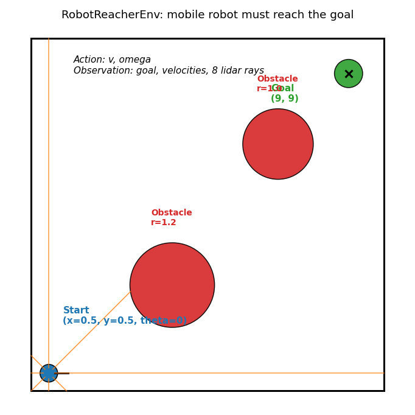
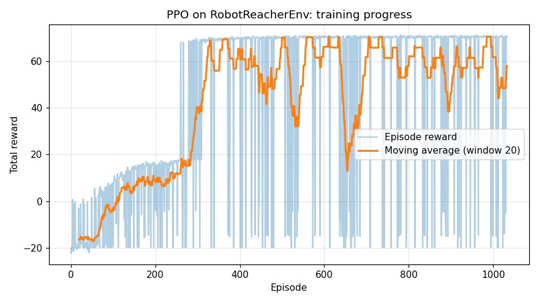
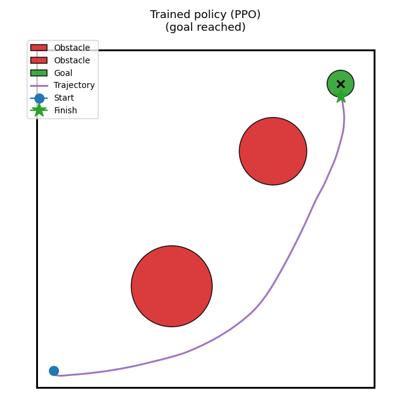
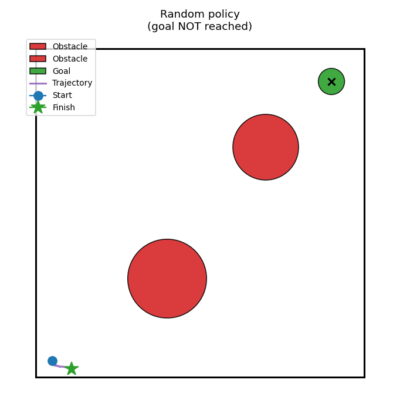
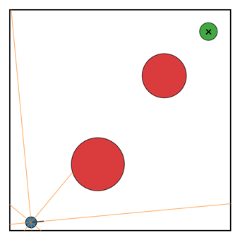

# Своя среда Gymnasium: мобильный робот доезжает до цели

**Результат статьи:** собственная среда `RobotReacherEnv` по стандарту Gymnasium — 2D-модель мобильного робота с лидаром, — и обученный в ней агент PPO, который доезжает до цели, объезжая препятствия.

---

## Содержание

- [Зачем писать свою среду](#зачем-писать-свою-среду)
- [Устройство среды RobotReacherEnv](#устройство-среды-robotreacher)
- [Кинематика робота](#кинематика-робота)
- [Наблюдение: голы и лидар](#наблюдение-цели-и-лидар)
- [Награда](#награда)
- [Код среды](#код-среды)
- [Проверка среды](#проверка-среды)
- [Обучение PPO](#обучение-ppo)
- [Результат: обученный агент против случайного](#результат-обученный-агент-против-случайного)
- [Связь с ROS 2 и реальным роботом](#связь-с-ros-2-и-реальным-роботом)
- [Проверки](#проверки)

---

## Зачем писать свою среду

Стандартные среды Gymnasium (CartPole, LunarLander) — это тренажёры для изучения RL. Для робототехники нужна своя среда: её состояние — это состояние робота, её действия — команды моторам, её награда — успех вашей задачи.

Среда по стандарту Gymnasium автоматически совместима со **всеми** алгоритмами SB3 без изменений. А сама среда — идеальная «песочница»: в ней можно безопасно настраивать награду и наблюдение, прежде чем переносить обучение на реального робота или в Gazebo.

---

## Устройство среды RobotReacherEnv

Квадратная комната 10×10 м, в ней два круглых препятствия. Робот стартует в углу (0.5, 0.5) и должен доехать до цели (9, 9).



| Элемент | Описание |
|---|---|
| Состояние | `x, y, theta` — положение и курс робота |
| Действие | `v` (линейная скорость, −0.5…1.0 м/с), `omega` (угловая скорость, ±1.5 рад/с) |
| Наблюдение | 12 чисел: цель в системе робота, текущие скорости, 8 лучей лидара |
| Конец эпизода | достиг цели / столкновение / 250 шагов (25 секунд) |

Это та же модель движения, что у TurtleBot3 и большинства колёсных роботов: они не двигаются вбок, а едут вперёд и поворачивают. Действия непрерывные — такие же, как команды `Twist` в ROS 2.

---

## Кинематика робота

На каждом шаге (dt = 0.1 с) состояние обновляется по модели дифференциального привода:

```text
theta += omega * dt
x     += v * cos(theta) * dt
y     += v * sin(theta) * dt
```

---

## Наблюдение: цели и лидар

Нейросеть не знает о положении робота «вообще» — она видит только 12 чисел:

- **цель в системе координат робота** (2 числа) — «насколько цель впереди и сбоку»;
- **текущие скорости v и omega** (2 числа) — чтобы учитывать инерцию;
- **8 лучей лидара** (8 чисел) — расстояние до ближайшего препятствия в каждом из 8 направлений (каждые 45°), нормированное на дальность 12 м.

Лидар считается настоящим ray casting: луч пересекается со всеми стенами и окружностями препятствий, берётся ближайшее пересечение. Ключевая функция в `robot_env.py`:

```python
def _ray_distance(origin, angle):
    """Расстояние от точки origin до ближайшего препятствия вдоль луча."""
    d = np.array([math.cos(angle), math.sin(angle)])
    best = LIDAR_RANGE

    for center, radius in zip(OBSTACLES, OBSTACLE_RADIUS):   # окружности
        rel = origin - center
        b = 2.0 * float(np.dot(d, rel))
        c = float(np.dot(rel, rel)) - radius * radius
        disc = b * b - 4.0 * c
        if disc >= 0.0:
            for t in ((-b - math.sqrt(disc)) / 2.0, (-b + math.sqrt(disc)) / 2.0):
                if t > 1e-6:
                    best = min(best, t)

    for wall_x in (0.0, WORLD_SIZE):                          # вертикальные стены
        if abs(d[0]) > 1e-9:
            t = (wall_x - origin[0]) / d[0]
            if t > 1e-6 and 0.0 <= origin[1] + t * d[1] <= WORLD_SIZE:
                best = min(best, t)
    ...
```

---

## Награда

Награда за шаг — это всё, что агент знает о задаче. Она сконструирована из трёх частей:

```python
reward = 2.0 * (d_prev - d_new) - 0.02   # прогресс к цели - штраф за каждый шаг
if d_new <= GOAL_RADIUS:  reward += 50.0  # +50 за достижение цели
elif self._collision():   reward = -20.0  # -20 за столкновение
```

- `2.0 * (d_prev - d_new)` — награда за уменьшение расстояния до цели: сделал шаг к цели — плюс, отъехал — минус;
- `-0.02` — постоянный штраф за время, чтобы агент не кружил вечно;
- `+50` — бонус за достижение цели (терминальное событие);
- `-20` — штраф за столкновение со стеной или препятствием (тоже конец эпизода).

Максимум: около 66–71 балла (бонус + суммарный прогресс по прямой). Положительная награда означает «робот доезжает чаще, чем врезается».

---

## Код среды

Полный код — `code/02_robot_env/robot_env.py` (~230 строк). Каркас среды по стандарту Gymnasium выглядит так:

```python
import gymnasium as gym
from gymnasium import spaces
import numpy as np

class RobotReacherEnv(gym.Env):
    def __init__(self, render_mode=None):
        super().__init__()
        self.observation_space = spaces.Box(...)   # 12 чисел с границами
        self.action_space = spaces.Box(
            low=np.array([V_MIN, W_MIN]), high=np.array([V_MAX, W_MAX])
        )

    def reset(self, *, seed=None, options=None):
        ...                                          # возвращает (obs, info)

    def step(self, action):
        ...                                          # возвращает (obs, reward, terminated, truncated, info)

    def render(self):
        ...                                          # картинка для отладки
```

Всё, что нужно SB3 от среды — реализовать эти четыре метода: `__init__` (пространства наблюдений и действий), `reset` (начало эпизода), `step` (один шаг физики и награда), `render` (визуализация).

---

## Проверка среды

Перед обучением проверьте среду случайными действиями:

```bash
cd "lesson 12 (stable baselines3)/code/02_robot_env"
python robot_env.py
```

```
Observation shape: (12,)
Action space: Box([-0.5 -1.5], [1.  1.5], (2,), float32)
Observation space: Box([-15.  -15.   -0.5  -1.5   0. ...], [15.  15.   1.   1.5  1. ...], (12,), float32)
step 1: v=-0.48  w=+0.30  reward=-0.07
step 2: v=+0.50  w=-0.15  reward=+0.03
...
Total reward: -0.20
```

Случайный агент получает около −20 баллов за эпизод: он врезается или выходит из времени.

---

## Обучение PPO

Обучение почти не отличается от CartPole — тот же PPO, но среда своя:

```bash
cd "lesson 12 (stable baselines3)/code/02_robot_env"
python train_robot.py
```

Скрипт `train_robot.py` обучает PPO 150 000 шагов (около 3 минут на CPU) и рисует кривую обучения:



В конце скрипт оценивает модель на 20 эпизодах:

```
Mean reward over 20 episodes: 66.1 +/- 19.8
Positive reward means the robot reaches the goal more often than it crashes.
```

66 баллов из максимума ~71 — агент стабильно довозит робота до цели.

---

## Результат: обученный агент против случайного

Демонстрация — `code/02_robot_env/evaluate_robot.py`:

```bash
cd "lesson 12 (stable baselines3)/code/02_robot_env"
python evaluate_robot.py
```

```
Trained policy: total reward = 70.7, steps = 134
Random policy: mean reward over 5 episodes = -19.9
```

Траектория обученного агента: робот выходит из угла, огибает первое препятствие, проходит между препятствиями и попадает в цель за 134 шага (13.4 с).



Траектория случайного агента для сравнения — бессмысленное блуждание до столкновения:



Анимация эпизода с лучами лидара:



---

## Связь с ROS 2 и реальным роботом

Эта среда — упрощённая модель робота, но обученную политику можно перенести на ROS 2 без переписывания:

1. **В Gazebo.** Замените внутреннюю физику среды на Gazebo: нода публикует в топик `cmd_vel` действия политики и читает одометрию (`/odom`) и лидар (`/scan`), формируя то же самое 12-числовое наблюдение. На каждом шаге нода вызывает `policy.predict(obs)`.
2. **На реальном роботе.** Обучение целиком «вживую» дорого и опасно (десятки тысяч падений). Стандартный путь: обучить в симуляции, затем дообучить (fine-tune) короткой сессией на реальном роботе или использовать симуляцию с доменной рандомизацией.
3. **Вместе с Nav2.** RL-политика может решать точечную задачу «доедь до цели в динамичной толпе», а Nav2 — строить глобальный маршрут и следить за безопасностью (например, ограничивать скорости политики).

Главное правило переноса: **наблюдение политики на роботе должно численно совпадать с наблюдением в среде** (те же величины, тот же масштаб, та же частота). В нашей среде лидар нормирован на 12 м и снимается каждые 0.1 с — при переносе повторите это же на реальных данных.

---

## Проверки

1. Увеличьте дальность «лидара» до 16 лучей (`N_RAYS = 16`). Изменился ли результат обучения?
2. Добавьте третье препятствие посередине комнаты. Сколько шагов обучения теперь нужно?
3. Замените PPO на SAC (`from stable_baselines3 import SAC`). Сравните кривую обучения.
4. Сделайте цель случайной в `reset()`. Что произойдёт с наградой и почему?
5. Уменьшите бонус за цель с 50 до 5. Как изменится поведение агента?

---

## Итог урока

Вы освоили полный цикл RL-проекта: постановка задачи → среда Gymnasium → награда и наблюдение → обучение PPO → оценка и визуализация. Следующий логичный шаг — подключить обученную политику к симуляции TurtleBot3 в Gazebo из урока 10 и сравнить её с навигацией Nav2.
