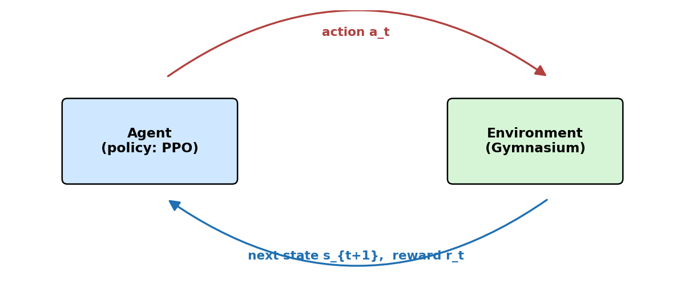
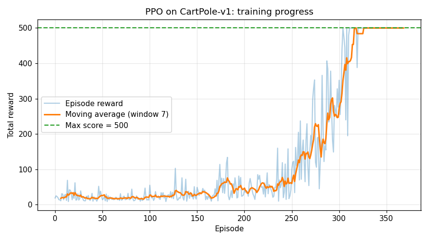
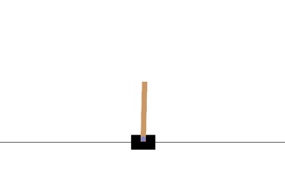
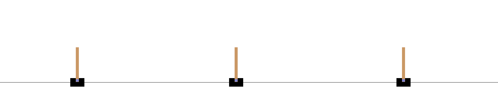

# Введение в Stable Baselines 3: первая модель на CartPole

**Результат статьи:** обученная на вашем компьютере модель PPO, которая решает задачу CartPole-v1 на максимум баллов (500/500), плюс понимание базовых понятий обучения с подкреплением и устройства Stable Baselines 3.

---

## Содержание

- [Что такое обучение с подкреплением](#что-такое-обучение-с-подкреплением)
- [Где RL в мобильной робототехнике](#где-rl-в-мобильной-робототехнике)
- [Установка Stable Baselines 3](#установка-stable-baselines-3)
- [Знакомство со средой CartPole](#знакомство-со-средой-cartpole)
- [Обучение агента PPO](#обучение-агента-ppo)
- [Кривая обучения](#кривая-обучения)
- [Сохранение и загрузка модели](#сохранение-и-загрузка-модели)
- [Демонстрация результата](#демонстрация-результата)
- [TensorBoard](#tensorboard)
- [Какие алгоритмы есть в SB3](#какие-алгоритмы-есть-в-sb3)
- [Проверки](#проверки)

---

## Что такое обучение с подкреплением

Обучение с подкреплением (Reinforcement Learning, RL) — это метод машинного обучения, в котором **агент** учится действовать методом проб и ошибок, получая от **среды** награду за свои действия. Никто не размечает данные и не говорит агенту «правильный ответ» — агент сам ищет стратегию, которая максимизирует суммарную награду.

Цикл взаимодействия агента и среды:



1. Агент получает от среды состояние `s_t` (сенсоры, положение, скорости).
2. Агент выбирает действие `a_t` (команды моторам).
3. Среда выполняет действие, переходит в новое состояние `s_{t+1}` и возвращает награду `r_t`.
4. Агент обновляет свою политику, чтобы в будущем получать больше награды.

**Stable Baselines 3 (SB3)** — самая популярная библиотека RL на Python. Она даёт готовые, хорошо протестированные реализации современных алгоритмов (PPO, DQN, SAC, TD3, A2C) и единый интерфейс для обучения, сохранения и оценки моделей.

---

## Где RL в мобильной робототехнике

- **Навигация без карты**: робот учится доезжать до цели по показаниям лидара и камеры.
- **Следование за человеком, парковка, облёт препятствий**: задачи, где сложно писать правила вручную.
- **Настройка параметров классических алгоритмов**: RL подбирает веса потенциалов, скорости Nav2 и т.п.

В этом курсе RL идёт после Nav2 и TurtleBot3: классические алгоритмы (Nav2, SLAM) решают навигацию надёжно и предсказуемо, а RL полезен там, где правила не покрывают всех ситуаций.

---

## Установка Stable Baselines 3

Требования: Python 3.9–3.12. Команды одинаковы на Windows, Linux и macOS.

```bash
pip install stable-baselines3 gymnasium matplotlib pillow tensorboard
```

Проверка установки:

```bash
python -c "import stable_baselines3, gymnasium, torch; print('SB3', stable_baselines3.__version__, '| gymnasium', gymnasium.__version__, '| torch', torch.__version__)"
```

Ожидаемый результат — три версии без ошибок, например `SB3 2.4.1 | gymnasium 1.0.0 | torch 2.6.0`.

> **Примечание по GPU.** SB3 работает и на CPU, и на GPU (CUDA). Для маленьких политик (обычные полносвязные сети) CPU часто быстрее, поэтому в скриптах курса явно указано `device="cpu"`. Если у вас есть мощный GPU, уберите этот параметр или поставьте `device="cuda"`.

---

## Знакомство со средой CartPole

Среды в RL поставляются библиотекой **Gymnasium**. CartPole-v1 — классическая задача: тележка на рельсе балансирует шест. Наблюдение — 4 числа (положение тележки, её скорость, угол шеста, угловая скорость), действие — одно из двух: толкнуть влево или вправо. Эпизод длится максимум 500 шагов; +1 балл за каждый шаг, пока шест не упал.

Проверьте, что среда работает:

```python
import gymnasium as gym

env = gym.make("CartPole-v1")
print("Observation:", env.observation_space)  # Box(-inf..inf, shape (4,), float32)
print("Action:", env.action_space)            # Discrete(2)

obs, _ = env.reset(seed=0)
print("First observation:", obs)
```

Случайный агент в этой задаче держит шест в среднем 20–30 шагов, поэтому случайной стратегией задача не решается.

---

## Обучение агента PPO

**PPO** (Proximal Policy Optimization) — современный алгоритм RL, который хорошо работает «из коробки» и не требует тонкой настройки. С него рекомендуют начинать все RL-проекты.

Полный скрипт обучения лежит в `code/01_cartpole/train_cartpole.py`. Его ключевая часть:

```python
import gymnasium as gym
from stable_baselines3 import PPO

env = gym.make("CartPole-v1")
model = PPO("MlpPolicy", env, seed=42, device="cpu")  # MlpPolicy - нейросеть из полносвязных слоёв
model.learn(total_timesteps=50_000)                    # 50 000 шагов взаимодействия со средой
model.save("models/ppo_cartpole")
```

Запуск полного скрипта (с графиком и оценкой):

```bash
cd "lesson 13 (stable baselines3)/code/01_cartpole"
python train_cartpole.py
```

Во время обучения SB3 печатает таблицу метрик (loss, explained variance, learning rate), а в конце — оценку:

```
Mean reward over 10 episodes: 500.0 +/- 0.0
Max score is 500, so about 100% of the task is solved.
```

Обучение занимает несколько минут на CPU. Модель сохраняется в `code/01_cartpole/models/ppo_cartpole.zip`.

---

## Кривая обучения

Скрипт `train_cartpole.py` дополнительно рисует график награды по эпизодам и сохраняет его в `images/cartpole_training_curve.png`:



Характерная картина обучения: сначала агент действует почти случайно (награда около 20), затем постепенно учится балансировать и выходит на максимум 500. Колебания на графике нормальны — агент постоянно пробует новые стратегии.

---

## Сохранение и загрузка модели

Модель сохраняется в один zip-файл. Загрузить и использовать её можно так:

```python
from stable_baselines3 import PPO

model = PPO.load("models/ppo_cartpole", device="cpu")

obs, _ = env.reset()
action, _ = model.predict(obs, deterministic=True)  # deterministic=True - без случайности
```

`model.predict()` возвращает действие и скрытое состояние (для рекуррентных политик). Для итоговой демонстрации всегда используйте `deterministic=True` — это убирает исследовательский шум.

---

## Демонстрация результата

Скрипт `code/01_cartpole/evaluate_cartpole.py` прогоняет один эпизод обученной модели, сохраняет анимацию и коллаж кадров:

```bash
cd "lesson 13 (stable baselines3)/code/01_cartpole"
python evaluate_cartpole.py
```

```
Total reward: 500.0 (max is 500)
```





Агент удерживает шест все 500 шагов — задача решена полностью.

---

## TensorBoard

SB3 по умолчанию пишет логи обучения в папку `logs/`. Посмотреть кривые loss, learning rate и других метрик:

```bash
cd "lesson 13 (stable baselines3)/code/01_cartpole"
tensorboard --logdir logs
```

Затем откройте в браузере адрес `http://localhost:6006`.

---

## Какие алгоритмы есть в SB3

| Алгоритм | Тип действий | Когда использовать |
|---|---|---|
| **PPO** | Непрерывные и дискретные | Универсальный выбор по умолчанию |
| **A2C** | Непрерывные и дискретные | Проще и быстрее PPO, чуть менее стабилен |
| **DQN** | Только дискретные | Задачи с дискретным управлением |
| **SAC** | Непрерывные | Плавное управление моторами, эффективен по сэмплам |
| **TD3** | Непрерывные | Как SAC, но менее чувствителен к настройке |

Для робототехники чаще всего берут **PPO** (стабильность и простота) и **SAC** (максимальная эффективность по сэмплам, когда сбор данных дорог — например, на реальном роботе).

Попробуйте заменить PPO на другой алгоритм — интерфейс одинаковый:

```python
from stable_baselines3 import DQN   # только для дискретных действий!

model = DQN("MlpPolicy", env, seed=42, device="cpu")
model.learn(total_timesteps=50_000)
```

---

## Проверки

1. Запустите `train_cartpole.py` с `TOTAL_TIMESTEPS = 10_000`. Какой балл набирает модель?
2. Обучите агента без `deterministic=True` в демонстрации. Что изменилось и почему?
3. Замените среду на `LunarLander-v2` (`pip install box2d-py`). Сколько шагов нужно, чтобы агент научился сажать модуль?
4. Откройте TensorBoard во время обучения и найдите график `rollout/ep_rew_mean`.

---

## Что дальше

В [следующей статье](custom_robot_environment.md) мы напишем собственную среду Gymnasium — мобильного робота, который по лидару доезжает до цели, — и обучим его тем же PPO. Это первый шаг к использованию RL на реальном роботе.
