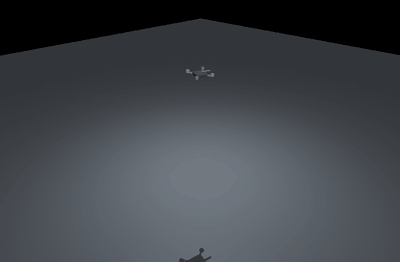
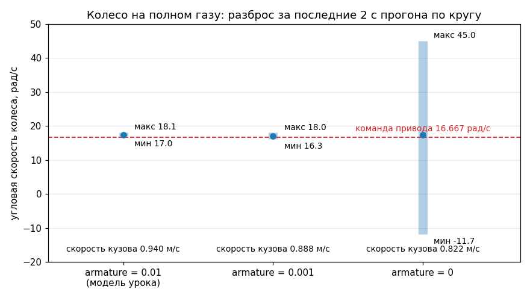

# Своя модель в MJCF

## Цель

После этой главы вы умеете написать физическую модель робота на MJCF с нуля
и проверить её **до** обучения: прочитать паспорт из скомпилированной
`MjModel`, выбрать идиом привода под задачу, назначить параметры контакта так,
чтобы объект не разваливался, и поймать ошибку модели прогоном на три секунды,
а не на три часа. Модель — первый и самый дешёвый рубеж отладки.

## 1. Зачем MuJoCo рядом с Gazebo

В [уроке 8](<../lesson 8 (Gazebo)/README.md>) симулятором был Gazebo. Он никуда
не девается: Gazebo — это интеграция с ROS 2 (мост типов, `/clock`, плагины
датчиков, Nav2 поверх этого всего), и по построению он идёт в реальном времени.
Обучение с подкреплением требует противоположного: миллион шагов среды
за обозримое время и никаких брокеров между политикой и физикой.

Замер голой физики на квадрокоптере трека C
([quad.xml](track_c_drone/quad.xml), `timestep=0.002`), три запуска подряд
одного скрипта на этой машине:

```
mj_step quad.xml: 18.81 мкс/шаг,  53 175 шаг/с, реальное время x106.4
mj_step quad.xml: 10.90 мкс/шаг,  91 783 шаг/с, реальное время x183.6
mj_step quad.xml:  9.56 мкс/шаг, 104 594 шаг/с, реальное время x209.2
```

Разброс — не шум измерения, а загрузка машины: в отчёте `07_track_c.md` та же
физика дала 201 820 шаг/с (4.95 мкс). **Для планирования берите нижнюю границу
своего замера** — здесь это ~10 мкс на `mj_step`, около 200-кратного ускорения
относительно реального времени на одном ядре. Целая среда дороже: в ней ещё
наблюдение, награда, проверки терминации, а один шаг политики — это
`FRAME_SKIP` шагов физики ([hover_env.py:57](track_c_drone/hover_env.py) —
`FRAME_SKIP = 10`, 50 Гц):

```python
from rl_toolkit.probes import probe_step_cost
from hover_env import HoverEnv
print(probe_step_cost(HoverEnv(seed=0), n=3000))
# 233.1 мкс/шаг, 4 291 шаг/с, x85.8 реального времени, часов на 1 млн 0.06
# 223.8 мкс/шаг, 4 468 шаг/с, x89.4 реального времени, часов на 1 млн 0.06
```

Миллион шагов среды — около четырёх минут. Тот же миллион в Gazebo при RTF ≈ 1
и 50 Гц управления — 20 000 секунд, почти шесть часов (RTF своей сцены
замерьте сами). Отсюда разделение ролей: **в MuJoCo учим, в Gazebo и на
роботе проверяем перенос.**

## 2. Анатомия MJCF

Самая короткая осмысленная модель урока — [quad.xml](track_c_drone/quad.xml),
172 строки: корпус, четыре мотор-гондолы, четыре точки приложения тяги.

```xml
<mujoco model="quad_c">
  <compiler angle="radian" autolimits="true"/>
  <option timestep="0.002" integrator="implicitfast" gravity="0 0 -9.81"
          density="1.204" viscosity="1.8e-5"/>
  <default> ... </default>   <asset> ... </asset>
  <worldbody>
    <geom name="floor" type="plane" size="10 10 0.2" material="ground"/>
    <body name="drone" pos="0 0 0.5">
      <freejoint name="root"/>   <geom .../>   <site .../>
    </body>
  </worldbody>
  <actuator> ... </actuator>   <sensor> ... </sensor>
</mujoco>
```

| Элемент | Что задаёт | Где смотреть |
|---|---|---|
| `<option>` | шаг физики, интегратор, гравитация, плотность и вязкость среды | [quad.xml:42-43](track_c_drone/quad.xml) |
| `<default>` | умолчания для всего файла и для классов геомов | [quad.xml:53-62](track_c_drone/quad.xml) |
| `<worldbody>` | корень дерева тел; сюда же неподвижная геометрия (пол, стены) | [quad.xml:72-123](track_c_drone/quad.xml) |
| `<body>` | звено с собственной системой координат; вложенность = кинематическое дерево | [quad.xml:87](track_c_drone/quad.xml) |
| `<joint>` / `<freejoint>` | степени свободы звена относительно родителя | [quad.xml:88](track_c_drone/quad.xml) |
| `<geom>` | форма: и для столкновений, и для массы (если нет `<inertial>`) | [quad.xml:91-108](track_c_drone/quad.xml) |
| `<site>` | безмассовая точка-метка: приложение силы, место датчика | [quad.xml:113-118](track_c_drone/quad.xml) |
| `<actuator>` / `<sensor>` | привод (`ctrl` → сила) и измерения, которые вы **вправе** положить в наблюдение | [quad.xml:150-170](track_c_drone/quad.xml) |

**`<inertial>` в quad.xml нет вообще.** Масса и тензор инерции целиком
посчитаны компилятором по геомам: четыре гондолы по 0.055 кг на плече 0.092 м
дают `4*0.055*0.092^2 = 1.86e-3` из полных `2.76e-3` кг·м² — инерцию задаёт
не корпус, а масса на плече ([quad.xml:100-108](track_c_drone/quad.xml)).
Явный `<inertial>` нужен, только когда вы знаете числа с железа. И `<site>` —
не декорация: ось `z` сайта — это ось винта, поэтому сайты не повёрнуты.

## 3. Три идиома привода

### 3.1 `position` — сервопривод по положению

```xml
<position name="steer_l" joint="steer_fl" kp="20" ctrllimited="true" ctrlrange="-0.5 0.5"/>
```

[car_parking.xml:148](track_a_car/car_parking.xml); следующая строка — такой же
привод на `steer_fr`. Момент = `kp*(ctrl − q)`, `ctrl` — **целевой угол**.
У `position` без явного `kv` собственного демпфирования нет. Проверка по
скомпилированной модели: `actuator_gainprm[0,0] = 20.0`, `biasprm[0,1] = −20.0`,
`biasprm[0,2] = 0.0` — чистая пружина. Гасит колебания только
`damping` самого шарнира, в модели он поднят до 0.6
([car_parking.xml:123](track_a_car/car_parking.xml)). Это ровно тот механизм,
из-за которого жёсткий руль опрокидывал машину (§6).

### 3.2 `velocity` — сервопривод по скорости

```xml
<velocity name="drive_l" joint="roll_rl" kv="0.20"
          ctrllimited="true" ctrlrange="-16.6667 16.6667"
          forcelimited="true" forcerange="-0.8 0.8"/>
```

[car_parking.xml:177-179](track_a_car/car_parking.xml).
Момент = `kv*(ctrl − q̇)`, `ctrl` — **целевая угловая скорость колеса**.
`±16.6667 рад/с = 1.0 м/с / 0.06 м` (радиус колеса). `forcerange` здесь —
предел сцепления: по замеру в комментарии строк 164-169 при 0.8 Н·м
проскальзывание 0.004 рад/с, при 1.5 Н·м — уже 3.134 рад/с, то есть выше
0.8 Н·м момент уходит в пробуксовку, а не в ускорение.

Зачем `velocity`, а не `position` с наращиванием уставки: в старой версии
урока тяга была `position`-приводом, `ctrl` оказывался **производной уставки**,
и накопленная ошибка слежения 16 рад выстреливала в перерегулирование —
предел 1.080 м/с, пик 1.348 м/с, +24.8 % (`04_lesson14_code.md` §4.2), плюс
скрытое состояние вне наблюдения, то есть POMDP. У `velocity` интегратора нет,
и пик 0.992 м/с предел не превышает
([car_parking.xml:154-156](track_a_car/car_parking.xml)).


*Обе идиомы из §3.1-3.2 в одной модели, 4.3 с манёвра. Смотрите раздельно
на две группы колёс: передние отрабатывают **целевой угол** `position`-привода
(`kp=20`, предел ±0.5 рад), задние — **целевую скорость** `velocity`-привода.
Разгон и торможение в кадре укладываются в предел `ctrlrange` ±16.6667 рад/с
(пик 0.992 м/с): интегратора, который давал +24.8 % перерегулирования у старой
`position`-тяги, здесь просто нет.*

### 3.3 `general` с трансмиссией `site` — произвольный винт силы

```xml
<general name="thrust1" site="rotor1" ctrlrange="0 4.6" gear="0 0 1 0 0 -0.0165"
         dyntype="filterexact" dynprm="0.02" gaintype="fixed" gainprm="1" biastype="none"/>
```

[quad.xml:150-151](track_c_drone/quad.xml).
**`gear` для трансмиссии `site` — это шестивектор `(Fx Fy Fz Tx Ty Tz)`
в системе координат сайта.** Единица `ctrl` умножается на этот вектор и
прикладывается к телу, которому принадлежит сайт. Здесь `Fz = 1` — единица
`ctrl` даёт 1 Н тяги вдоль оси винта (оси `z` сайта), а `Tz = ∓0.0165` —
реактивный момент, `k_m = 0.0165` м. Знак чередуется: винты 1, 2 — CCW, 3, 4 —
CW; иначе сумма реактивных моментов на висении не обнуляется и аппарат
крутится сам по себе. По модели: `actuator_gear[0] = [0,0,1,0,0,−0.0165]`.

`dyntype="filterexact" dynprm="0.02"` — это **состояние привода**: инерция
мотора первого порядка, `da/dt = (u − a)/tau`, `tau = 20` мс. Из-за неё
`na = 4`, и она же ставит потолок всему треку: полоса контура угловой скорости
обязана быть `<= 1/(3*tau) = 16.7` рад/с
([quad.xml:142-148](track_c_drone/quad.xml)). `filterexact`, а не `filter` —
точное экспоненциальное решение за шаг; проверка — тест 1 стенда: ступенька
`ctrl` 0 → max даёт выход на 63.2 % ровно за 0.0200 с.



*Что получается из четырёх таких строк `<general>` и четырёх сайтов: у политики
нет «газа» и «крена», она правит каждым винтом отдельно, `ctrl` каждого лежит
в 0…4.6 Н, а висение — это 39.45 % диапазона (§5). Смотрите на курс: аппарат
висит, не разворачиваясь вокруг вертикали — так выглядит правильная расстановка
знаков `Tz = ∓0.0165`, реактивные моменты CCW- и CW-винтов гасят друг друга.*

> Соблазн, от которого модель урока отказалась: описать дрон четырьмя
> `<motor>` на одном сайте (тяга + три момента). Короче, но нет насыщения
> по каждому винту и нет запрета на отрицательную тягу — политика получает
> физически недостижимые команды ([quad.xml:22-32](track_c_drone/quad.xml)).

## 4. Что держит контакт

Шесть параметров, из-за которых «модель разваливается».

**`armature`** — добавка к диагонали матрицы масс, «инерция ротора». У колёс
урока `armature="0.01"` ([car_parking.xml:124](track_a_car/car_parking.xml));
инерция самого колеса мала: `dof_M0` шарнира `roll_rl` = `1.02e-02`
с armature и `2.37e-04` без, разница в 43 раза. Привод `kv=0.20` при
`timestep=0.01` в первом случае устойчив, во втором — нет. Замер на круге,
полный газ, последние 2 с:

```
armature=0.01 (урок)  : w колеса  17.483 рад/с (от   16.991 до   18.139), v кузова 0.940 м/с
armature=0            : w колеса  17.367 рад/с (от  -11.722 до   45.016), v кузова 0.822 м/с
armature=0.001        : w колеса  17.012 рад/с (от   16.253 до   18.044), v кузова 0.888 м/с
```

Среднее почти одинаковое — а колесо без `armature` дребезжит от −11.7 до
+45.0 рад/с при команде 16.667 и **везёт кузов медленнее**: энергия уходит
в буксование. Обучение идёт, метрики выглядят нормально, перенос — нулевой.



*Тот же замер, что в блоке выше, нарисованный целиком. Смотрите не на точки
средних — они совпадают в пределах 0.5 рад/с и в логе обучения будут выглядеть
одинаково, — а на высоту синих полос: с `armature=0` колесо болтается от −11.7
до +45.0 рад/с вокруг команды 16.667, и именно эта конфигурация везёт кузов
медленнее всех (0.822 против 0.940 м/с).*

**`damping`** — вязкое трение в шарнире, `момент = −damping*q̇`: 0.6 у рулевых
шарниров, 0.2 у свободного шарнира кузова
([car_parking.xml:111,123](track_a_car/car_parking.xml)). Мало — колебания
после каждой перекладки руля; много — руль не успевает за командой на 20 Гц.
**`frictionloss`** — сухое трение, постоянный момент сопротивления независимо
от скорости (`0.01` на шарнирах качения); без него колесо крутится вечно.
**`condim`** — размерность конуса трения контакта; `condim=3` в обеих моделях
урока ([car_parking.xml:45](track_a_car/car_parking.xml),
[quad.xml:56](track_c_drone/quad.xml)) — скольжение без сопротивления кручению.
`condim=1` — контакт без трения, машина буксует на месте; `condim=4/6`
добавляют сопротивление верчению и качению, дрон «прилипает» к полу.

**`solref` / `solimp`** — жёсткость и профиль податливости контакта.
`solref = (timeconst, damping_ratio)`, и `timeconst` не может быть меньше
`2*timestep`: MuJoCo зажимает его снизу. Замер — сброс кузова с 0.30 м,
`timestep=0.01`, остальное из модели урока:

```
solref="0.004 1": мин z 0.05273, z в конце 0.05997
solref="0.008 1": мин z 0.05273, z в конце 0.05997   <- значение модели урока
solref="0.02 1" : мин z 0.05273, z в конце 0.05997
solref="0.05 1" : мин z 0.03079, z в конце 0.05978
solref="0.2 1"  : мин z -0.08655, z в конце 0.02400
```

Первые три строки совпадают до последнего знака: 0.004 и 0.008 зажаты до
`2*timestep = 0.02`. А `0.2` — провал кузова под пол и просадка на 3.6 см
в покое.

**`timestep`** и **`integrator`** — у машинки `0.01` и `Euler`
([car_parking.xml:32](track_a_car/car_parking.xml)), у дрона `0.002` и
`implicitfast` ([quad.xml:42](track_c_drone/quad.xml)). Разница не в «качестве»,
а в жёсткости задачи: у дрона мотор с `tau = 0.02` с, и на шаге 0.01 фильтр
привода и контур угла были бы одного порядка по времени. Слишком большой шаг —
провал в контактах, потом `WARNING: Nan, Inf or huge value in QACC`; слишком
маленький — вдвое меньше шаг, вдвое дольше прогон.

## 5. Паспорт модели: числа читать из `MjModel`

Главное правило главы. Компилятор складывает массы геомов, считает тензор
инерции, разворачивает `default`-классы, подставляет умолчания и **зажимает**
часть значений (как `solref` выше). Число в XML и число в модели — разные
вещи, и расходятся они молча. Как это сделано в
[stand.py](track_c_drone/stand.py), ни одного числа из текста XML:

```python
    mass = float(model.body_subtreemass[bid])       # bid — id тела "drone"
    Rm = np.zeros(9)
    mujoco.mju_quat2Mat(Rm, model.body_iquat[bid])
    Iw = Rm.reshape(3, 3) @ np.diag(model.body_inertia[bid]) @ Rm.reshape(3, 3).T
    ctrl_hi = float(model.actuator_ctrlrange[0, 1])
    arm = float(abs(model.site_pos[sid][1]))        # sid — id сайта "rotor1"
    k_m = float(abs(model.actuator_gear[0, 5]))
    tau = float(model.actuator_dynprm[0, 0])
```

Запуск `python stand.py --quick` и фактический вывод на этой машине:

```
ПАСПОРТ МОДЕЛИ (прочитан из MjModel, не из XML)
                 величина | значение
--------------------------+---------
                масса, кг |   0.7400
                   вес, Н |   7.2594
              Ixx, кг*м^2 |   0.0028
              Iyy, кг*м^2 |   0.0028
              Izz, кг*м^2 |   0.0054
                       nq |        7
                       nv |        6
                       nu |        4
                       na |        4
              timestep, с |   0.0020
               плечо L, м |   0.0920
радиус винта от центра, м |   0.1301
                   k_m, м |   0.0165
            tau мотора, с |   0.0200
             ctrl макс, Н |   4.6000
  тяга висения на винт, Н |   1.8149
       висение, % от ctrl |  39.4533
        тяговооружённость |   2.5346
```

Читается это так: `nq=7, nv=6` — свободное тело (кватернион в `qpos` длиннее
угловой скорости в `qvel` на единицу); `na=4` — состояния фильтров моторов,
их обязательно инициализировать при сбросе, иначе первые ~60 мс аппарат падает,
пока винты раскручиваются с нуля (функция `fresh`). Висение на 39.45 %
диапазона — число, из которого растёт нормировка действия политики.

**Привычка:** правите XML — перезапускайте паспорт. Шапка
[quad.xml:11-20](track_c_drone/quad.xml) — дословный вывод `stand.py`.

## 6. Модель отлаживается до обучения

История из старой версии урока: рулевой сервопривод был жёстким, `kp=40`,
и машину опрокидывало в повороте; лечение нашлось смягчением до `kp=10`
(`parking_car.md:78`: «жёсткий сервопривод (`kp=40`) раскачивает машину
в контакте и опрокидывает её при повороте»). Эффект воспроизводится за 4 с
машинного времени — полный газ, руль ±0.5 рад, перекладка каждые 0.5 с:

```
kp= 10 damping=0.3 -> макс |крен|    5.89°  макс |угол руля| 0.5213 рад  z кузова в конце 0.061 м
kp= 20 damping=0.6 -> макс |крен|   17.21°  макс |угол руля| 0.5188 рад  z кузова в конце 0.059 м
kp= 40 damping=0.3 -> макс |крен|  180.00°  макс |угол руля| 0.9117 рад  z кузова в конце 0.140 м
kp= 40 damping=0.6 -> макс |крен|  180.00°  макс |угол руля| 0.5529 рад  z кузова в конце 0.140 м
```

`z = 0.140` при радиусе колеса 0.06 и крене 180° — машина лежит на крыше.
`damping=0.6` не спасает: при `kp=40` она переворачивается в обоих случаях,
но по разной причине. При `damping=0.3` угол руля вылетает за собственный
предел `range="-0.5 0.5"` (0.9117 рад против 0.5) — численная неустойчивость
пружины без демпфера (§3.1); при `damping=0.6` руль держится в пределах,
но момент 40 Н·м/рад на лёгком переднем колесе переворачивает кузов честной
физикой. Текущая модель стоит на `kp=20, damping=0.6` — компромисс, найденный
замером: при `kp=10` установившийся угол был 0.4848 рад на команду 0.500
(предел руля не выдерживался), при `kp=20` — 0.5039
([car_parking.xml:144-147](track_a_car/car_parking.xml)). Мораль дорогая:
такая ошибка не даёт ни исключения, ни предупреждения — она даёт «политика
почему-то не учится» через восемь часов прогона.

## 7. URDF из урока 5 → MJCF

MuJoCo читает URDF напрямую: `mujoco.MjModel.from_xml_path("robot.urdf")`,
но переносится не всё — проверено на файлах
[урока 5](<../lesson 5 (URDF and XACRO)/README.md>) из
`../ros2_ws/src/urdf_tutorial/urdf/`:

```
OK   01-myfirst.urdf:  nbody=1 njnt=0 ngeom=0 nu=0 nsensor=0 масса=0.0000
OK   05-visual.urdf:   nbody=1 njnt=0 ngeom=0 nu=0 nsensor=0 масса=0.0000
FAIL 06-flexible.urdf: Error: mass and inertia of moving bodies must be larger
                       than mjMINVAL. Element name 'left_gripper', id 2
```

**`<visual>` по умолчанию выбрасывается.** `ngeom=0` — не ошибка чтения,
а `compiler discardvisual`, который для URDF включён по умолчанию. Вставьте
в URDF блок расширения MuJoCo — и геометрия появляется (`nbody=1 ngeom=0`
превращается в `nbody=3 ngeom=2`):

```xml
<robot name="visual">
  <mujoco><compiler discardvisual="false" balanceinertia="true" fusestatic="false"/></mujoco>
```

**Подвижное звено без `<inertial>` не компилируется.** RViz и Gazebo такой
URDF показывают, MuJoCo отказывается: инерция нужна ему для матрицы масс, а не
для картинки (откуда она берётся — [physical_and_collisions.md](<../lesson 5 (URDF and XACRO)/physical_and_collisions.md>)).

| Переносится | Не переносится |
|---|---|
| дерево звеньев и `<joint>` (revolute, prismatic, fixed) | `<transmission>`, `<gazebo>`, теги `ros2_control` |
| `<collision>` — форма и столкновения | `<visual>` (по умолчанию отбрасывается) |
| `<inertial>` — масса и тензор инерции | приводы и датчики — пишутся вручную |
| пределы шарниров | `<default>`, `condim`, `solref`, `armature` |

URDF даёт скелет и инерции; управление и контакт вы пишете на MJCF сами.

## Проверки

1. `python stand.py --quick` в `track_c_drone/` печатает паспорт:
   `nq/nv/nu/na = 7/6/4/4`, тяга висения 1.8149 Н, `tau мотора` совпадает
   со временем выхода на 63.2 % в тесте 1.
2. Замерьте `probe_step_cost` своей среды три раза подряд и запишите
   **нижнюю** границу. Меньше ~1000 шаг/с — ищите, что в шаге дорого.
3. Откройте [quad.xml:150-157](track_c_drone/quad.xml) и объясните каждое
   из шести чисел в `gear`. Не получается — перечитайте §3.3.
4. Поменяйте в копии `car_parking.xml` `armature="0.01"` на `armature="0"`
   и прогоните машину по кругу: должен появиться дребезг угловой скорости
   колеса, сравнимый с §4.
5. Найдите в своей модели каждое число, выписанное в комментарий вручную,
   и проверьте его через скомпилированную `MjModel`. Все ли совпали?
6. Загрузите любой URDF из `../ros2_ws/src/urdf_tutorial/urdf/` в MuJoCo и
   объясните, почему у модели `ngeom = 0`.
