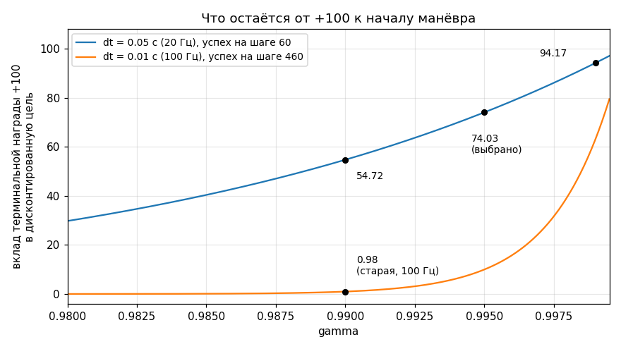
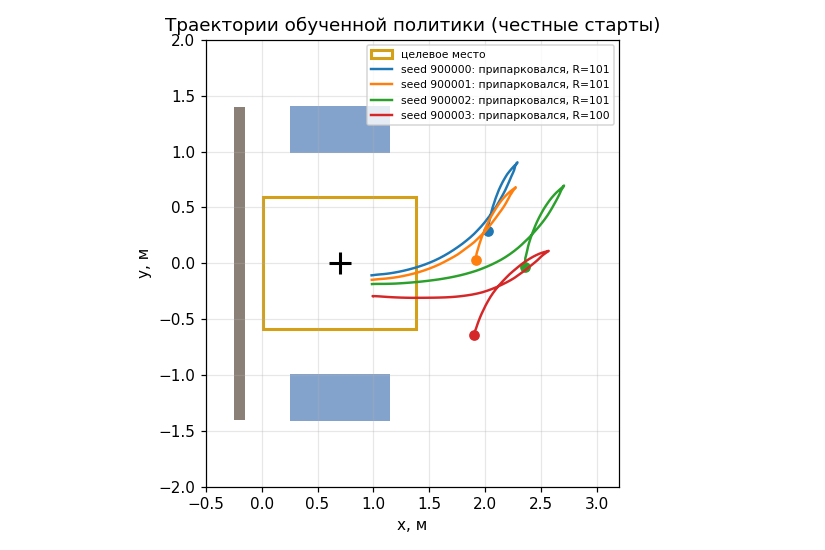

# Своя среда Gymnasium: контракт и ловушки

## Цель

Научиться писать среду, которая не врёт обучающему алгоритму: её генератор случайных чисел живёт там, где его ищет векторизация; обрыв по таймауту отличается от обрыва по провалу; наблюдение содержит всё, от чего зависит динамика и награда; объявленные границы описывают реальность; частота политики согласована с `gamma`; условия обрыва не пересекаются.

Каркас `gym.Env` дал урок 13 — здесь он не повторяется. Здесь шесть мест, где формально корректная среда молча портит обучение, и проба, которая каждое ловит за секунды.

Числа берутся из трёх источников: отчёт разбора старой версии урока (`analysis/04_lesson14_code.md`, 20 дефектов, каждый доказан прогоном), каталог оплаченных ошибок (`analysis/06_pitfalls.md`) и свежий прогон [probe.py](track_a_car/probe.py) на этой машине (Python 3.12.3, mujoco 3.9.0, gymnasium 1.0.0, stable_baselines3 2.4.1).


*Та самая среда, о контракте которой идёт речь: трек A, обученная политика. Смотрите на конец ролика — манёвр занимает 4.3 с из 9 с, отведённых эпизоду, то есть эпизод кончается не по лимиту шагов (`truncated`, §2), а по `terminated`: машина простояла в воротах `SUCCESS_HOLD = 8` шагов подряд. Тот самый счётчик `_hold`, которого нет в наблюдении, — остаточная ненаблюдаемость из §3.*

---

## 1. Генератор случайных чисел: `self.np_random`, а не свой

Контракт gymnasium 1.0: `super().reset(seed=seed)` создаёт `self.np_random`, и вся случайность среды обязана идти через него. Старая версия завела свой:

```python
# _legacy_env.py:76 (__init__)
self._rng = np.random.default_rng(0)
# _legacy_env.py:104-116 (reset)
super().reset(seed=seed)             # сидирует self.np_random — и всё
if seed is not None:
    self._rng = np.random.default_rng(seed)
x = self._rng.uniform(1.9, 2.4)      # используется только self._rng
```

`self.np_random` сидируется и не используется ни разу. Оба чекера среду пропускают. Замер (сохраните рядом с `car_env.py` и запустите):

```python
import gymnasium as gym, numpy as np, _legacy_env, car_env
uniq = lambda rows: len({tuple(np.asarray(r, dtype=np.float64)) for r in rows})
for name, make in (("старая", lambda: _legacy_env.CarParkingEnv(in_spot_start_prob=0.0)),
                   ("новая",  lambda: car_env.CarParkingEnv(in_spot_start_prob=0.0))):
    fresh = [make().reset()[0] for _ in range(4)]
    v = gym.vector.SyncVectorEnv([make for _ in range(4)])
    print(name, uniq(fresh), uniq(v.reset()[0]), uniq(v.reset(seed=7)[0]))
```

| сценарий | старая | новая |
|---|---|---|
| 4 свежие среды, `reset()` без seed | различных стартов **1 из 4** | 4 из 4 |
| `SyncVectorEnv(4).reset()` без seed | **1 из 4** | 4 из 4 |
| `SyncVectorEnv(4).reset(seed=7)` | 4 из 4 | 4 из 4 |
| одна среда, `reset(seed=42)` четырежды | 1 из 4 | 1 из 4 |

Последняя строка — не дефект, а контракт: `reset(seed=N)` обязан давать один и тот же эпизод, на этом держатся A/B-сравнения. Дефект — первые две: четыре параллельные копии собирают **побитово одну и ту же траекторию**, и `n_envs=4` даёт не вчетверо больше данных, а вчетверо больше копий одних и тех же. Оговорка, без которой вывод нечестен: SB3 подставляет случайный seed сам при `seed=None`, поэтому в `make_vec_env` дефект не проявится — он проявится в `gymnasium.vector` и в самописной векторизации.
Побочный эффект того же дефекта: каждый вызов `evaluate()` шёл по одной и той же последовательности стартов, и «лучшая модель» выбиралась по 30 фиксированным эпизодам (`04_lesson14_code.md` §5.1).

Как сделано сейчас — [car_env.py](track_a_car/car_env.py):429-439:

```python
super().reset(seed=seed)
if seed is not None:
    # gymnasium не сидирует action_space сам — из-за этого картинка
    # «случайная политика» в старом уроке была невоспроизводима (§6.5).
    self.action_space.seed(int(seed))

# mj_resetData, а не ручное обнуление qpos/qvel: иначе через эпизоды
# переносятся data.time и qacc_warmstart (§1.7).
mujoco.mj_resetData(self.model, self.data)

self._started_in_spot = bool(self.np_random.random() < self.in_spot_start_prob)
```

Остальное из контракта, что старая версия теряла молча: `close()` не был определён вовсе, и GL-контекст `mujoco.Renderer` тёк при каждом создании среды (§1.3; сейчас — строки 548-556); `render()` игнорировал `render_mode`, а `MUJOCO_GL` не упоминался в уроке ни разу (§7; сейчас `os.environ.setdefault("MUJOCO_GL", "glfw")` стоит **до** `import mujoco`, строка 62); `metadata["render_fps"] = 50` при физике 100 Гц давало видео вдвое медленнее реального (§1.4; сейчас `"render_fps": int(round(1.0 / DT))`, строка 238 — число выводится из `DT`, а не пишется руками).

---

## 2. `terminated` против `truncated`

Разница ровно одна. `terminated` — эпизод кончился **по природе задачи**: цель взята, машина в стене, робот на крыше; будущего нет, и его ценность равна нулю. `truncated` — кончился **по нашему решению**: вышел лимит шагов; мир продолжается, мы просто перестали смотреть, и ценность состояния нулю не равна.

Цель обучения критика на последнем шаге:

```
terminated:  y_T = r_T
truncated:   y_T = r_T + gamma * V(s_T)
```

Если среда объявляет таймаут как `terminated`, второе слагаемое исчезает, и агент учится, что время истекает **насмерть**: в момент `t = T` мир кончается и всё накопленное обнуляется. Политика начинает торопиться и бросать манёвр.

Сколько это стоит — замер на чекпойнте трека A (`runs/a1/model_150000_steps.zip` с парным `vecnormalize`, 20 эпизодов, все 20 оборвались по таймауту):

```
V(s_T) в момент таймаута  : среднее +1.731  мин -0.911  макс +3.301
gamma*V(s_T), gamma=0.995 : среднее +1.723
недисконтированный возврат эпизода: среднее -3.639
```

Отброшенное слагаемое — около половины возврата целого эпизода, и оно отбрасывалось бы на каждом эпизоде, оборванном по времени. Оговорка: политика на 150 тыс. шагов слабая, `V` у неё грубая; порядок величины это не меняет.

В среде нужна одна строка ([car_env.py](track_a_car/car_env.py):531):

```python
truncated = bool(self._step_count >= MAX_STEPS and not terminated)
```

`and not terminated` обязательно: флаги взаимоисключающие, иначе SB3 получит противоречивый сигнал. Дальше связка `Monitor` + `DummyVecEnv` превращает это в `info`, который читает `OnPolicyAlgorithm.collect_rollouts`. Проверяется так:

```python
venv = DummyVecEnv([lambda: Monitor(CarParkingEnv(in_spot_start_prob=0.0))])
venv.seed(0); venv.reset()
for k in range(400):
    obs, r, done, infos = venv.step(np.zeros((1, 2), dtype=np.float32))
    if done[0]:
        print(k + 1, infos[0].get("TimeLimit.truncated"),
              "terminal_observation" in infos[0]); break
```

Вывод: `180 True True`. Оба ключа обязаны быть: по первому SB3 понимает, что надо бутстрапить, по второму берёт `s_T` — наблюдение, вернувшееся из `step()`, уже относится к новому эпизоду.

Обратная сторона, которую надо назвать выбором, а не данностью (`06_pitfalls.md` §B23): **условие терминации — это граница мира агента.** В треке A столкновение и выезд терминируют эпизод, значит «задел бордюр и продолжил парковаться» агент выучить не может в принципе. Ранний обрыв экономит шаги и молча вычёркивает целые классы поведения.

---

## 3. Марковскость: главный блокер и как он ловится

Алгоритм предполагает, что наблюдение — **достаточная статистика состояния**: два состояния с одинаковым наблюдением обязаны вести себя одинаково. `MlpPolicy` памяти не имеет; если предположение нарушено, потолок качества наложен конструкцией среды, а не сложностью задачи.

**Как ломалось.** Тяга старой версии шла через позиционные приводы и скрытый интегратор:

```python
# _legacy_env.py:140-141
self._roll_target += drive_cmd * DT
self.data.ctrl[:] = [steer_cmd, steer_cmd, self._roll_target, self._roll_target]
```

Момент на колесе равен `kp*(roll_target − q_wheel) − kv*q̇_wheel`, то есть ускорение зависит от **ошибки слежения**. Ни `roll_target`, ни `q_wheel`, ни их разность не входили в 13 чисел наблюдения (`_legacy_env.py:208`). Замер разбора (`04_lesson14_code.md` §1.1): два состояния с побитово одинаковым наблюдением и одинаковым действием `[0, 0]` через 20 шагов дают `vx = +0.0000` и `vx = +0.2773` м/с. Одно наблюдение — две динамики.

**Как ловится.** Метод «двойник»: два состояния с побитово одинаковым наблюдением, но разной историей (одно свежее, второе прогрето полным газом и затем насильно приравнено по `qpos`/`qvel`), обоим — одна цепочка из 20 действий. Если наблюдение есть полное состояние, траектории обязаны совпасть побитово. Проба 2 в [probe.py](track_a_car/probe.py), `python probe.py`:

```
СТАРАЯ среда (позиционные приводы + _roll_target):
  наблюдения совпадают побитово : True
  после 20 одинаковых действий  : |разница vx|=0.0914 м/с  |разница x|=0.0021 м
НОВАЯ среда (velocity-приводы, wheel_v и steer_rate в наблюдении):
  наблюдения совпадают побитово : True
  после 20 одинаковых действий  : |разница vx|=0.000e+00 м/с  |разница x|=0.000e+00 м
```

Промышленный вариант той же идеи — `probe_observability` из [probes.py](rl_toolkit/probes.py): ищет в выборке пары состояний с почти одинаковым наблюдением и смотрит, насколько расходится интересующая величина. Проба 3:

```
 среда |             величина |   tol |  пар | разброс величины | вердикт
 новая |  скорость колёс, м/с | 0.100 | 1637 |           0.0203 | величина наблюдаема
старая | ошибка слежения, рад | 0.100 | 7612 |           1.4898 | величина НЕ наблюдаема
```

Полтора радиана накопленной ошибки привода при одном и том же наблюдении.

**Как вылечено** ([car_env.py](track_a_car/car_env.py)). Интегратор убран: приводы колёс — `velocity`, команда есть сама скорость колеса (`wheel_cmd = a[1] * WHEEL_W_MAX`, строка 474), состояние привода целиком лежит в `qvel`. Плюс в наблюдение добавлены `steer_rate` и `wheel_v` (строки 675-676) — состояние обоих приводов стало наблюдаемым.

Побочный эффект, который нельзя скрывать: **новая среда разведывает хуже**. Проба 7, 20 эпизодов на режим: при случайном действии раз в шаг новая машина проходит 0.42 м против 0.71 м у старой, при удержании действия 0.5 с — 0.98 м против 1.62 м. Причина ровно та, ради которой приводы и меняли: старая машина после смены команды продолжала катиться на накопленной ошибке слежения — та самая скрытая память. Наблюдаемость оплачена сужением случайной разведки.

**Остаточная ненаблюдаемость — она есть и сейчас.** Успех требует простоять в воротах `SUCCESS_HOLD = 8` шагов подряд, а счётчик `self._hold` в наблюдение не входит:

```python
for hold in (0, 7):
    e = CarParkingEnv(in_spot_start_prob=0.0); e.reset(seed=0)
    e.set_probe_state(dict(x=float(SPOT[0]), y=0.0, yaw=0.0, hold=hold))
    o = e._observation().copy()
    _, r, term, _, info = e.step(np.zeros(2, dtype=np.float32))
    print(hold, f"{r:+.3f}", term, info["success"])
```

```
наблюдения до шага совпадают ПОБИТОВО: True
  _hold=0: награда   +0.030  terminated=False  success=False
  _hold=7: награда +100.030  terminated=True   success=True
разница награды на одном и том же наблюдении: 100.000
```

Это тот же класс дефекта, что разобран в `06_pitfalls.md` §A3 («штраф за то, чего нет в наблюдении»), и в отгружаемой среде он остался. Почему терпимо: `_hold` — детерминированная функция последних восьми наблюдений, а внутри ворот машина почти неподвижна, так что «я уже несколько шагов стою здесь» восстановимо из короткой истории.
Почему всё равно надо знать: пока `_hold` скрыт, критик усредняет по восьми разным исходам одного наблюдения, и часть дисперсии value-функции — не шум обучения, а эта неопределённость. Правка на один канал: `float(self._hold) / SUCCESS_HOLD` в `_observation()` плюс границы `[0, 1]`, и A/B по доле успехов.

Правило: **прежде чем штрафовать или награждать величину, проверьте, что она выводима из наблюдения.** Если нет — добавьте её в наблюдение либо замкните контур через уже наблюдаемый канал. Штраф за ненаблюдаемое — шум, а не сигнал: на шагающей платформе такой штраф прогнали 7 млн шагов, и стало хуже (путь 2.56 → 2.41 м, падения 18 → 25).

---

## 4. Границы `observation_space`: заявленное против достижимого

Объявленный `Box` — не проверка и не ограничение: gymnasium **не вызывает** `Box.contains` на каждом шаге, и наблюдение вне ящика проходит молча. Сузим границу одного канала (`vx`, индекс 4) до ±0.30 м/с. На старте машина стоит, `vx = 0`, поэтому `reset()` и первый шаг внутри ящика:

```python
e = CarParkingEnv(in_spot_start_prob=0.0)
lo, hi = e.observation_space.low.copy(), e.observation_space.high.copy()
lo[4], hi[4] = -0.30, 0.30
e.observation_space = spaces.Box(low=lo, high=hi, dtype=np.float32)
```

```
gymnasium.utils.env_checker      ПРОШЁЛ без единого замечания
sb3.common.env_checker           ПРОШЁЛ без единого замечания
шагов, где vx вышел за объявленные +-0.30: 174 из 2000 (8.7 %), макс. вылет 0.431 м/с
```

Оба чекера смотрят **один** `reset()` и **один** шаг: всё, что нарушается изредка или только в движении, они не видят.

Почему `VecNormalize` делает это враньё невидимым. Сеть ест не сырое наблюдение, а `clip((obs − mean) / sqrt(var), ±clip_obs)`, где `mean`/`var` — статистика **реальных** наблюдений. Масштаб канала подгоняется автоматически, а `clip_obs = 10` — это десять сигм, туда почти ничего не попадает.
Тот же прогон через `VecNormalize(norm_obs=True, clip_obs=10.0)` даёт `максимум |нормированного obs| = 10.000, шагов с упором в клип: 1 из 2000` — один шаг из двух тысяч при 8.7 % нарушений в сырых данных. Ни ошибки, ни предупреждения, ни следа в логе: нормализатор чинит масштаб и вместе с ним прячет симптом.

Значит границы надо **выводить**, а не ставить «с запасом». В [car_env.py](track_a_car/car_env.py):282-306 каждая выведена из геометрии площадки:

```python
#   площадка: x in [-0.30, 6.75], |y| <= 3.35; место в (0.7, 0)
#   -> |dx| <= 6.05, |dy| <= 3.35, dist <= hypot(6.05, 3.35) = 6.92
arena_diag = 6.92
```

А `probe_shapes` печатает таблицу «объявлено / наблюдалось / запас» по 4000 шагам случайной политики (проба 1):

```
      поле |       объявлено |     наблюдалось | запас
     steer |   [-0.60, 0.60] | [-0.461, 0.474] |  x1.3
   wheel_v |   [-1.20, 1.20] | [-0.606, 0.732] |  x1.8
        vx |   [-2.50, 2.50] | [-0.533, 0.731] |  x4.0
  sin_dyaw |   [-1.00, 1.00] |  [0.961, 1.000] | x51.4
выходов за объявленные границы: 0 из 4000
```

Ноль нарушений — обязательное условие. Запас ×1.3…×4 означает, что ящик описывает реальность. Запас ×51 у `sin_dyaw` не дефект: канал ограничен математически (`sin` ∈ [−1, 1]), а случайная политика просто не успевает развернуть машину. Столбец «запас» — вопрос к себе, а не приговор: у каждой большой цифры должно быть объяснение.

---

## 5. Частота политики, frame skip и `gamma`

Эффективный горизонт дисконтирования `горизонт = dt / (1 − gamma)` секунд обязан **покрывать эпизод**. Иначе терминальная награда не видна критику: он не может связать её с решениями начала манёвра.

Старая версия шагала физикой 100 Гц и отдавала одно действие на один `mj_step`: `dt = 0.01` с, `gamma = 0.99` по умолчанию SB3. Горизонт `0.01 / 0.01 = 1.0` с при эпизоде 6 с — покрытие **0.17**. Замер разбора (`04_lesson14_code.md` §2.3, 100 эпизодов обученной политики): терминальный `+100` стоил в дисконтированной цели **0.38**, вся лестница бонусов — 0.57. Арифметически на медианном шаге успеха 460: `100 · 0.99^460 = 0.98`.

Лечится не подкруткой `gamma`, а **frame skip** — несколькими шагами физики на одно действие ([car_env.py](track_a_car/car_env.py):75-97, 479-482):

```python
TIMESTEP = 0.01          # шаг физики, задан в car_parking.xml
FRAME_SKIP = 5           # шагов физики на одно действие -> политика 20 Гц
DT = TIMESTEP * FRAME_SKIP                    # 0.05 с
EPISODE_SECONDS = 9.0
MAX_STEPS = int(round(EPISODE_SECONDS / DT))  # 180 шагов политики
GAMMA = 0.995
```

Проба 4 (`python probe.py`); «стоимость +100» считается для типичного момента парковки: шаг 60 при 20 Гц, шаг 460 при 100 Гц:

```
   конфигурация |  dt, с |  gamma | горизонт, с | эпизод, с | покрытие | стоимость +100
старая (100 Гц) | 0.0100 | 0.9900 |      1.0000 |    6.0000 |     0.17 |           0.98
  новая (20 Гц) | 0.0500 | 0.9900 |      5.0000 |    9.0000 |     0.56 |          54.72
  новая (20 Гц) | 0.0500 | 0.9950 |     10.0000 |    9.0000 |     1.11 |          74.03
  новая (20 Гц) | 0.0500 | 0.9990 |     50.0000 |    9.0000 |     5.56 |          94.17
```



*Те же четыре числа таблицы, растянутые по `gamma` (формула `100 · gamma^k`; шаг успеха `k` взят оттуда же: 460 при 100 Гц и 60 при 20 Гц). Смотрите на две точки при `gamma = 0.99`: 0.98 внизу и 54.72 вверху — награда, физика и задача одни и те же, отличается только frame skip. И на форму кривых: при 100 Гц вклад терминальной награды держится на третьем знаке `gamma` и почти на всём диапазоне неотличим от нуля, при 20 Гц кривая пологая — выбор между 0.99 и 0.999 уже не решает судьбу обучения.*

Выбрано `gamma = 0.995`: покрытие 1.11, горизонт чуть длиннее эпизода. `0.999` дал бы 5.56, но горизонт, многократно превышающий эпизод, раздувает дисперсию оценки преимущества, ничего не добавляя по существу.

Frame skip платит и скоростью: на секунду симуляции приходится впятеро меньше обращений к сети. Проба 10:

```
мкс на шаг политики      320.3
шагов политики в секунду 3122
шагов ФИЗИКИ в секунду   15611  (старая версия: 10 390)
часов на 1 млн шагов политики   0.089  (в одном процессе)
```

Три вещи держатся согласованными руками, потому что их никто не проверит: `gamma` алгоритма = `gamma` среды (потенциальный шейпинг `γΦ(s′) − Φ(s)` инвариантен только при совпадении); `gamma` у `VecNormalize` — та же (он нормирует награду по дисконтированной сумме, расхождение тихо ломает масштаб); `metadata["render_fps"] = 1/DT`. В [train.py](track_a_car/train.py) это одна константа `GAMMA`, переданная в среду (строка 82), в `VecNormalize` (строка 105) и в `PPO` (строка 214).

---

## 6. Взаимоисключающие исходы

Условия обрыва — это разбиение, а не набор независимых флагов. Если два исхода случаются на одном шаге, награда и метрика начинают противоречить друг другу.

Старые ворота успеха (`|dx| < 0.5`, `|dy| < 0.5`, `|dyaw| < 0.7` рад = 40°) пересекались со «столкновением». Полный перебор поз внутри ворот средствами MuJoCo (`mj_kinematics` + `mj_collision`), проба 5:

```
    ворота (dx, dy, dyaw) | поз перебрано | из них в контакте |   доля
старые (0.50, 0.50, 0.70) |          6615 |               903 | 13.7 %
 новые (0.30, 0.30, 0.25) |         20181 |                 0 |  0.0 %
```

(В разборе тот же перебор более крупным шагом дал 13.9 %, `04_lesson14_code.md` §3.3.) На такой позе `step()` возвращал `info={'success': True, 'collision': True}`, награда была `−30`, а счётчик успехов в обучающем скрипте засчитывал **успех**.

Чтобы не пересекалось, нужны три независимых действия.

**Вывести ворота из геометрии, а не назначить.** Габарит машины: полудлина 0.46 м, полуширина 0.265 м. При `|dyaw| ≤ 0.25` продольный габарит `0.46·cos + 0.265·sin = 0.511` м; тогда при `|dx| ≤ 0.30` машина занимает `x ∈ [−0.111, 1.511]` при грани задней стены на −0.150 (зазор 0.039 м), а по поперечной оси доходит до 0.671 при ближней грани соседа 0.990 (зазор 0.319 м). Это комментарий [car_env.py](track_a_car/car_env.py):109-125, и он перепроверяется перебором на каждом запуске проб.



*Смотрите здесь не на траектории, а на геометрию, из которой считаются ворота: жёлтый прямоугольник — целевое место, серая полоса слева — задняя стена, синие прямоугольники — соседние машины. Зазоры 0.039 м до стены и 0.319 м до соседа — это расстояния от габарита машины на границе ворот до этих самых тел, а не запас «на глаз». Стоит подвинуть соседа в MJCF — и ворота придётся пересчитать.*

**Проверять неудачные исходы первыми** ([car_env.py](track_a_car/car_env.py):505-517):

```python
success = False
terminated = False
if collision or oob or tipped:
    terminated = True
    self._hold = 0
else:
    if parked:
        self._hold += 1
        if self._hold >= SUCCESS_HOLD:
            success = True
            terminated = True
    else:
        self._hold = 0
```

`else` вместо второго независимого `if` — вся починка блокера.

**Смотреть на все степени свободы.** Старая проверка скорости брала только продольную компоненту: машина, скользящая боком на 2.5 м/с и вращающаяся на 3 рад/с, засчитывалась остановившейся (§2.6). Сейчас `speed = math.hypot(vx, vy)` плюс отдельный порог по `omega` (строки 492-501).

Проверяется `probe_termination` из [probes.py](rl_toolkit/probes.py): словарь «поза → ожидаемый `terminated`», поза ставится через `set_probe_state`, дальше один шаг нулевым действием. Проба 6:

```
                                     случай | ожидалось | получено | совпало
         в месте, стоит, выдержка добирается |        да |       да |      да
          в месте, но скользит БОКОМ 0.8 м/с |       НЕТ |      НЕТ |      да
 в месте, но вращается 3.0 рад/с (порог 0.4) |       НЕТ |      НЕТ |      да
                    прижался к соседу справа |        да |       да |      да
                     уткнулся в заднюю стену |        да |       да |      да
все случаи сошлись
```

Ложное срабатывание условия обрыва — самый дорогой класс дефектов: на шагающей платформе робот, стоящий обеими стопами на препятствии, числился летящим, и награда платила за то, чтобы препятствия **обходить** (`06_pitfalls.md` §B16). Пять строк `set_probe_state` в среде стоят дешевле одного прогона вслепую.

---

## Чек-лист «среда готова к обучению»

Ни один запуск обучения не начинается, пока все пункты не зелёные. В скобках — проба из [probes.py](rl_toolkit/probes.py) и её номер в [probe.py](track_a_car/probe.py).

1. Формы, dtype и `dt` — те, что заявлены; `reset(seed=k)` дважды даёт побитово равное наблюдение. Без детерминизма любое A/B — шум. (`probe_shapes`, проба 1.)
2. Случайность идёт через `self.np_random`, `action_space` сидируется отдельно: четыре свежие среды без seed дают четыре разных старта. (`probe_shapes` плюс замер из §1.)
3. Границы `observation_space` выведены из геометрии, нарушений ноль, у каждого большого запаса есть объяснение. (`probe_shapes`, столбец «запас», проба 1.)
4. Скрытого состояния нет: два состояния с одинаковым наблюдением и одинаковым действием расходятся на 0. Что осталось скрытым — записано явно. (`probe_observability`, пробы 2 и 3.)
5. Ни один член награды не зависит от величины, которой нет в наблюдении. (`probe_reward_terms` вместе с `probe_observability`, проба 8.)
6. Условия обрыва срабатывают там, где должны, и не срабатывают там, где не должны; исходы взаимоисключающие. (`probe_termination`, пробы 5 и 6.)
7. Таймаут приходит как `truncated`, и в `info` есть `TimeLimit.truncated` и `terminal_observation`. (прогон через `DummyVecEnv` из §2.)
8. `dt / (1 − gamma)` покрывает эпизод; `gamma` совпадает у среды, алгоритма и `VecNormalize`. (`probe_shapes` даёт `dt` и длину эпизода, проба 4.)
9. «Ничего не делать» невыгодно: пассивный возврат отрицательный. У нас −4.892 за эпизод; при недокалиброванной плате за время было +0.338. (`probe_null_baseline`, проба 7.)
10. Разведка что-то находит, связная команда доезжает до цели. Если дольше всех живёт нулевое действие — лечится тихим стартом (`log_std_init`), а не наградой. (`probe_action_scale`, проба 7.)
11. Цена шага известна в мкс и в часах на миллион: усложнение среды переводится прямо в часы прогона. (`probe_step_cost`, проба 10.)

---

## Проверки

1. Запустите `python probe.py` в `track_a_car/`. Последняя строка обязана быть «Все пробы зелёные. Можно запускать train.py», код возврата 0. В выводе пробы 1 найдите «выходов за объявленные границы» — там должно стоять 0 из 4000.
2. В пробе 2 сравните две строки «после 20 одинаковых действий». Объясните, почему у старой среды разница ненулевая при побитово одинаковых наблюдениях, а у новой — ровно `0.000e+00`.
3. Посчитайте эффективный горизонт для `dt = 0.05` и `gamma = 0.98`. Покрывает ли он эпизод 9 с? Сверьтесь с таблицей пробы 4 и скажите, что именно сломается в обучении при таком `gamma`.
4. Воспроизведите замер из §4: сузьте одну границу `observation_space`, прогоните оба чекера и 2000 случайных шагов. Сколько шагов нарушили ящик и сколько замечаний выдали чекеры?
5. Добавьте `self._hold / SUCCESS_HOLD` в `_observation()` (не забудьте границы и размерность 16), повторите замер из §3 и убедитесь, что наблюдения перестали совпадать побитово. Прогоните `probe.py` целиком: какие пробы сломались от изменения размерности наблюдения?
6. Найдите в [car_env.py](track_a_car/car_env.py) все места с константой `GAMMA` и все места в [train.py](track_a_car/train.py), куда она передаётся. Их должно быть три. Что произойдёт, если рассогласовать `gamma` у `VecNormalize` и у алгоритма?
