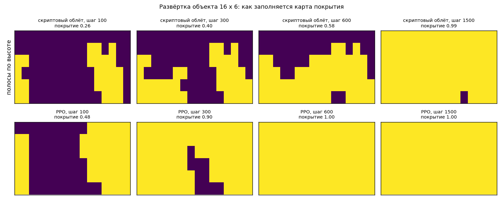
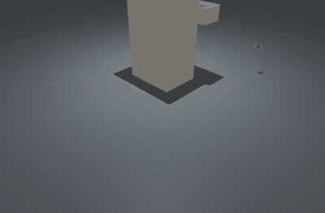

# Проектирование наблюдения

## Цель

После этой главы вы умеете:

* объяснить, почему наблюдение — это контракт между средой и роботом;
* выбрать раму для каждого канала: мир или корпус — и обосновать выбор;
* класть в наблюдение проекцию гравитации вместо углов Эйлера и кватерниона;
* отделить законную информацию от привилегированной — той, которой у робота нет;
* проверить **до обучения**, что каждая штрафуемая величина выводима из
  наблюдения (`rl_toolkit.probes.probe_observability`);
* понять, когда одного кадра мало, и чем заменить стек кадров.

---

## 1. Правило номер один: наблюдение — это контракт

Политика — это функция `obs -> action`. Она не знает ни про MuJoCo, ни про ваш
робот, она видит вектор чисел. Отсюда жёсткое правило:

> **Наблюдение на роботе обязано численно совпадать с наблюдением в среде: те же
> величины, в том же порядке, в тех же единицах, в тех же масштабах, на той же
> частоте.**

Каждое слово оплачено. «Тот же порядок» — у политики нет имён каналов, только
индексы. «Те же единицы» — сеть выучила конкретные числа, а не физический смысл.
«Та же частота» — производные (скорости, `prev_act`) имеют смысл только
относительно `dt`. Контракт виден в коде явно: учебная среда ходьбы вырезана из
боевой на порядок по объёму, но наблюдение сохранено тем же — «ГЛАВНОЕ
СВОЙСТВО: наблюдение осталось ТЕМ ЖЕ 35-мерным, что у боевой среды, поэтому
эталонная политика 60M грузится и работает прямо здесь»
([walk_env.py:13-16](track_b_walk/walk_env.py)). Обратная сторона: в учебной
среде два канала мертвы, потому что команда всегда только вперёд —
`self.cmd = np.array([vx_cmd, 0.0, 0.0])`
([walk_env.py:357-359](track_b_walk/walk_env.py)). Замер 3000 шагов (см. §6) даёт
по боковой и угловой командам `std = 0.0000` при `std = 0.3029` у продольной.
Два числа из 35 не несут информации, и убрать их нельзя: уберёшь — потеряешь
совместимость с эталоном.

---

## 2. Мир против корпуса: три трека рядом

Правило: **в наблюдении должно быть то, что робот измеряет, и в той раме, в
которой он это измеряет.** Мировая рама законна только тогда, когда на роботе
есть локализация, которая её выдаёт.

| | машинка (A) | двуногий (B) | дрон C1 «висение» | дрон C2 «сканер» |
|---|---|---|---|---|
| размер | 15 | 35 | 19 | 60 |
| поза | цель в раме кузова | **нет вовсе** | цель в раме корпуса `R^T(target-p)` | цилиндрика вокруг объекта: `rad/ARENA_R`, `sin/cos(ang)`, `z/Z_MAX` |
| ориентация | `sin/cos` ошибки курса | проекция гравитации (3) | столбцы `R[:,0]`, `R[:,2]` (6) | пеленг на ось объекта `sin/cos` |
| скорость | линейная в раме кузова + `omega` | **линейной нет**: гироскоп (3) и скорости суставов | `R^T v` (3) + `omega` (3) | `vxb`, `vyb`, `vz` в раме корпуса + `wz` |
| приводы | угол руля, `steer_rate`, `wheel_v` | углы и скорости 8 суставов | — | — |
| прошлое | — | `prev_act` (8), фаза `sin/cos` | `prev_action` (4) | `prev_a` (4), покрытие, локальная карта |
| мир | `x`, `y`, `dist`, до двух соседей | — | — | радиус и высота относительно объекта |
| код | [car_env.py:656-682](track_a_car/car_env.py) | [walk_env.py:319-331](track_b_walk/walk_env.py) | [hover_env.py:250-256](track_c_drone/hover_env.py) | [scan_env.py:527-562](track_c_drone/scan_env.py) |

**Двуногий не видит мира вообще.** Это не упрощение, а паспорт железа: вектор
гравитации в раме корпуса — «ЕДИНСТВЕННЫЙ канал, по которому политика узнаёт
свой наклон: абсолютной ориентации в наблюдении нет и быть не должно (на железе
её тоже нет — там акселерометр и гироскоп)»
([walk_env.py:310-314](track_b_walk/walk_env.py)). Линейной скорости корпуса
среди 35 чисел тоже нет: на роботе её взять неоткуда, IMU даёт только угловую, и
политика восстанавливает её из скоростей суставов и фазы. Размен осознанный, но
помнить о нём надо: член награды `r_lin` платит за величину, которую политика
**выводит**, а не измеряет.


*Эталонная политика 60M, команда 0.4 м/с. Смотрите не на походку, а на то, чего
в наблюдении НЕТ: робот держит направление и скорость, не зная ни мировых
координат, ни абсолютного курса, ни линейной скорости корпуса — в его 35 числах
только проекция гравитации, гироскоп, углы и скорости суставов, `prev_act`, фаза
и команда. Заодно видно известный дефект этой политики: стопы почти не
отрываются от пола — семенение (шаг 0.4 см при каденсе 10.8 шагов/с), разобранное
в главе 08.*

**Дрон видит цель, но в своей раме.** `R^T (target - p)` инвариантно к рысканию:
поворот вокруг вертикали не меняет вход сети, хотя меняет мировые координаты, —
сеть учит одну задачу вместо 360 её копий. **Сканер считает цилиндрику вокруг
объекта**: задача осесимметрична, поэтому естественные координаты
радиус/азимут/высота, а не `x, y, z`, и угол лежит парой `sin/cos` — «нет
разрыва на ±pi» ([scan_env.py:540-544](track_c_drone/scan_env.py)).
**Машинка — единственная, кто видит мировые `x, y`**
([car_env.py:673](track_a_car/car_env.py)): на площадке с фиксированным местом и
фиксированными соседями это работает, но повторить такое наблюдение на железе
можно только с локализацией уровня [урока 10](<../lesson 10 (Nav2)/README.md>) (одометрия плюс AMCL) — без неё
политика, обученная на мировых координатах, не запустится.

---

## 3. Проекция гравитации вместо углов Эйлера

Боевые среды ходьбы кладут в наблюдение вектор гравитации, перевёрнутый в раму
корпуса, — [\_reference_walk_env_r4.py:469-472](track_b_walk/_reference_walk_env_r4.py):

```python
    def _gravity_body(self) -> np.ndarray:
        R = np.zeros(9)
        mujoco.mju_quat2Mat(R, self.data.qpos[3:7])
        return R.reshape(3, 3).T @ np.array([0.0, 0.0, -1.0])
```

Три числа вместо четырёх, и ни одного разрыва. Углы Эйлера рвутся при обходе ±π,
кватернион рвётся иначе: `q` и `−q` — один и тот же поворот, а для сети это два
совершенно разных входа. Сохраните `obs_continuity.py` и запустите:

```python
import math

import mujoco
import numpy as np


def g_body(q):                                 # гравитация в раме корпуса
    R = np.zeros(9)
    mujoco.mju_quat2Mat(R, np.asarray(q, dtype=np.float64))
    return R.reshape(3, 3).T @ np.array([0.0, 0.0, -1.0])


pe = pg = None
max_de = max_dg = 0.0
for i in range(721):                           # крен 0..2pi, шаг 0.5 градуса
    w, x = math.cos(math.pi * i / 720), math.sin(math.pi * i / 720)
    e, g = math.atan2(2 * w * x, 1 - 2 * x * x), g_body((w, x, 0.0, 0.0))
    if pe is not None:
        max_de = max(max_de, abs(e - pe))
        max_dg = max(max_dg, float(np.abs(g - pg).max()))
    pe, pg = e, g
q = np.array([0.9238795, 0.3826834, 0.0, 0.0])
print("скачок угла крена (Эйлер)  %.4f рад" % max_de)
print("скачок проекции гравитации %.4f" % max_dg)
print("разница входа по q и -q    %.4f" % float(np.abs(q - (-q)).max()))
print("то же по гравитации        %.3e"
      % float(np.abs(g_body(q) - g_body(-q)).max()))
```

Вывод на машине курса (mujoco 3.9.0):

```
скачок угла крена (Эйлер)  6.2745 рад
скачок проекции гравитации 0.0087
разница входа по q и -q    1.8478
то же по гравитации        0.000e+00
```

Физика непрерывна: за полградуса поворота ничего не произошло, а угол Эйлера
прыгает на 6.27 рад — в 720 раз больше, чем проекция гравитации; для сети это
выброс, которого в реальности нет. Второй довод — датчик: проекция гравитации
это ровно то, что выдаёт акселерометр в покое, а угол Эйлера не выдаёт никакой
датчик — его надо вычислить, внеся свои соглашения о порядке осей. Трек C делает
то же через матрицу поворота: в наблюдении лежат `R[:,0]` и `R[:,2]` — «два
столбца матрицы поворота ВМЕСТО кватерниона: q и -q — один и тот же поворот,
кватернион даёт разрыв входа там, где физика непрерывна»
([hover_env.py:19-21](track_c_drone/hover_env.py)).

---

## 4. Привилегированная информация

Привилегированная информация — то, что есть у симулятора и чего нет у робота;
проверка одна: **откуда это возьмётся на железе?**

**Законно: карта покрытия.** В наблюдении сканера лежат доля отснятой
поверхности и локальная карта — текущий сектор ±2, каждый столбиком из шести
полос, «БЕЗ НЕЁ агент не знает, ГДЕ дыра, и награда за покрытие ненаблюдаема:
штраф (или плата) за ненаблюдаемое — это шум, а не сигнал»
([scan_env.py:553-559](track_c_drone/scan_env.py)). Карту строит сам агент по
своим 15 лучам: ячейка засчитывается только по фактическому попаданию луча с
дистанции не дальше `R_INSPECT = 2.5`
([scan_env.py:80](track_c_drone/scan_env.py)), и на роботе она строится тем же
кодом по данным того же дальномера. Это память агента, а не подсказка.



*Та самая величина, которую агент носит с собой: развёртка поверхности объекта
16 × 6, жёлтая ячейка — уже отснятая. В наблюдение попадает не весь этот кадр, а
доля жёлтого и текущий сектор ±2 (шесть полос по высоте) — но заполняется он
самим агентом по фактическим попаданиям его 15 лучей. Смотрите на нижний ряд:
PPO закрывает развёртку целиком к шагу 501, и эпизод на этом обрывается, тогда
как скриптовому облёту (верхний ряд) на 0.99 нужно 1500 шагов.*

**Незаконно: точное положение цели в мире.** Попади в наблюдение координаты
непросмотренной ячейки из `self.cell_xyz`, политика выучила бы «лететь по
указателю» — и на роботе, где указателя нет, не заработала бы вовсе. Эти точки
в среде есть, но используются **только** для потенциального шейпинга награды:
«Они нужны ТОЛЬКО для потенциального шейпинга `prog` … засчитывается ячейка по
фактическому попаданию луча» ([scan_env.py:264-271](track_c_drone/scan_env.py)).
Граница проходит здесь: **в награде привилегированная информация допустима, в
наблюдении — нет.** Награда считается только при обучении, наблюдение — всегда.

---

## 5. Наблюдаемость штрафа

> Если награда платит или штрафует за величину, которой нет в наблюдении и
> которая из наблюдения не выводится, — это шум, а не сигнал.

Донорский проект сжёг на этом 7 млн шагов; каталог оплаченных ошибок, §A3,
цитирует `RESUME.md:67-79`:

> «В наблюдении политики 35 каналов … **Ошибки курса там нет ни в каком виде.**
> … Приёмка это и показала: путь по полигону 2.56 → 2.41 м, падения 18 → 25 …
> **Правило на будущее: прежде чем штрафовать величину, проверь, что она есть в
> наблюдении.** Дешевле любого прогона.»

Штраф за накопленную ошибку курса `p_yaw` сделал **хуже**. Причина механическая:
проекция гравитации вокруг вертикали инвариантна (несёт крен и тангаж, но не
курс), а гироскоп даёт мгновенную угловую скорость, не накопленный угол.
Уменьшать невидимую величину политика могла только вслепую, ценой всего
остального. Лечение оказалось не в награде, а в управлении: **контур замкнули
через уже наблюдаемый канал.** Командная угловая скорость `cmd[2]` в наблюдении
есть, поэтому на вход подаётся не сырая команда, а
`wz_eff = clip(cmd_wz + clip(−K·yaw_err, ±CORR), ±0.6)`. Размерность наблюдения
не изменилась — и правку проверили **на готовых весах за минуты**: увод
112.3° → 39.2° при K = 2.0.

Инструмент, который ловит это до обучения, — `probe_observability`
([probes.py:372-394](rl_toolkit/probes.py)). Метод «одинаковый вход, разный
ответ»: набрать выборку состояний, найти пары с практически одинаковым
наблюдением и посмотреть, насколько в них расходится проверяемая величина. Вызов
— `probe_observability(env, quantity=lambda u: float(u.data.qvel[0]), n=250,
tol=0.05)`, где `u` — это `env.unwrapped`. Канонический пример печатает сама
библиотека — `python -m rl_toolkit.probes`, раздел 7 (вывод получен сейчас):

```
   величина sin^2(phase) (выводится из наблюдения):
   OK ВЕРДИКТ: величина наблюдаема (пар с одинаковым obs=900, макс разброс величины=2.447e-13, в долях сигмы=6.921e-13, R2 линейной модели=0)
   величина «номер шага» (в наблюдении её нет):
   !! ВЕРДИКТ: величина НЕ наблюдаема (пар с одинаковым obs=900, макс разброс величины=180, в долях сигмы=3.118, R2 линейной модели=0.00613)
```

900 пар состояний с одинаковым наблюдением, номер шага в них расходится на 180.
Штрафовать «за долгое решение» в такой среде бессмысленно. Три оговорки, без
которых проба вводит в заблуждение.

1. **`R²` — справка, а не вердикт**: величина может быть наблюдаема нелинейно.
   Замер на треке B сейчас (`WalkEnv`, `n=250`, `tol=0.05`): наклон корпуса
   `R² = 0.9394`, продольная скорость `R² = 0.7959`, и обе объявлены
   наблюдаемыми на **двух** найденных парах — мало, и проба это печатает
   ([probe.py:174-178](track_b_walk/probe.py)).
2. **Порог зависит от `tol`.** На гладком многообразии «разброс в долях сигмы»
   почти повторяет сам допуск, поэтому смотреть надо на **абсолютный** разброс.
   Проба 3 трека A (`cd track_a_car && python probe.py`) печатает четыре строки
   подряд: у новой среды скорость колёс расходится на 0.0094 (`tol` 0.05) и
   0.0203 (`tol` 0.10) м/с, у старой ошибка слежения привода — на 0.9780 и
   1.4898 рад. Доли сигмы при этом почти одинаковы (0.0444 / 0.0963 против
   0.0863 / 0.1314), то есть по ним старая среда выглядит прилично, а
   абсолютный разброс — **полтора радиана** при одном и том же наблюдении.
3. **«Проверка не состоялась» — тоже результат.** Случайная политика почти
   никогда не возвращает среду в близкие состояния: замер сейчас на среде
   парковки со случайными действиями (`n=400`, `tol=0.05`) даёт «пар с
   одинаковым obs = 0». Лечится политикой, заведомо приводящей машину в покой:
   трек A подаёт «еду 1 с, стою 1 с» ([probe.py:215-221](track_a_car/probe.py)).

---

## 6. Нормировка: VecNormalize не освобождает от здравых масштабов

`VecNormalize` вычитает бегущее среднее и делит на бегущее СКО — формула
буквально такая (SB3 2.4.1, `vec_normalize.py:221`, цитируется в
[checkpointing.py:287-291](rl_toolkit/checkpointing.py)):
`np.clip((obs - obs_rms.mean) / np.sqrt(obs_rms.var + epsilon), -clip_obs,
clip_obs)`, при `epsilon = 1e-8` и `clip_obs = 10.0`. Отсюда соблазн: «раз оно
всё равно нормирует, зачем масштабировать руками?» Учебная среда ходьбы всё
равно масштабирует ([walk_env.py:329-330](track_b_walk/walk_env.py)):
`obs = np.concatenate([g, gyro * 0.25, qj, vj * 0.05, self.prev_act, cmd,
phase])`.

Четыре причины. **Статистика набирается на ходу**: в момент `t = 0` средних и
дисперсий нет, первые десятки тысяч шагов сеть получает сырые числа. **`clip_obs
= 10.0` режет в единицах сигмы, а не в ваших**: канал, который в обучении почти
не менялся, на роботе вылетает за клип и приходит в сеть константой 10.
**Мёртвый канал усиливается в 10⁴ раз**: при `var = 0` делитель равен
`sqrt(1e-8) = 1e-4`, и если на роботе в такой канал придёт 0.001 вместо нуля, в
сеть попадёт 10 — так ведут себя два мёртвых канала команды из §1. **Статистика
— часть политики**: потеряли парный `.pkl` — потеряли политику, «это не „чуть
хуже“, это другая политика»
([checkpointing.py:298-300](rl_toolkit/checkpointing.py)).

Замер масштабов на треке B (3000 шагов, случайное действие амплитуды 0.2,
сделано сейчас):

```
канал                 std в наблюдении   было бы без множителя
гравитация (3)                  0.5098   0.5098  (множителя нет)
гироскоп (3)                    0.2142   0.8566  (множитель 0.25)
скорости суставов (8)           0.0342   0.6837  (множитель 0.05)
размах std по 35 каналам: от 0.0161 до 0.7077, отношение 44
```

Отношение 44 между самым широким и самым узким каналом приемлемо; без
множителей гироскоп и скорости суставов давили бы углы суставов на порядок.
Цель ручной нормировки — привести каналы к одному порядку **до** того, как
`VecNormalize` начнёт работать, и гарантировать, что тот же масштаб вы
повторите на роботе. Трек C нормирует иначе — на физические пределы задачи, а не
на статистику: `o[0] = rad / ARENA_R`, `o[4] = vxb / V_MAX`,
`o[9] = d.qvel[5] / WZ_MAX`, лучи `dists / RAY_MAX`
([scan_env.py:542-552](track_c_drone/scan_env.py); константы `ARENA_R = 9.0`,
`V_MAX = 1.6`, `WZ_MAX = 1.8`, `RAY_MAX = 6.0` —
[scan_env.py:85-92](track_c_drone/scan_env.py)). Такая нормировка не зависит от
посещённых состояний и переносится на робота без файла статистики.

---

## 7. История и стек кадров

Марковость требует, чтобы будущее зависело только от текущего наблюдения. Одного
кадра не хватает в трёх типичных случаях.

**Скрытое состояние привода.** Старая версия парковки гоняла тягу через
позиционный привод и скрытый интегратор `_roll_target`, которого в наблюдении не
было. Проба «двойник» строит два состояния с **побитово** одинаковым
наблюдением, но разной историей, и подаёт на оба одну последовательность из 20
действий (`cd track_a_car && python probe.py`, проба 2):

```
  СТАРАЯ среда (_legacy_env.py, позиционные приводы + _roll_target):
    наблюдения совпадают побитово : True
    после 20 одинаковых действий  : vx(A)=-0.0728  vx(C)=+0.0185  |разница|=0.0914 м/с

  НОВАЯ среда (velocity-приводы, wheel_v и steer_rate в наблюдении):
    наблюдения совпадают побитово : True
    после 20 одинаковых действий  : vx(A)=-0.1278981278  vx(C)=-0.1278981278  |разница|=0.000e+00 м/с
```

Лечение — не стек кадров, а **два явных канала**: `steer_rate` и `wheel_v`
([car_env.py:659-662](track_a_car/car_env.py)); расхождение упало до нуля.

**Награда, зависящая от прошлого действия.** Любой штраф за дребезг считается по
разнице с предыдущим действием, значит предыдущее действие обязано лежать в
наблюдении: «`prev_action` 4 — без него награда за гладкость НЕ марковская»
([hover_env.py:23](track_c_drone/hover_env.py)). Тонкость трека B: `prev_act` —
это действие **предыдущего** шага, потому что в `step` стоит задержка на шаг, и
именно оно сейчас доехало до приводов
([walk_env.py:325-327](track_b_walk/walk_env.py)).

**Награда, зависящая от всей истории.** Покрытие «зависит от ИСТОРИИ … то есть
не марковская по позе; поэтому карта покрытия ОБЯЗАНА лежать в наблюдении, иначе
награда физически ненаблюдаема и штраф превращается в шум»
([scan_env.py:5-10](track_c_drone/scan_env.py)). Проверяется тем же
инструментом, если ограничить пробу позными каналами. Замер сейчас
(`DroneScanEnv`, `quantity = _cov`, `obs_index = 0..9`, `n = 250`, `tol = 0.30`):
132 пары состояний с одинаковой позой, покрытие в них расходится до 0.021 —
«величина НЕ наблюдаема». По позе покрытие не восстановить, его надо носить с
собой.



*Поведение, которое покупается этим каналом. Смотрите на концовку: эпизод
обрывается досрочно, в тот самый момент, когда покрытие закрылось. Такое решение
из одной позы не построить — в двух одинаковых позах с разным покрытием нужны
разные действия, и различить их можно только по карте, лежащей в наблюдении.
Стека кадров тут не хватило бы: разойтись успевает вся история эпизода, а не
последние несколько шагов.*

**Про стек кадров.** Ни один из трёх треков урока его не использует.
`VecFrameStack` умножает размер наблюдения на глубину и лечит лишь то, что
дешевле вылечить явным каналом: производную кладут производной, состояние
привода — состоянием привода, историю покрытия — картой. Стек оправдан, когда
явного канала нет в принципе: вход — картинка, и скорость из одного кадра не
извлекается. Признак, что кадра мало, один — проба «двойник» даёт ненулевое
расхождение.

---

## Проверки

1. `python -m rl_toolkit.probes` — раздел 7 печатает два вердикта: для
   `sin^2(phase)` «величина наблюдаема» с разбросом порядка `1e-13`, для номера
   шага «величина НЕ наблюдаема» с разбросом 180 (3.12 сигмы). Если второй
   вердикт зелёный — проба сломана, и штраф за ненаблюдаемое пройдёт мимо.
2. `cd track_a_car && python probe.py` — проба 2 обязана дать `0.000e+00` для
   новой среды при ненулевом расхождении у старой (0.0914 м/с). Ненулевое
   расхождение у СВОЕЙ среды означает скрытое состояние: ищите интегратор,
   счётчик или флаг, которого нет в наблюдении.
3. Сохраните `obs_continuity.py` из §3 и запустите его: скачок угла Эйлера
   обязан быть в сотни раз больше скачка проекции гравитации (на машине курса
   6.2745 против 0.0087), а разница по `q` и `−q` — 1.8478 против `0.000e+00`.
4. `cd track_c_drone && python probe.py` — строки «C2 наблюдаемость d_obj» и
   «C1 наблюдаемость |omega|» обязаны быть зелёными: обе величины штрафуются
   (`near`, `omega`) и обе выводятся из наблюдения. Замер с аргументами
   [probe.py:92-97](track_c_drone/probe.py) даёт для `d_obj` 66 пар и разброс
   0.005 (0.021 сигмы).
5. `cd track_b_walk && python probe.py` — раздел 5 печатает `R²` 0.939 для
   наклона и 0.796 для скорости и рядом оговорку, что вердикт стоит всего на
   двух парах. Убедитесь, что читаете оговорку, а не только вердикт.
6. Для СВОЕЙ среды выпишите таблицу: строка на каждый член награды, столбцы
   «величина — индексы наблюдения, из которых она выводится». Член с пустым
   вторым столбцом либо получает канал, либо заменяется контуром в управлении,
   либо удаляется. Третьего варианта нет.
