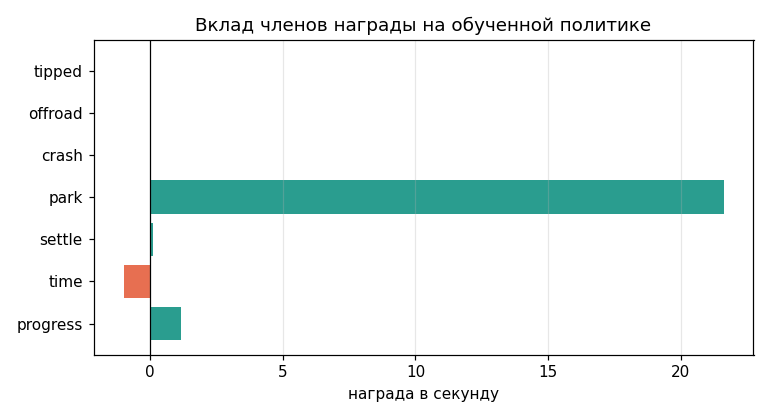
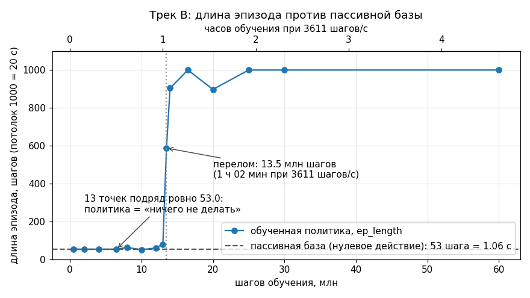

# Диагностика: как поймать враньё до обучения

## Цель

После этой главы вы умеете за несколько минут доказать, что среда, наблюдение и награда делают то,
что вы думаете, — и не начинаете прогон, пока это не доказано: восемь проб из
[probes.py](rl_toolkit/probes.py), пассивная база, свип каждого члена награды, цена шага в часах и
сравнение любого чекпойнта с нулевым действием.

Правило курса: **прогон стоит часов, проба — секунды**. Цена отказа от проб измерена: штраф за
ненаблюдаемую ошибку курса сжёг 7 млн шагов и сделал хуже (путь по полигону 2.56 → 2.41 м, падения
18 → 25 — каталог граблей §A3); расписание от абсолютного счётчика сожгло **три прогона подряд**
(§A11); метрика длины шага, тождественно равная нулю, сделала недействительными числа трёх прогонов
(§A1).

## Восемь проб: что каждая ловит

Пробы работают с любой средой gymnasium — `mujoco` внутри [probes.py](rl_toolkit/probes.py) не
импортируется вообще. Каждая возвращает `Table` или `Verdict`; `report()` печатает сводку со
светофором `[OK]` / `[!!]` / `[..]`.

**`probe_shapes` — формы, единицы, детерминизм.** Размерности, границы `Box`, `dt`, длина эпизода и
главное — побитовый повтор `reset(seed=k)`: без него любое A/B-сравнение политик превращается в шум.
Замер трека A сегодня ([probe.py](track_a_car/probe.py), проба 1): `obs_shape (15,)`, `action_shape
(2,)`, `dt 0.05`, 20.0 Гц, эпизод 180 шагов = 9.0 с, `seed_deterministic True`, **выходов за
объявленные границы: 0 из 4000**; самый узкий запас у канала `steer` — объявлено `[-0.60, 0.60]`,
наблюдалось `[-0.461, 0.474]`.

**`probe_action_scale` — масштаб разведки.** Время жизни эпизода при случайном действии амплитуды
`|a| = level * high`. Если дольше всех живёт уровень 0.0, разведка убивает машину раньше, чем
чему-то учит. Замер трека B ([probe.py](track_b_walk/probe.py), §4):

| амплитуда случайного действия | 0.0 | 0.05 | 0.1 | 0.3 | 1.0 |
|---|---|---|---|---|---|
| жизнь, с | 1.06 | 1.06 | 1.06 | 1.03 | **0.47** |

Дефолт SB3 `log_std_init = 0.0` (std ≈ 1) убивает 33-килограммовую машину **вдвое быстрее**, чем
если её не трогать. Отсюда `log_std_init = -2.3` в боевом рецепте: лечится это разведкой, а не
наградой и не куррикулумом.

**`probe_null_baseline` — пассивная база.** Возвращает `alive_s`, `alive_steps`, возврат и разброс
**по эпизодам**, а не по объединённой выборке. Формулировка докстринга: «Политика, живущая МЕНЬШЕ
этой базы, не управляет — она мешает». Разбор — ниже.

**`probe_reward_terms` — ставки членов на заданном поведении.** Награда/с каждого члена, доля в
сумме модулей, пометка «кандидат в душители» при доле выше 0.40. Колонка «/с по модулю» нужна
потому, что член, усредняющий знаковую величину, показывает ноль и при отсутствии проблемы, и при
знакопеременной раскачке. Замер трека A сегодня (проба 8.6):

```
    член | награда/с | /с по модулю | доля |суммы| | ненулевых |             пометка
---------+-----------+--------------+--------------+-----------+--------------------
    time |   -1.0000 |       1.0000 |       0.7195 |       400 | кандидат в душители
progress |    0.3898 |       0.3937 |       0.2805 |       400 |
  settle |    0.0000 |       0.0000 |       0.0000 |         0 |
```

На пассивном поведении 72 % всей ставки — штраф времени, а `settle` и `park` не начисляются ни разу:
вырастет `time` — и агент предпочтёт закончить эпизод любым способом.



*Та же проба, но на обученной политике трека A. Сравните с таблицей выше: там весь баланс держал
штраф `time` (−1.0/с, 72 % ставки), здесь появился `park` ≈ +21.7/с — он и перевешивает всё
остальное. Смотрите на порядок величин: пока `park` и `settle` не начисляются, агент оптимизирует
не парковку, а скорейший конец эпизода.*

**`probe_termination` — обрыв срабатывает там, где задумано.** Ставит машину в заданную позу через
`env.unwrapped.set_probe_state(state)` и сверяет `terminated` с ожиданием. Ложное падение — самый
дорогой класс: у боевого прогона r4p робот, **стоящий обеими стопами на препятствии, числился
летящим**, и награда набирала около −19/с за то, что машина залезла на препятствие, то есть платила
за обход препятствий. Самопроверка сегодня на намеренно сломанной версии печатает:

```
                         случай | ожидалось | получено | совпало
--------------------------------+-----------+----------+--------
стоит на полу (0.45 над опорой) |       НЕТ |       да |     НЕТ
РАСХОЖДЕНИЙ: 1. Условие обрыва срабатывает не там, где задумано — это дороже любой правки награды.
```

На треке A все десять случаев сходятся, включая контринтуитивный «в месте, но скользит боком».

**`probe_step_cost` — микросекунды на шаг.** `us_per_step`, `steps_per_s`, `realtime_factor`,
`hours_per_1M`. Первые 50 шагов — прогрев: первый шаг тянет ленивую инициализацию и врёт (разбор ниже).

**`probe_observability` — можно ли вообще штрафовать эту величину.** Метод «одинаковый вход, разный
ответ»: если нашлись состояния с практически одинаковым наблюдением, но разной величиной, политика
физически не может её различить. R² линейной регрессии — справка, а не вердикт: величина может быть
наблюдаема нелинейно. Вывод самопроверки сегодня для скрытого счётчика, которого нет в наблюдении:

```
!! ВЕРДИКТ: величина НЕ наблюдаема (пар с одинаковым obs=900,
   макс разброс величины=180, в долях сигмы=3.118, R2 линейной модели=0.00613)
```

Это и есть §A3: штраф `p_yaw` за 7 млн шагов ухудшил всё, потому что ошибки курса не было в 35
каналах наблюдения ни в каком виде. Лечение — не новый штраф, а либо величина в наблюдении, либо
контур через уже наблюдаемый канал.

**`probe_controller_sweep` — цена правки на готовых весах.** Свип параметра среды или контура **без
единого шага обучения**: если правка не меняет размерность наблюдения, её цену узнают за минуты
вместо суток. Так выбирали коэффициент контура курса — увод 112.3° при K = 0 против 39.2° при K =
2.0, плато 1.6…2.6, выбор сознательно не на краю плато. В самопроверке сегодня метрика растёт
−1.0262 → −0.0060 при `loop_k` от 0 до 2 и дальше не улучшается: «оптимум внутри диапазона — выбор
не на краю». Оптимум на краю означает, что вы не нашли оптимум, а упёрлись в границу свипа.

```
cd "lesson 14 (RL custom models)"
python -m rl_toolkit.probes
```

## Пассивная база: обязательный ориентир

Пассивная база — эпизод с **нулевым действием**. Политика, живущая меньше пассивной базы, не
управляет: она мешает. Это первое число, которое надо получить, и единственное, с которым честно
сравнивать всё остальное.

Числа трека B. Пассивная машина живёт **53 шага = 1.06 с** — воспроизведено независимо в четырёх
местах урока (`walk_env.py`, `probe.py`, `trap.py`, `train.py`), разброс между эпизодами 0.000 с.
Кривая боевого прогона из `evaluations.npz` (честный 1g, 20 эпизодов на точку), часы — при 3611
шагов/с:

| шагов | `ep_length` | часов |
|---|---|---|
| 0.5 M | **53.0** | 0.04 |
| **6.5 M** | **53.0** | **0.50** |
| 13.0 M | 79.0 | 1.00 |
| **13.5 M** | **587.4** | **1.04 ← перелом** |
| 16.5 M | 1000.0 | 1.27 |

За полчаса обучения (6.5 млн шагов) длина эпизода — **ровно 53.0**, и она ровно 53.0 на каждой из
тринадцати точек от 0.5 M до 13.0 M: политика побитово совпадает с «ничего не делать», не выучилось
НИЧЕГО. Перелом — на 13.5 млн шагов, час и две минуты. Без пассивной базы тот же график выглядел бы
как «обучение идёт»: награда на этих точках гуляет 27.4 / 22.5 / 27.5 / 25.0 — есть шум, есть
подъёмы, есть на что смотреть. Именно горизонтальная линия 53.0 рядом с кривой превращает «идёт» в
«не идёт».



*Та же кривая из `evaluations.npz` целиком, с пассивной базой пунктиром. Смотрите не на форму
кривой, а на то, где она отрывается от пунктира: до 13 млн шагов точки лежат ровно на базе — за
первый час обучения политика не сделала ничего, чего не делает нулевое действие. Верхняя ось
переводит шаги в часы на этой машине (3611 шагов/с).*

Вторая сторона той же пробы — [trap.py](track_b_walk/trap.py). Два чекпойнта с **одинаковой
сигнатурой** `Box(35,)` / `Box(8,)`, оба грузятся `PPO.load` без ошибки:

```
пассивная база (действие 0): 53.0 шагов = 1.06 с

      претендент |                 эпизоды, шагов | жизнь, с | награда |     против пассивной
-----------------+--------------------------------+----------+---------+---------------------
нулевое действие |                           [53] |     1.06 |   -13.4 | = 1.00 (это и есть база)
     свои R4 60M | [1000, 1000, 1000, 1000, 1000] |    20.00 |  1597.1 |               x 18.87
    ЧУЖИЕ R3 59M |           [29, 32, 34, 32, 32] |     0.64 |  -272.2 | x 0.60  ХУЖЕ, ЧЕМ НИЧЕГО
```

Чужие веса — от соседней ветки того же проекта: машина с тазом 0.1445 м вместо 0.4272 и приводами
5…7 Н·м вместо 112.86. Разницу показал **только замер против нулевого действия**.

```
cd track_b_walk
python trap.py
```

## Синтетический вход с известным ответом

Каждую нетривиальную метрику и каждый нетривиальный член награды надо один раз прогнать через вход,
для которого ответ известен заранее. История §A1: в награде стоял член `r_stride`, платящий за длину
шага, и он исправно набирал **21.9 награды в секунду**. При этом робот семенил — 5.25 Гц на ногу,
шаг 58 мм. По логу «оплата длины шага работает», а длины шага нет. Причина: длина шага измерялась
как смещение стопы **в системе координат корпуса** между двумя посадками одной ноги. Для любой
периодической походки эта разность тождественно равна нулю — корпус уехал ровно настолько же,
насколько стопа.

Доказательство — `synthetic_rollout` и `periodic_gait` из
[diagnostics.py](rl_toolkit/diagnostics.py), три походки с заранее известным шагом (вывод
самопроверки, запуск сегодня):

```
шаг задан, м | мир, м | СК корпуса, м | посадок | скорость, м/с
-------------+--------+---------------+---------+--------------
      0.1000 | 0.1000 |        0.0000 |       9 |        0.1250
      0.3000 | 0.3000 |       -0.0000 |       9 |        0.3750
      0.4500 | 0.4500 |        0.0000 |       9 |        0.5625
```

Три заведомо разных входа дают одно число — метрика сломана, как бы красиво она ни росла в
TensorBoard. Следующие строки объясняют, за что член платил на самом деле:

```
   апериодичная походка (дрожание точки постановки +-0.02 м, шаг тот же 0.30 м):
     метрика в СК корпуса: 0.0400 м по модулю (было 0.0000)
     метрика в мире:       0.3000 м (шаг не изменился)
```

То есть `r_stride` платил за **апериодичность** — за дрожание точки постановки.

Отдельный урок: та же формула стояла и в награде, и в измерителе `_probe_stride.py`. Это
**согласованная ложь** — сверка «награда против пробы» сходится, потому что обе стороны ошибаются
одинаково, и числа длины шага в трёх прогонах замером не были. Синтетический вход — единственная
проверка, которая эту симметрию ломает.

```
python -m rl_toolkit.diagnostics
```

## Свип члена: `sweep_term` и `gradient_report`

`sweep_term(term, axis, values, make_ctx, dt)` считает ставку члена в награде/с как функцию одной
физической величины. `make_ctx` обязан вернуть `Ctx` с тем же `dt`, иначе ставка посчиталась бы в
разных единицах — это проверяется и роняет свип. Из докстринга:

```
    ПЛОСКАЯ строка = нулевой градиент: обучение по этому члену невозможно,
    сколько бы вес ни поднимали (06_pitfalls.md §A2).
```

`gradient_report(table, tol=0.02)` выносит вердикт «нет градиента» / «градиент есть» / «градиент
ОБРАТНЫЙ»:

```
    `tol` — относительный размах ставки по диапазону:
        span = (max - min) / max(|среднее|, 1e-12).
    Если span < tol, член физически не различает крайние точки оси, и
    поднимать вес бессмысленно: умножение нуля на константу — ноль.
```

Вывод `python -m rl_toolkit.diagnostics` (запуск сегодня; команда v = 0.25 м/с, вес W = 8.0, потолок
L_cap = 0.3 м, dt = 0.02 с). Сначала плата вида «доля от потолка»:

```
свип члена 'r_stride_cap' по оси 'L, м' (dt=0.02 с, вес 8)
  L, м |  сырое | награда/с
-------+--------+----------
0.0580 | 0.0333 |   13.3333
0.1000 | 0.0333 |   13.3333
0.2000 | 0.0333 |   13.3333
0.3000 | 0.0333 |   13.3333
!! ВЕРДИКТ: нет градиента (размах=3.553e-15, относительный размах=2.665e-16)
   аналитика: 2*W*v/L_cap = 2*8.0*0.25/0.3 = 13.3333/с при ЛЮБОЙ длине шага
   тот же член с весом 12: 20.0000/с при L=0.058 и 20.0000/с при L=0.300
   вывод: вес умножил ноль на 1.5 и получил ноль (06_pitfalls.md §A2).
```

Шаг **впятеро** длиннее даёт ту же ставку. Подъём веса 8 → 12 на отметке 70 млн шагов не мог ничего
изменить — и не изменил. Если расширить ось до 0.45 м, вердикт становится ещё хуже: 13.3333 →
8.8889, «градиент ОБРАТНЫЙ», член платит за то, чего мы не хотим.

Та же плата, переписанная как **смещение от порога**:

```
свип члена 'r_stride_offset' по оси 'L, м' (dt=0.02 с, вес 8)
  L, м |   сырое | награда/с
-------+---------+----------
0.0580 | -0.0055 |   -2.2069
0.1000 |  0.0010 |    0.4000
0.2000 |  0.0055 |    2.2000
0.3000 |  0.0070 |    2.8000
0.4000 |  0.0078 |    3.1000
0.4500 |  0.0069 |    2.7556
OK ВЕРДИКТ: градиент есть; внутренний максимум при L, м = 0.4 (3.1000/с);
   есть СМЕНА ЗНАКА — плохое поведение становится чистым штрафом
```

Ключ — знак, а не величина: семенение L = 0.058 м получает **−2.2069/с**, то есть чистый штраф, а не
«менее выгодную награду». На платформе после той же правки походка 5.25 Гц / 0.058 м стала получать
**−14.0/с** вместо прежних **+22.8/с**; шаг вырос 11.2 → 34.1 см, каденс упал 5.1 → 2.0 Гц, слежение
выросло 78 % → 91.7 %. Правило: перед запуском выведите ставку члена в единицу времени как функцию
поведения и убедитесь, что производная по целевой величине не ноль. «Поднять вес» — лечение только
там, где градиент есть, но слаб.

```
cd track_b_walk
python probe.py
```

## Цена шага — это бюджет в часах

`probe_step_cost` переводит усложнение среды прямо в часы обучения. Формула из докстринга: `часы =
шаги / (шагов_в_секунду * 3600)`. Замеры сегодня на этой машине, одна среда, один процесс:

| среда | мкс/шаг | шагов/с | быстрее реального времени | часов на 1 млн шагов |
|---|---|---|---|---|
| трек A, парковка ([car_env.py](track_a_car/car_env.py)) | 341.4 | 2929 | ×146 | 0.095 |
| трек C1, зависание ([hover_env.py](track_c_drone/hover_env.py)) | 91.4 | 10945 | ×219 | 0.025 |
| трек C2, сканирование ([scan_env.py](track_c_drone/scan_env.py)) | 197.1 | 5073 | ×101 | 0.055 |

C1 и C2 — одна и та же физика дрона; разница в том, что C2 добавляет лучевой сенсор покрытия. Сенсор
**удваивает цену шага** (×2.16) и, значит, время любого прогона. Рельеф, контакты и лучи — не
«мелкие детали среды», а прямые множители к счёту за часы.

Как эту цену снижают — замер трека C (`probe_multiray.py`, ТЗ трека C §3.4):

| лучей | цикл `mj_ray`, мкс | `mj_multiRay`, мкс | ускорение |
|---|---|---|---|
| 15 | 28.3 | **5.0** | 5.6× |
| 128 | 227.5 | **15.0** | 15.2× |
| 512 | 950.3 | **59.8** | 15.9× |
| 2048 | 4140.8 | **219.0** | 18.9× |

Лидар на 512 лучей через `mj_multiRay` стоит 59.8 мкс — как десять шагов физики, и укладывается в
бюджет; тот же лидар циклом по `mj_ray` из Python стоил бы 950 мкс и обрушил бы среду в шесть раз.

**Оговорка, без которой число бесполезно.** Замер крайне чувствителен к посторонней нагрузке: на
свободной машине проба трека B давала 3742 шага/с, на занятой — 700…860 в пяти повторах. Разброс в
4–5 раз означает одно: мерить надо у себя, а не переписывать чужое число — включая числа выше.

```
cd track_c_drone
python probe.py --part 1
```

## A/B «политика против нулевого действия»

Первая проверка любого чекпойнта — до графиков, до ролика, до выводов. Одна таблица, три строки:
нулевое, случайное и обученное действие на одних сидах и одной сложности. Так устроен `eval_hover`
в [evaluate.py](track_c_drone/evaluate.py):

```python
    fns = {"нулевое действие (= тяга висения)": lambda: (lambda o: np.zeros(4))}
    rng = np.random.default_rng(0)
    fns["случайное действие"] = lambda: (lambda o: rng.uniform(-1, 1, 4))
    if pair is not None:
        model, norm = load_policy(pair, device="cpu")
        fns["PPO"] = lambda: (lambda o: model.predict(norm(o)[None],
                                                      deterministic=True)[0][0])
```

Результат трека C1 на отгружаемой политике (20 эпизодов, эпизод 500 шагов = 10 с, полная сложность; запуск сегодня —
команда в конце раздела):

| политика | прожито шагов из 500 | доля доживших | финальная ошибка позиции |
|---|---|---|---|
| нулевое действие (ровно тяга висения) | **78.8** | 0.000 | 3.377 м |
| случайное действие | **26.8** | 0.000 | 0.970 м |
| обученная PPO (1.5 млн шагов) | **500.0** | **1.000 — 20/20** | **0.1667 м** |

Здесь политика честно бьёт базу в 6.3 раза по живучести и в 20 раз по точности. В треке B на 6.5 млн шагов та же таблица дала бы 53
против 53 — и ночной прогон не запускали бы, пока не починен куррикулум.


*Строка «обученная PPO» из таблицы выше. Нулевое действие здесь — не выключенные моторы, а ровно
тяга висения, и всё равно 78.8 шага до падения: смотрите, как непрерывно политика правит четырьмя
винтами по отдельности, чтобы удержать ту же точку все 500 шагов. Именно поэтому база берётся
замером, а не рассуждением «нулевое действие и так висит».*

Два правила к этой таблице. Первое: **ролик — не замер**; в ролике боевого прогона по одному эпизоду
на дорожку вышло 0 падений из 8, а честная приёмка на шести эпизодах дала 18 падений из 48 (37 %).
Второе: девять соседних чекпойнтов одного прогона дают путь 3.00 / 1.24 / 2.58 / 3.21 / 1.71 / 2.16
/ 2.24 / 2.66 / 3.26 м — разброс между соседями в 2.6 раза. Сначала измерьте разброс, потом решайте,
сколько нужно эпизодов.

```
cd track_c_drone
python evaluate.py --hover policies/hover --scan policies/scan --episodes 20
```

## Проверки

1. `python -m rl_toolkit.probes` и `python -m rl_toolkit.diagnostics` печатают «САМОПРОВЕРКА …
   ПРОЙДЕНА» и код 0; видны вердикты «нет градиента» и «градиент есть» со сменой знака.
2. `cd track_a_car && python probe.py` заканчивается строкой «Все пробы зелёные. Можно запускать
   train.py»; в пробе 1 стоит `seed_deterministic True`, выходов за границы 0 из 4000.
3. Вы назвали пассивную базу своей среды в шагах и в секундах и записали её рядом с графиком
   обучения (для трека B это 53 шага = 1.06 с), а `cd track_b_walk && python trap.py` показал, что
   чужой чекпойнт с совпадающей сигнатурой живёт ×0.60 от неё — хуже, чем ничего.
4. Вы померили `hours_per_1M` у себя при закрытых лишних окнах и посчитали, сколько шагов
   влезает в ваш бюджет: числа из таблиц выше не подходят, разброс от нагрузки 4–5 раз.
5. Для каждого нетривиального члена награды есть синтетический вход с известным ответом, и метрика
   на трёх разных входах даёт три разных числа.
