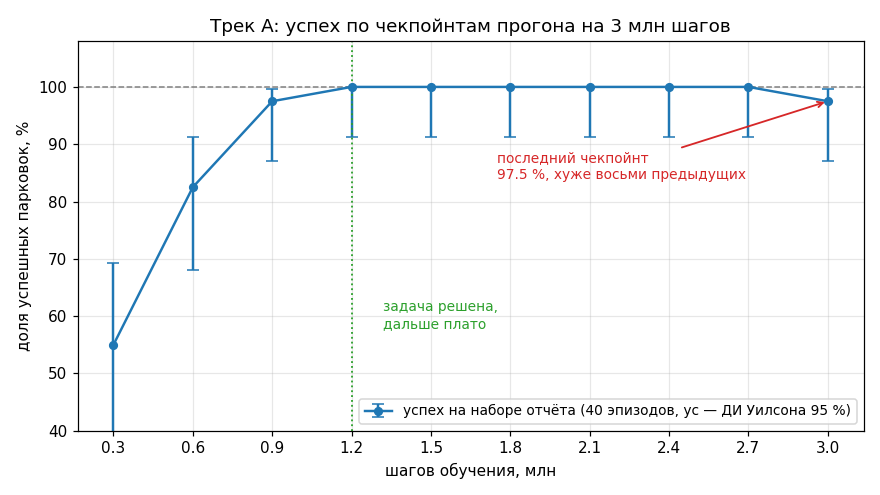

# Длинный прогон: чекпойнты, нормализация, честная оценка

## Цель

После этой главы вы ведёте прогон длиной в часы или сутки и не теряете его
результат: чекпойнты находятся автоматически, каждый грузится вместе со своей
статистикой нормализации, чужие веса отсеиваются первым же замером, дообучение
продолжает расписание, а итоговое число получено не на том наборе эпизодов, на
котором выбиралась модель. Всё это уже реализовано в
[rl_toolkit/checkpointing.py](rl_toolkit/checkpointing.py) и используется всеми
тремя треками; задача главы — объяснить, почему код устроен именно так, и
показать, что ломается без него.

## 1. Единицы колбэков SB3

Главный источник путаницы: у колбэка SB3 два счётчика, и они разные.

```python
        # Number of time the callback was called
        self.n_calls = 0  # type: int
        # n_envs * n times env.step() was called
        self.num_timesteps = 0  # type: int
```

(`stable_baselines3/common/callbacks.py:43-46`, версия 2.4.1.) `n_calls` растёт
на единицу за один `env.step` **векторной** среды, то есть за один шаг
роллаута (`callbacks.py:110-111`); `num_timesteps` растёт на число сред.

Дальше важно только одно: условие сохранения записано в **вызовах** —
`if self.n_calls % self.save_freq == 0` (`callbacks.py:300`; у `EvalCallback`
то же самое, `callbacks.py:449`), а имя файла пишется в **env-шагах** —
`f"{name_prefix}_{checkpoint_type}{self.num_timesteps}_steps.{extension}"`
(`callbacks.py:297`).

Следствие: если написать `CheckpointCallback(save_freq=500_000, ...)` и
запустить на 8 средах, чекпойнт будет не каждые 500 тыс. env-шагов, а каждые
4 млн — ровно **в 8 раз реже**, чем вы думали. На прогоне в 3 млн шагов файлов
не появится вообще ни одного.

Перевод делает `steps_to_calls(env_steps, n_envs) = max(1, env_steps // n_envs)`
([rl_toolkit/checkpointing.py:116-131](rl_toolkit/checkpointing.py)). Деление
целочисленное, поэтому реальный шаг между чекпойнтами равен
`(env_steps // n_envs) * n_envs` — и он не обязан совпадать с запрошенным.

Запустите самопроверку модуля — `python -m rl_toolkit.checkpointing`. Первый
раздел вывода:

```
1. Единицы: env-шаги -> вызовы env.step -> реальный шаг чекпойнта
    сред |  запрошено | save_freq |  реальный шаг | круглый?
       1 |     500000 |    500000 |        500000 | да
       4 |     500000 |    125000 |        500000 | да
       8 |     500000 |     62500 |        500000 | да
      12 |     500000 |     41666 |        499992 | НЕТ
      24 |     500000 |     20833 |        499992 | НЕТ
   вывод: при 12 средах реальный шаг 499 992, а не 500 000 — номера уезжают.
```

При 8 средах всё сошлось **случайно**: 500 000 делится на 8. При 12 — нет, и
номера чекпойнтов накапливают сдвиг: 499 992, 999 984, 1 499 976, …

## 2. Чекпойнты не на круглых миллионах

Это прямое следствие. Потребитель чекпойнтов, написанный «в лоб», ищет файлы
условием `n % 1_000_000 == 0` — и находит ноль. Второй раздел самопроверки:

```
3. Наивный поиск (n % 1 000 000 == 0) нашёл: 0 чекпойнтов
   bucketize(..., every=1 000 000) нашёл: [999984, 1999968, 2999952, 3999936]
   ожидалось (последний в каждой корзине): [999984, 1999968, 2999952, 3999936]
```

В исходном проекте на этом сторож, рендеривший ролики, молча простоял весь
прогон: роликов ноль, ошибок ноль (каталог ошибок, §A10). Тихий отказ — худшая
часть этой грабли: отсутствие ошибки не доказывает, что всё работает.

Устойчивый шаблон — раскладка по корзинам, а не проверка делимости: `bucketize`
складывает чекпойнты в словарь по ключу `p.steps // every` и берёт из каждой
корзины последний ([rl_toolkit/checkpointing.py:273-276](rl_toolkit/checkpointing.py)).
Такой поиск работает при любом числе сред и при любом шаге сохранения.

Правило: **никогда не пишите условие вида «номер делится на круглое число» по
номеру, который сгенерировали не вы.** И каждый автоматический потребитель
артефактов обязан уметь сказать «я ничего не нашёл».

## 3. Пара «веса + нормализация»

Политика ест не сырое наблюдение, а `(obs − mean) / sqrt(var + eps)` со
статистикой из `VecNormalize`. Веса и статистика — одна неразделимая пара.
Насколько это критично: на боевой машине исходного проекта **статистика
наблюдений уезжает на 0.40 сигмы за 2 млн шагов**, то есть чужой или
устаревший `vecnorm` искажает вход сильнее, чем разница между версиями
политики (замерено на `runs_walk_r4b`; цитата и разбор — в шапке
[rl_toolkit/checkpointing.py](rl_toolkit/checkpointing.py), пункт 2).

Учебная демонстрация того же на эталонной походке трека B: команда
`python demo.py --no-vecnorm --episodes 2 --cmds 0.4` даёт 0.281 м/с и 0 полных
эпизодов из 2 — против 0.358 м/с и 20/20 с парной статистикой (паспорт
[track_b_walk/policies/manifest.txt](track_b_walk/policies/manifest.txt)).

Пары пишет **только** `CheckpointCallback` при `save_vecnormalize=True`
(`callbacks.py:313-315`). `EvalCallback` при новом рекорде делает ровно одно —
`self.model.save(os.path.join(self.best_model_save_path, "best_model"))`
(`callbacks.py:516-521`), и ничего про `VecNormalize`. Поэтому **у
`best_model.zip` парного vecnorm не бывает**, это свойство SB3 2.4.1, а не
недосмотр вашего прогона.

`find_pair` про это говорит вслух. Из вывода самопроверки:

```
[vecnorm] ВНИМАНИЕ: у best_model.zip парного vecnorm НЕ БЫВАЕТ — EvalCallback
его не пишет (SB3 2.4.1, callbacks.py:518-521). Взят последний по номеру:
model_vecnormalize_3999936_steps.pkl. Все метрики по этой паре — ОЦЕНОЧНЫЕ.
```

Такое же предупреждение печатается для обычного чекпойнта, у которого пара
потерялась (в самопроверке это шаг 2 499 960, к нему подставляется 2 999 952 —
разница 499 992 env-шага). Практический вывод: отчитываться по
`best_model.zip` можно только с пометкой «оценочно», а число для отчёта брать
с обычного чекпойнта, у которого пара точная.

## 4. Ловушка совпадающей сигнатуры

Совпадение форм пространств — не доказательство совместимости. В
[track_b_walk/policies/](track_b_walk/policies/) лежат двое весов с одинаковой
сигнатурой `Box(35,)` / `Box(8,)`: свои (машина R4) и чужие (машина R3,
соседняя ветка проекта). `PPO.load` принимает обоих без единой ошибки.

Фактический вывод `python trap.py` в каталоге `track_b_walk` на этой машине:

```
пассивная база (действие 0): 53.0 шагов = 1.06 с, награда -13.4

СИГНАТУРЫ (то, по чему обычно и делают вывод «подходит»):
  свои  R4 60M: obs Box(-inf, inf, (35,), float32)  act Box(-1.0, 1.0, (8,), float32)
  ЧУЖИЕ R3 59M: obs Box(-inf, inf, (35,), float32)  act Box(-1.0, 1.0, (8,), float32)
  -> совпадают ПОЛНОСТЬЮ. Никакой ошибки при загрузке не будет.

ЧТО НА САМОМ ДЕЛЕ ДЕЛАЮТ ЭТИ ВЕСА
      претендент |                 эпизоды, шагов | жизнь, с | награда |         против пассивной
-----------------+--------------------------------+----------+---------+-------------------------
нулевое действие |                           [53] |     1.06 |   -13.4 | = 1.00 (это и есть база)
     свои R4 60M | [1000, 1000, 1000, 1000, 1000] |    20.00 |  1597.1 |                  x 18.87
    ЧУЖИЕ R3 59M |           [29, 32, 34, 32, 32] |     0.64 |  -272.2 | x 0.60  ХУЖЕ, ЧЕМ НИЧЕГО
```

Чужие веса живут **в 1.7 раза меньше**, чем выключенное управление. Ни типы, ни
исключения этого не ловят; ловит один замер — политика обязана быть лучше
нулевого действия, и делать его надо первым.

Единственная защита на будущее — паспорт рядом с весами. Образец —
[track_b_walk/policies/manifest.txt](track_b_walk/policies/manifest.txt): в нём
происхождение, объём обучения, сигнатура, метрики честной оценки, рецепт
обучения и **известный дефект** походки. Последний пункт особенно важен:
семенение (длина шага 0.4 см при каденсе 10.8 шагов/с) по табличным метрикам не
видно вообще — робот идёт с нужной скоростью и не падает. Кладите такой файл
рядом с каждым чекпойнтом, который переживёт свой прогон.


Те самые «свои R4 60M» из таблицы выше — множитель ×18.87, команда 0.4 м/с.
Смотрите на стопы: они почти не отрываются от пола. Это и есть семенение —
длина шага 0.4 см при каденсе 10.8 шагов/с. Ни одна строка таблицы этого не
показывает: скорость держится, эпизоды полные, награда 1597. Дефект видно
только глазом и из строки «известный дефект» в паспорте.

## 5. Цена оценки

`EvalCallback` гонит `n_eval_episodes` эпизодов **последовательно в одной
среде**, остановив обучение. Замер исходного проекта: интервалы с оценкой шли
на **1218 fps против 1786** без неё и занимали **26 % времени прогона**
(каталог ошибок, §A12). Хуже того, цена **растёт сама**. Пока политика падала, эпизод обрывался на
~480 шагах; когда она перестала падать, эпизод стал полным (1000 шагов), и
оценка подорожала вдвое без единой правки конфигурации. Это нестационарный
расход: чем лучше идёт обучение, тем дороже обходится измерение.

Отсюда правило: **оценка отвязывается от чекпойнтов**. Чекпойнты дёшевы и
нужны часто, оценка дорога и ловит тренд, а не каждый шаг. По умолчанию
`setup_callbacks` ставит её вдвое реже
([rl_toolkit/checkpointing.py:416-417](rl_toolkit/checkpointing.py)) и печатает
бюджет при сборке:

```
[колбэки] чекпойнт: запрошено 500000 env-шагов -> save_freq=41666 вызовов -> РЕАЛЬНЫЙ шаг 499992 env-шагов
[колбэки] оценка:   запрошено 1000000 env-шагов -> eval_freq=83333 вызовов -> РЕАЛЬНЫЙ шаг 999996 env-шагов, 20 эпизодов последовательно в ОДНОЙ среде
[колбэки] номера чекпойнтов будут НЕ круглыми (499992, 999984, ...) — искать их условием (n % круглое == 0) нельзя, используйте bucketize()
[колбэки] за 30000000 шагов ожидается 60 чекпойнтов и 30 оценок
```

Эта распечатка на старте заменяет смоук-тест: видно и реальные шаги, и то,
сколько раз всё сработает за прогон.

## 6. Отбор и отчёт — на разных наборах

Старая версия урока выбирала лучшую модель и отчитывалась о ней на **одном и
том же** фиксированном наборе эпизодов: `evaluate()` создавала среду с жёстко
заданным генератором, поэтому «финальные» 50 эпизодов содержали ровно те же 30,
по которым выбирался этап (разбор кода, §5.1). Что из этого вышло — замерено на
поставленной модели, блоками по 50 эпизодов одного и того же потока:

```
  n= 10 -> 40.0%   n= 30 -> 66.7%   n= 50 -> 62.0%   n=100 -> 72.0%   n=200 -> 73.0%
spread across the first 4 disjoint 50-episode blocks: [62.0, 82.0, 74.0, 74.0]
```

Заявленные «62 %» оказались **худшим из четырёх** блоков; на 200 независимо
засидированных стартах доля успеха 78.5 % ± 5.7 п.п. Число было занижено на
11–16 п.п. просто потому, что набор для отбора и набор для отчёта совпали и
оказались маленькими.

Лечение в треке A — два непересекающихся диапазона seed'ов: `SELECT_SEED =
100_000` для eval-среды колбэка отбора и `REPORT_SEED0 = 900_000` для отчёта
([track_a_car/train.py:67-68](track_a_car/train.py)). Каждый эпизод отчёта
стартует с явного `env.reset(seed=REPORT_SEED0 + i)`
([track_a_car/evaluate.py:79](track_a_car/evaluate.py)), а рядом с процентом
печатается доверительный интервал Уилсона
([track_a_car/evaluate.py:56-68](track_a_car/evaluate.py)) — на 30 эпизодах при
p = 0.62 его полуширина около 17 п.п., и соседние этапы обучения по такому
замеру неразличимы.

Как это выглядит на живом прогоне — вот все десять чекпойнтов трека A,
каждый прогнан по 40 эпизодов набора отчёта:



Смотреть тут надо на три вещи. С 1.2 млн шагов кривая упирается в 100 % —
дальше обучение не добавляет ничего, и прогон на 3 млн был избыточным.
Последняя точка ниже восьми предыдущих (97.5 % против 100 %) — «последние
веса» и «лучшие веса» лежат в разных файлах, поэтому чекпойнты и нужны.
И усы: на 40 эпизодах интервал Уилсона шириной около 9 п.п., так что 97.5 и
100 % по одному такому замеру формально неразличимы — именно поэтому доля без
интервала рядом ничего не решает. Числа взяты из
[track_a_car/README.md](track_a_car/README.md), скрипт —
[images/success_by_checkpoint.py](images/success_by_checkpoint.py).

Правило: **набор для отбора и набор для отчёта не пересекаются, seed'ы заданы
явно, рядом с долей стоит интервал.**

## 7. Дообучение: resume

Три вещи ломаются при продолжении прогона.

**Абсолютный счётчик.** `model.num_timesteps` при resume продолжается, а не
обнуляется:

```python
if reset_num_timesteps:
    self.num_timesteps = 0
    self._episode_num = 0
else:
    # Make sure training timesteps are ahead of the internal counter
    total_timesteps += self.num_timesteps
```

(`stable_baselines3/common/base_class.py:411-416`). Значит любое расписание,
считаемое от этого счётчика, при старте с 163.5M и «удержанием 2 млн» выдаст
максимальную сложность с первого же шага. В исходном проекте на этом сгорели
три прогона. Куррикулум урока считается от абсолютного счётчика **осознанно**,
и рампы в треке A сдвигаются на текущее значение: `linear(hold=t0, ramp=...)`,
где `t0 = int(model.num_timesteps)`
([track_a_car/train.py:232-233](track_a_car/train.py)). Плюс
`explain(schedule, ...)` печатает вычисленные значения до старта.

**`reset_num_timesteps`.** Замер (`PPO.load` из чекпойнта на 64 шагах, затем
`learn(total_timesteps=64)`):

```
learn(reset_num_timesteps=False): num_timesteps=128
learn(reset_num_timesteps=True) : num_timesteps=64
```

Первый вариант продолжает счётчик, второй обнуляет и вдобавок заново стартует
`_current_progress_remaining` с 1.0 — то есть перезапускает расписание
learning rate. Старая версия урока звала `learn()` пять раз в цикле без этого
флага; в `logs/` накопилось 34 каталога `PPO_1 … PPO_34`, а кривая в
TensorBoard была разорвана на 34 куска (разбор кода, §5.7). В треке A вызов
`learn()` **один**, а флаг передан явно —
`reset_num_timesteps=(args.resume is None)`
([track_a_car/train.py:280](track_a_car/train.py)).

**Что переносится через `PPO.load`, а что нет.** Замерено здесь и сейчас на
крошечной среде:

```
до сохранения : ent_coef=0.005  std=0.3768  num_timesteps=64
load() как есть: ent_coef=0.005  std=0.3768  num_timesteps=64
load(ent_coef=0.02): ent_coef=0.02  std=0.3768
load(policy_kwargs=...): ValueError -> The specified policy kwargs do not equal the stored policy kwargs...
после log_std += 0.7: std=0.7588
```

Читается так: `model.__dict__.update(data)` восстанавливает гиперпараметры из
файла, а следующая строка `model.__dict__.update(kwargs)`
(`base_class.py:737-738`) даёт им перекрыться аргументами `load`. Поэтому
`ent_coef` меняется на лету, а `policy_kwargs` изменить нельзя: SB3 сверяет их
с сохранёнными и бросает `ValueError`.

Ширина разведки `log_std` — **обученный параметр**, он приезжает из чекпойнта.
У зрелой политики он мал, и она не выйдет из своего предельного цикла, сколько
ни дообучай. Зеркало тихого старта — поднять его вручную: `+0.7` удваивает std
(0.3768 → 0.7588 в замере выше). В исходном проекте это был аргумент
`--std-add`, которым перестраивали походку.

## 8. Минибатч выводится из буфера, а не задаётся константой

Если `batch_size` — константа, то при смене числа сред буфер `n_steps * n_envs`
перестаёт на неё делиться. SB3 не падает, а предупреждает и берёт последний
неполный минибатч (`ppo.py:153-162`).

Трек A округляет `n_steps` вверх до кратного числу минибатчей и выводит
`batch_size = buffer // N_MINIBATCHES`, закрывая результат утверждением
`assert buffer % batch_size == 0`
([track_a_car/train.py:152-158](track_a_car/train.py)).

Трек C решает ту же задачу иначе — берёт наибольший делитель буфера в разумном
диапазоне:

```python
    batch = max(d for d in range(256, min(4096, buf) + 1) if buf % d == 0)
```

([track_c_drone/train_hover.py:170](track_c_drone/train_hover.py)). Посчитано
по этой формуле при `buf = 512 * envs`: 8 сред — буфер 4096, батч 4096 (один
минибатч); 12 сред — 6144 и 3072; 24 среды — 12288 и 4096. Остаток везде ноль.
Для сравнения, константа 512 при формуле трека A: на 8 средах буфер 4096,
остаток 0; на 12 средах буфер 4104, остаток 8 — именно этот случай и печатает
предупреждение SB3.

## 9. RL — не всегда про GPU

Замер на этой же RTX 4060 Laptop, MLP-политика 256×128: **2063 шага/с на CPU
против 741 на GPU** ([track_b_walk/train.py:85-87](track_b_walk/train.py)).
Разница почти трёхкратная — и в пользу CPU.

Почему так. Узкое место длинного прогона — не умножение матриц, а физика: одна
среда `tsaplya2.xml` выдаёт 5429 шагов/с в одном процессе, и все эти шаги
считает MuJoCo **на CPU**. Сеть 256×128 при батче в несколько тысяч не
загружает даже одного мультипроцессора видеокарты, зато на каждом минибатче
приходится перекачивать тензоры между хостом и устройством — перекачка стоит
дороже самого счёта. Плюс GPU не делится: два PPO на этой видеокарте дают
CUDA OOM, а восемь процессов на CPU уживаются нормально (ограничение здесь
память: 8 сред примерно 3.7 ГБ, 12 сред около 7 ГБ).

Поэтому во всех треках урока `--device cpu` стоит по умолчанию
([track_b_walk/train.py:129](track_b_walk/train.py)). Переводить на GPU имеет
смысл, только когда политика перестала быть маленьким MLP — например, стала
свёрточной сетью над картинкой.

---

## Проверки

1. `python -m rl_toolkit.checkpointing` завершается сообщением «САМОПРОВЕРКА
   ПРОЙДЕНА». В разделе 1 при 12 средах стоит реальный шаг 499 992, в
   разделе 3 наивный поиск находит 0 чекпойнтов, а `bucketize` — четыре.
2. Посчитайте вручную реальный шаг чекпойнта для своего числа сред по формуле
   `(env_steps // n_envs) * n_envs` и сверьте с тем, что печатает
   `setup_callbacks` при запуске обучения. Числа обязаны совпасть.
3. `cd track_b_walk && python trap.py` — чужие веса дают множитель ×0.60 к
   пассивной базе, свои ×18.87. Убедитесь, что при загрузке чужих весов не
   возникло ни одной ошибки и ни одного предупреждения от SB3.
4. Возьмите любой прогон с чекпойнтами и попросите `find_pair` вернуть пару к
   `best_model.zip`. В выводе обязано появиться слово «ОЦЕНОЧНЫЕ». Если его
   нет — вы читаете не тот каталог.
5. Запустите оценку своей модели дважды: на seed'ах отбора и на seed'ах отчёта
   ([track_a_car/evaluate.py](track_a_car/evaluate.py) печатает оба набора).
   Разница между числами — это и есть та величина, на которую вы бы соврали,
   отчитавшись по набору отбора.
6. Прервите обучение и продолжите его с `--resume`. В логе должны появиться
   строки `[resume] продолжаем с абсолютного шага N` и `[resume] подхвачена
   статистика VecNormalize`, а печать расписания куррикулума — показать не
   стартовые значения рамп, а те, что соответствуют шагу N.
