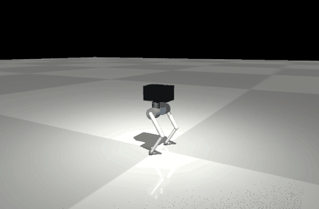
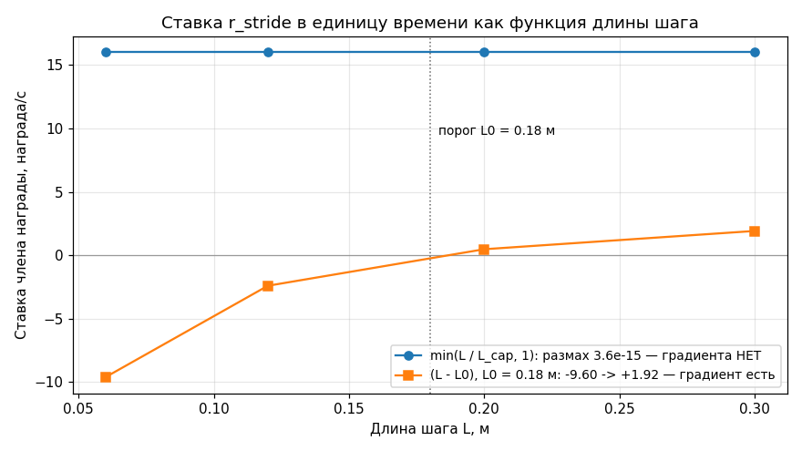
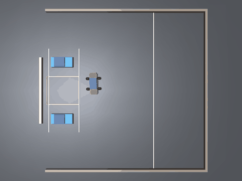

# Каталог оплаченных ошибок

## Цель

После этой главы вы сможете по симптому («награда растёт, а задача не решается», «поднял вес — ничего не изменилось», «чекпойнтов нет, ошибок тоже нет») назвать вероятную причину и указать пробу, которая проверяет её за секунды, а не за сутки прогона.

Здесь нет выдуманных примеров. Первые пятнадцать записей — ошибки боевого проекта `legged_robots` (двуногий робот, прогоны до 206 млн шагов); его референсная среда лежит в уроке как [track_b_walk/_reference_walk_env_r4.py](track_b_walk/_reference_walk_env_r4.py), и журнал прогонов в её докстринге процитирован по номерам строк. Последние шесть — ошибки **прошлой версии этого же урока** ([.](../.)): они ближе студенту, потому что задача проще и весь код помещается в голове.

Каждая запись устроена одинаково: **симптом → диагноз → доказательство числом → лечение → обобщение → чем ловится заранее**. Строка «Доказательство» обязательна: запись без числа — это мнение, а не грабля.

## Четыре сквозных правила

1. **Прежде чем штрафовать величину, проверь, что она есть в наблюдении.** Дешевле любого прогона. Расширение: проверь ещё, что метрика этой величины не тождественный ноль (№1) и что у платы есть градиент по ней (№2).
2. **Измеряй, а не предполагай, — и измеряй ДО прогона.** Три дефекта рельефа нашли пробами, не потратив ни шага обучения; неверный диагноз «это своп» стоил 16 тысяч шагов.
3. **Демонстрация — не измерение.** 0 падений из 8 в ролике против 18 из 48 в честной приёмке — один и тот же чекпойнт.
4. **Молчаливый отказ дороже громкого.** Сторож демо простоял весь прогон и не сказал ни слова; `.ps1` не запустился, но окно выглядело живым.

---

## Часть 1. Пятнадцать ошибок боевого проекта

### 1. Метрика, которая всегда равна нулю

**Симптом.** Робот семенит: 5.25 Гц на ногу, шаг 58 мм. В награде есть член `r_stride`, который платит именно за длину шага, и он исправно набирает 21.9 награды в секунду. По логу «оплата длины шага работает» — а длины шага нет.



*Так выглядит симптом записей №1 и №2. Смотрите не на корпус, а на стопы: они почти не отрываются от пола и частят на месте — шаг 0.4 см при каденсе 10.8 шагов/с. Робот идёт с заданной скоростью 0.4 м/с и не падает, поэтому в сводке прогона всё хорошо; при этом член `r_stride` исправно набирает награду за длину шага, которой нет.*

**Диагноз.** Смещение стопы между двумя посадками бралось в системе координат **корпуса**. Для любой периодической походки эта разность тождественно равна нулю: корпус уехал ровно настолько же, насколько уехала стопа. Член платил не за длину шага, а за апериодичность — за дрожание точки постановки.

**Доказательство.** [_reference_walk_env_r4.py:131-140](track_b_walk/_reference_walk_env_r4.py): на синтетических походках 0.10 / 0.30 / 0.45 м метрика даёт **0.0000 м во всех трёх**. Та же формула стояла и в пробе `_probe_stride.py`, поэтому числа длины шага в журнале трёх прогонов («0.4 → 3.9 см») замером не были. Масштаб потери: шаг 58 мм в мировой раме при кинематическом потолке 473 мм — **12 % от возможного**.

**Лечение.** Смещение считается в мировой раме; исправлены оба места — и награда, и измеритель. Метрика проверена на синтетических походках с заранее известным ответом.

**Обобщение.** Каждую нетривиальную метрику прогоняй через синтетический вход с известным ответом. Метрика, дающая одно и то же число на трёх заведомо разных входах, сломана — как бы красиво она ни росла в TensorBoard. И отдельно: одна и та же формула, скопированная в награду и в измеритель, даёт **согласованную ложь**, которую сверка «награда против пробы» не видит.

**Как поймать заранее.** `diagnostics.synthetic_rollout` + `diagnostics.periodic_gait` ([rl_toolkit/diagnostics.py](rl_toolkit/diagnostics.py)): задаёшь походку с известным шагом и требуешь, чтобы измеритель вернул именно его.

### 2. Форма платы без градиента: почему подъём веса 8 → 12 не помог

**Симптом.** Награда за длину шага есть, вес ей подняли в полтора раза (8 → 12) на отметке 70 млн шагов — шаг не изменился. Вывод новичка: «мало платим, поднимем ещё».

**Диагноз.** Дело не в весе, а в **форме** платы. Плата `min(L / L_cap, 1)` начисляется за каждую посадку; при каденсе `f` посадок в секунду `2f`, значит ставка равна `2f·W·L/L_cap`. Но в установившейся ходьбе `L·f = v` (скорость задана командой), поэтому ставка `= 2W·v/L_cap` — **длина сокращается**. Умножение на любой вес умножает ноль на константу.

**Доказательство.** [_reference_walk_env_r4.py:141-146](track_b_walk/_reference_walk_env_r4.py): `L = 0.058 м → 11.33/с`, `L = 0.300 м → 11.16/с`. Шаг впятеро длиннее даёт ставку на 1.5 % **хуже**: градиент не просто нулевой, он слегка отрицательный. Воспроизведено на этой машине тулкитом урока (`sweep_term` + `gradient_report`, dt = 0.005 с, v = 0.30 м/с, W = 8):

```
плата min(L/L_cap, 1) за посадку          плата (L - L0) за посадку, L0 = 0.18
stride |  сырое | награда/с               stride |   сырое | награда/с
-------+--------+----------               -------+---------+----------
0.0600 | 0.0100 |   16.0000               0.0600 | -0.0060 |   -9.6000
0.1200 | 0.0100 |   16.0000               0.1200 | -0.0015 |   -2.4000
0.2000 | 0.0100 |   16.0000               0.2000 |  0.0003 |    0.4800
0.3000 | 0.0100 |   16.0000               0.3000 |  0.0012 |    1.9200
ВЕРДИКТ: нет градиента (размах 3.6e-15)   ВЕРДИКТ: градиент есть (-9.60 -> +1.92 /с)
```



*Те же две колонки таблицы, нарисованные друг поверх друга. Смотрите на наклон, а не на высоту: синяя линия идеально горизонтальна — шаг 6 см и шаг 30 см оплачиваются одинаково, 16.0 награды/с, поэтому умножение веса 8 → 12 поднимает всю линию и не меняет ничего. Оранжевая пересекает ноль на пороге L0 = 0.18 м: короткий шаг стал штрафом, длинный — прибылью, и у политики появилось направление, куда двигаться.*

**Лечение.** Плата переписана с «доли от потолка» на **смещение от порога**: `rew = Σ(L − L0)·first_contact`. Ключ — знак, а не величина: посадка короче порога становится чистым штрафом, а не «менее выгодной наградой». Потолки обязательны, иначе член линеен по `1/f` и тянет каденс в ноль ([_reference_walk_env_r4.py:201-208](track_b_walk/_reference_walk_env_r4.py)). Результат прогона: шаг 11.2 → **34.1 см**, каденс 5.1 → **2.0 Гц**, слежение за командой 78 % → **91.7 %**.

**Обобщение.** До запуска выведи ставку члена **в единицу времени** как функцию поведения и проверь, что производная по целевой величине не ноль. «Поднять вес» — лечение только тогда, когда градиент есть, но слаб. Если поведение не изменилось после изменения веса в разы, проблема в форме, а не в величине.

**Как поймать заранее.** `diagnostics.sweep_term` даёт таблицу «ось → награда/с», `gradient_report` выносит вердикт «нет градиента / градиент есть / градиент ОБРАТНЫЙ».

### 3. Штраф за то, чего нет в наблюдении

**Симптом.** Робот уводит с прямой на 112° за 20 секунд. Добавили штраф за накопленную ошибку курса, прогнали 7 млн шагов — стало **хуже**: путь по полигону 2.56 → 2.41 м, падения 18 → 25.

**Диагноз.** В наблюдении политики 35 каналов, и ошибки курса там нет ни в каком виде: проекция гравитации в СК корпуса инвариантна к повороту вокруг вертикали, гироскоп даёт мгновенную угловую скорость, а не накопленный угол. Штрафовалась величина, которую агент физически не наблюдает.

**Доказательство.** 7 млн шагов обучения и приёмка после них: путь **2.56 → 2.41 м**, падения **18 → 25**, профиль по дорожкам сплющился вместо роста. Отрицательный результат ценой суток машинного времени.

**Лечение.** Не новый штраф, а обратная связь через уже наблюдаемый канал: на вход подаётся не сырая команда угловой скорости, а `wz_eff = clip(cmd_wz + clip(−K·yaw_err, ±CORR), ±0.6)`. Размерность наблюдения не изменилась, поэтому контур проверили **на готовых весах, до обучения**: увод 112.3° → **39.2°** при K = 2.0, плато 1.6…2.6 (значение выбрано не на краю), падений 0/8 во всех точках.

**Обобщение.** Награда — функция от того, что видит **агент**, а не от того, что видите вы в логах. Чек-лист: величина выводима из наблюдения? Если нет — её надо либо добавить в наблюдение, либо замкнуть контур в управлении. Бонус: правка, не меняющая размерность наблюдения, проверяется на готовых весах за минуты вместо суток.

**Как поймать заранее.** `probes.probe_observability` — метод «одинаковый вход, разный ответ»: ищет состояния с практически одинаковым наблюдением и существенно разной величиной. `probes.probe_controller_sweep` — свип коэффициента на готовых весах.

### 4. Аттрактор «стоять выгоднее»: абсолютное exp-ядро слежения

**Симптом.** Политика уверенно набирает награду, оценка бьёт рекорды (2.2k), падений ноль, плавность рекордная — и робот **стоит на месте**: vx = 0.001…0.007 при команде идти. Три итерации подряд добавление штрафов только двигало порог.

**Диагноз.** Ядро слежения было абсолютным: `exp(−8·err²)` с фиксированной шириной. При малой команде ошибка «стою вместо 0.2 м/с» мала в абсолютных единицах, и ядро платит стоящей машине большую долю максимума. Стояние — глобально доминирующая стратегия: оно безрисково (нет падений) и почти полностью оплачено.

**Доказательство.** При малой команде ядро платило стоящей машине **73 % слежения**, и штраф −0.5 этого не перевешивал. Сужение диапазона команд до −0.1…0.3 сделало стояние **ещё** выгоднее: в пределах 0.3 ядро платит стоя не меньше 49 %. Итоговая пара чисел при cmd = 0.4: абсолютное ядро платит стоящей машине **27.8 %**, относительное — **1.7 %**.

**Лечение.** Ядро сделано относительным: `σ = max(0.35·|cmd|, 0.07)`, `r_lin = 2.2·exp(−2·err²/σ²)`, плюс линейный штраф простоя как дальний градиент. Результат: vx при команде 0.2 вырос с 0 до **0.115** (57 % команды), при команде 0.4 — до 0.143, рекорд прогона.

**Обобщение.** Если у задачи есть безрисковое бездействие, посчитай **аналитически**, сколько награды в секунду получает агент, который вообще ничего не делает. Это число считают до запуска, а не ищут в TensorBoard. Ширина любого exp-ядра должна масштабироваться целью. И второе: сужение диапазона задач — не всегда упрощение, оно может усилить вырожденное решение.

**Как поймать заранее.** `probes.probe_reward_terms` с нулевой политикой: таблица «член → награда/с» на поведении «ничего не делать». Ненулевая строка у целевого члена здесь и есть утечка.

### 5. Свободная полоса наклона 20°, обнулявшая градиент к вертикали

**Симптом.** Политика застряла в аттракторе «медленно валиться вбок»: выживание 1.4 с при пассивных 1.1 с, действия в насыщении. 24 млн шагов без прогресса.

**Диагноз.** У штрафа наклона была мёртвая зона: до 20° наклон не наказывался вовсе. Внутри полосы градиент к вертикали тождественно равен нулю — политике безразлично, стоит она прямо или наклонена на 19°. Оптимум внутри мёртвой зоны — «валиться медленно», потому что за её пределами штраф уже не спасает.

**Доказательство.** [_reference_walk_env_r4.py:27-31](track_b_walk/_reference_walk_env_r4.py): «свободная полоса наклона до 20° УБРАНА (обнуляла градиент к вертикали — прогон застрял в аттракторе "медленно валиться вбок" на насыщенных действиях, **выживание 1.4 с против пассивных 1.1 с за 24M шагов**)». Обученная политика была хуже выключенного управления.

**Лечение.** `tilt²` **от нуля** — квадратичный штраф без мёртвой зоны, дающий градиент в любой точке. Вошёл первым пунктом в итоговый рецепт-победитель.

**Обобщение.** «Допуск» и «мёртвая зона» — не одно и то же. Допуск в **критерии приёмки** нормален; мёртвая зона в **награде** — это выключенный градиент на всём протяжении зоны. Если внутри зоны агенту всё равно, он выберет её край, а не центр.

**Как поймать заранее.** `diagnostics.sweep_term` по оси наклона: плоский участок таблицы виден глазами, а `gradient_report` на поддиапазоне мёртвой зоны выносит «нет градиента».

### 6. Недостижимый порог родил хромоту, а зеркальная аугментация её удвоила

**Симптом.** Робот хромает: на задней команде 0.25 м/с левая нога делает 16.0 см, правая 11.4 см. Логичное лечение — зеркальная аугментация данных. Прогнали. Результат: хромота **выросла вдвое** там, где она была, и уменьшилась там, где её почти не было.

**Диагноз.** Причина хромоты — не асимметрия обучения, а физически **недостижимый порог** в награде. Порог длины шага стоял константой 0.12 м, а достижимый шаг равен `скорость / каденс`: при 0.25 м/с и 2.3 Гц это 10.9 см. Порог недостижим при любом поведении, значит штраф платится всегда, и уйти от него можно единственным способом — не регистрировать посадку: свалить работу на одну ногу, а вторую опускать так, чтобы время полёта не добирало до порога засчёта 0.05 с. Зеркальная аугментация бессильна **по построению**: перекос «длинная-короткая» сам по себе зеркально-симметричен.

**Доказательство.** [_reference_walk_env_r4.py:210-224](track_b_walk/_reference_walk_env_r4.py):

| режим | шаг Л/П, см | потеряно контактов Л/П | индекс симметрии до / после аугментации |
|---|---|---|---|
| назад 0.25 | **16.0 / 11.4** | 20 % / 5 % | 20.7 % → **42.3 %** (вдвое хуже) |
| назад 0.40 | 21.3 / 19.7 | 12 % / 7 % | 18.2 % → 25.7 % (хуже) |
| назад 0.60 | 34.8 / 35.0 | 1 % / 2 % | 3.7 % → 1.1 % (лучше) |

**Лечение.** Три правки: (1) порог **пропорционален команде** — `S_ref = max(|v_cmd|, 0.20)/1.25`, `L0 = 0.45·S_ref` ([:227-230](track_b_walk/_reference_walk_env_r4.py)); (2) прямой штраф за разноногость с весом 6.0 — при каждой посадке шаг сравнивается с последним шагом другой ноги ([:232-235](track_b_walk/_reference_walk_env_r4.py)); (3) порог засчёта полёта 0.05 → 0.03 с, чтобы нога не пряталась от учёта.

**Обобщение.** Три урока в одном. Порог в награде обязан быть достижимым при каждой команде, иначе штраф превращается в постоянный оброк. Любой «порог засчёта» события — дверь для reward hacking: агент будет держаться прямо под порогом детектора. И лечение симптома вместо причины может симптом усилить: аугментация была разумной гипотезой, её опровергло не рассуждение, а замер по режимам.

**Как поймать заранее.** `diagnostics.reachability`: сравнивает `Term.threshold` с физически достижимым значением на наборе состояний и печатает «порог НЕДОСТИЖИМ» с запасом в тех же единицах.

### 7. Конфликт членов награды: длинный шаг удвоил раскачку по крену

**Симптом.** Победа предыдущего прогона (шаг вырос втрое, 11.2 → 34.1 см) обернулась новой жалобой заказчика: «робот трясёт грузом вправо-влево».

**Диагноз.** Это не побочный баг, а физика: у машины точечная стопа, и чтобы шагнуть длиннее, центр масс обязан сильнее уходить на опорную ногу. Требования «длинный шаг» и «спокойный груз» противоречат друг другу напрямую. Причём измерение разошлось по компонентам: боковая тряска уменьшилась, а раскачка по крену удвоилась.

**Доказательство.** Проба с грузом (коробка 15.325 кг — 46 % массы, высота 617 мм, команда 0.4):

| величина | до правки (78.5M) | после (86.5M) |
|---|---|---|
| крен | 1.87° | **3.77°** (вдвое хуже) |
| скорость крена, rms | 40 °/с | 46 °/с |
| боковое ускорение, rms | 0.401 g | **0.321 g** (лучше) |

На 0.7 м/с цена ещё выше: крен 1.87° → **6.67°**.

**Лечение.** Давить не на саму величину (увод ЦМ нужен физически), а на её производные: штраф наклона разделён на крен и тангаж с весами 40 и 4, вдесятеро ([:327](track_b_walk/_reference_walk_env_r4.py)), и добавлено боковое ускорение в точке груза. Веса подобраны **замером доли в награде**: при весе 2.0 новый блок съедал **48 %** награды заднего хода — снижено до 1.5, иначе агент выучил бы «назад лучше не ходить» ([:329-332](track_b_walk/_reference_walk_env_r4.py)). Конфликт записан явно вместе с правилом разрешения: если шаг просядет ниже ~15 см — снижать вес бокового ускорения, а не вес длины шага ([:123-127](track_b_walk/_reference_walk_env_r4.py)).

**Обобщение.** Многочленная награда — система с конфликтами, и конфликты надо выписывать заранее вместе с правилом «какой вес крутить первым, а какой не трогать». Калибруй веса по **доле в суммарной награде**, а не на глаз, и делай это на финальной политике. Член, съедающий 40–48 % награды одного из режимов, заставит агента этот режим бросить.

**Как поймать заранее.** `diagnostics.term_share_table` — доля каждого члена в |сумме| за секунду; всё, что выше 40 %, помечается «кандидат в душители».

### 8. Тихий старт: почему std ≈ 1 убивает 33-килограммовую машину

**Симптом.** Робот не учится **стоять**. Эпизоды длятся 0.17 с — при том что пассивная машина (нулевое управление) падает 1.78 с. Обученная политика в десять раз хуже выключенного робота, и так на любом объёме шагов.

**Диагноз.** SB3 по умолчанию ставит `log_std_init = 0.0`, то есть std ≈ 1.0 в нормированных единицах действия. У этой машины приводы дают 112.86 Н·м; случайный шум такого масштаба — мгновенное падение. Траектория «стоять» **ненаблюдаема**: ни одна траектория не живёт достаточно долго, чтобы value-функция увидела награду за стояние, и бутстрап критика не замыкается.

**Доказательство.** [_reference_walk_env_r4.py:47-55](track_b_walk/_reference_walk_env_r4.py): «даже на зафиксированной 0.35g политика жила **0.17 с при пассивных 1.78 с** … тихий старт `log_std_init = −2.3` (std ≈ 0.1) — A/B сразу дал **1.93 с** и положительную награду». Дополнительно: нулевое действие в боевых условиях давало +104 награды, а политика выбирала −70.

**Лечение.** `--std-init -2.3` при старте. Зеркальный приём для дообучения: `--std-add` **поднимает** `log_std` после загрузки чекпойнта, когда зрелая политика со std ≈ 0.057 слишком узка, чтобы перестроить походку (в решающем прогоне std 0.105 → 0.258).

**Обобщение.** Начальный масштаб разведки — гиперпараметр **физики задачи**, а не библиотеки. Проверка на две минуты: эпизод с нулевым действием против эпизода со случайным действием из стартового распределения. Если случайный резко хуже нулевого — стартовый шум надо давить. Главный диагностический признак: **обученная политика хуже выключенного управления** означает, что критик никогда не видел хорошей траектории, и чинить надо разведку, а не награду.

**Как поймать заранее.** `probes.probe_action_scale` — живучесть эпизода при |a| = 0.0 / 0.1 / 0.3 / 1.0 от верхней границы. Если уровень 0.0 живёт дольше всех, лечение — `log_std_init`, а не награда.

### 9. Куррикулум, который не помог: незамкнутый бутстрап

**Симптом.** Понижаем гравитацию до 0.35g, чтобы робот успел научиться балансу, потом плавно возвращаем 1g. Логично — и не работает. Эпизоды по-прежнему 0.17 с.

**Диагноз.** Куррикулум лечил не ту причину. Он удлиняет окно, в котором машина физически может устоять, но окно бесполезно, если политика в него не попадает: разведка со std ≈ 1 убивает машину и на 0.35g тоже. Куррикулум делает хорошую траекторию **достижимой**, тихий старт делает её **посещаемой**; нужны оба.

**Доказательство.** [_reference_walk_env_r4.py:36-45](track_b_walk/_reference_walk_env_r4.py): пробы показали, что позиционное серво сдвигает ЦМ максимум на ~26 мм (насыщение 112.86 Н·м), а наклон уже на 5° требует 48 мм; «ни одна траектория не переживает 1.4 с, и value-функция никогда не видит награду за стояние». A/B с **зафиксированной** 0.35g дал тот же результат, что и с рампой. Когда сложили оба лечения: 8M (0.35g) — 1.6 с; 15M (0.58g) — 18.3 с при 80 % падений; 20M (0.74g) — 20/20 с, 0 %; **24M (0.87g) — ходьба 20/20 с, 0 % падений, 0.356 м/с (89 % команды)**.

**Лечение.** Куррикулум сохранён, но дополнен тихим стартом и режимом выдержки: сначала 8 млн шагов на 0.35g с нулевыми командами, только потом рампы. Оценка — **всегда на честной 1g**: eval-среда гравитацию не трогает.

**Обобщение.** Куррикулум — это не «сделаем полегче и оно само». Он работает, только если из лёгкого режима есть градиентный мост в тяжёлый и если политика вообще попадает в область, где режим лёгкий. Вопрос перед вводом куррикулума: «какая траектория даёт положительную награду и посещает ли её текущая политика хоть иногда?» Если ответ «никакая» — сначала разведка, потом куррикулум. И метрика оценки не должна двигаться вместе с куррикулумом.

**Как поймать заранее.** `diagnostics.null_policy_baseline` — обязательная пассивная база: политика, живущая меньше неё, не управляет, а мешает. `curriculum.CurriculumCallback` держит рампы и синхронизирует их между обучающей и оценочной средами.

### 10. Ролик — не замер

**Симптом.** Отрендерили ролик лучшей политики по восьми дорожкам полигона: **0 падений из 8**. Красиво, показали заказчику. Честная приёмка на том же чекпойнте: **18 падений из 48 (37 %)**.

**Диагноз.** Три независимых искажения сразу: один эпизод на дорожку с фиксированным seed'ом просто оказался удачным; в ролике дорожка обрезана по 9 с, то есть потолок пути ≈ 2.9 м и метры между роликами несравнимы; замеры без рандомизации систематически льстят.

**Доказательство.** Девять соседних чекпойнтов одного прогона (164.0…168.0M) дают путь 3.00 / **1.24** / 2.58 / 3.21 / 1.71 / 2.16 / 2.24 / 2.66 / **3.26** м — соседи отличаются в 2.6 раза, и это шум, а не прогресс. Быстрый скрининг на 2 эпизодах объявлял победителем 165.5M, на 6 эпизодах порядок менялся: **двух эпизодов на дорожку для ранжирования не хватает**.

**Лечение.** Отдельный скрипт-приёмщик: ранжирование по 6 эпизодов × 8 дорожек с рандомизацией и штрафом за падения. Ролик остаётся иллюстрацией поведения, а seed'ы и рандомизация в нём берутся из приёмки, чтобы число в кадре совпадало с числом в отчёте.

**Обобщение.** У ролика есть выбор seed'а, обрезка по времени и выбор ракурса — три степени свободы в пользу автора. Сначала измерь разброс между соседними чекпойнтами, потом решай, сколько эпизодов нужно, чтобы отличить прогресс от шума. И оценивай с той же рандомизацией, что в обучении, иначе меряешь память, а не навык.

**Как поймать заранее.** `checkpointing.list_pairs` + `bucketize` дают ровный набор чекпойнтов для честного ранжирования; [track_a_car/evaluate.py](track_a_car/evaluate.py) печатает долю успеха по каждому чекпойнту, а не только по «лучшему».

### 11. Чужой VecNormalize: 0.40 сигмы за два миллиона шагов

**Симптом.** Загружаешь чекпойнт политики без парного файла нормализации — политика ведёт себя как чужая. В худшем случае просто не работает.

**Диагноз.** Политика ест не сырые наблюдения, а `(obs − mean)/std`, где `mean/std` — накопленная статистика `VecNormalize`, которая непрерывно уезжает по мере того, как меняется поведение. Веса и статистика — одна неразделимая пара.

**Доказательство.** У этой машины статистика наблюдений уезжает на **0.40 сигмы за 2 млн шагов**, то есть чужой `vecnorm` искажает вход сильнее, чем разница между версиями политики. При полном промахе нагляднее: замеренные std канала гравитации [0.078, 0.033, 0.023], и донор, обученный на сыром `gravity_z ≈ 1.0`, **промахивается по масштабу в 43 раза** на первом же канале. Свои же веса предыдущей версии в новом теле живут 0.4…0.8 с при любой нормализации.

**Лечение.** `CheckpointCallback(..., save_vecnormalize=True)`; частоты чекпойнтов и оценки согласованы, чтобы рядом с каждым чекпойнтом лежал парный `pkl`; оценочная среда делит статистику с обучающей, а её `VecNormalize` стоит с `training=False, norm_reward=False`.

**Обобщение.** Всё, что стоит между средой и сетью (нормализатор наблюдений, скейлер награды, фильтр действий), — **часть модели**, а не настройка запуска. Сохраняй и версионируй как одно целое, при загрузке проверяй парность по номеру шага. И замерь, как быстро уезжает статистика в **твоей** задаче.

**Как поймать заранее.** `checkpointing.find_pair` ищет `pkl`, парный чекпойнту по номеру, и печатает громкое предупреждение, если пары нет: «Загрузка без нормализации — это ДРУГАЯ политика, а не "чуть хуже"». Отдельно: у `best_model.zip` парного `vecnorm` **не бывает** — `EvalCallback` в SB3 2.4.1 сохраняет только веса (`callbacks.py:518-521`).

### 12. Единицы колбэков SB3: чекпойнты не на круглых миллионах

**Симптом.** Сторож, который ждёт чекпойнт на круглом миллионе шагов, **молча простоял весь прогон**. Роликов ноль. Ни ошибки, ни предупреждения. На прошлом прогоне тот же код работал.

**Диагноз.** `CheckpointCallback` считает не env-шаги, а **вызовы колбэка** — по одному на итерацию вектора сред. Имя же файла пишется по `num_timesteps`, то есть в env-шагах. Реальный шаг чекпойнта равен `(freq // n_envs) * n_envs`.

**Доказательство.** Проверено по исходникам SB3 2.4.1 на этой машине: `common/callbacks.py:300` — `if self.n_calls % self.save_freq == 0:` (условие в вызовах), `callbacks.py:297` — имя файла `f"..._{self.num_timesteps}_steps.zip"` (в env-шагах). Арифметика из [rl_toolkit/checkpointing.py](rl_toolkit/checkpointing.py), запущена как `real_checkpoint_step(500000, n)`:

| число сред | вызовов между чекпойнтами | реальный шаг |
|---|---|---|
| 8 | 62 500 | 500 000 (совпало случайно) |
| **12** | 41 666 | **499 992** |
| 16 | 31 250 | 500 000 |

При 12 средах номера накапливают сдвиг (103 499 920), и условие `n % 1_000_000 == 0` не выполняется никогда.

**Лечение.** Частоты задаются в env-шагах и пересчитываются в вызовы один раз (`checkpointing.steps_to_calls`), а потребитель чекпойнтов не полагается на делимость: чекпойнты раскладываются по корзинам `n // every`, из каждой берётся последний (`checkpointing.bucketize`).

**Обобщение.** У каждого счётчика фреймворка есть единицы, и они не всегда те, что в имени файла. Никогда не пиши условие `шаг % круглое_число == 0` по номеру, который сгенерировал не ты. Признак этого класса ошибок — **молчаливый отказ**: каждый автоматический потребитель артефактов обязан уметь сказать «я ничего не нашёл».

**Как поймать заранее.** `checkpointing.setup_callbacks` печатает при сборке реальные шаги и ожидаемое число срабатываний — одна распечатка вместо смоук-теста.

### 13. Абсолютный счётчик при resume: три сгоревших прогона

**Симптом.** Продолжаем обучение с чекпойнта 163.5M и задаём «два миллиона шагов на ровном полу, потом плавно поднимаем сложность рельефа». Робота **с первого же шага** бросает на максимальный рельеф. Три прогона подряд в мусор.

**Диагноз.** Куррикулум считался от `self.num_timesteps`, а это **абсолютный** счётчик: при resume он продолжается, а не обнуляется. `--terrain-hold 2000000` означает «до абсолютного шага 2M», а не «первые 2M этого запуска».

**Доказательство.** Арифметика на старте: `lvl = min(1, (163.5M − 2M)/18M) = min(1, 161.5M/18M) = 1.0` мгновенно. Семантика подтверждена по исходникам SB3 2.4.1, `common/base_class.py:411-416` (проверено на этой машине):

```python
if reset_num_timesteps:
    self.num_timesteps = 0
    self._episode_num = 0
else:
    # Make sure training timesteps are ahead of the internal counter
    total_timesteps += self.num_timesteps
```

**Лечение.** Семантика зафиксирована в документации аргумента плюс **печать факта на первом шаге**: `[рельеф] старт на уровне 1.00 (шаг 163500000, hold …, ramp …)`. Одна строка в лог, которая сделала бы три сгоревших прогона одним взглядом.

**Обобщение.** У любого расписания (куррикулум, отжиг lr, ε-greedy, рампа сложности) есть скрытый вопрос: **от какого нуля оно отсчитывается** — от начала обучения или от начала запуска? При resume эти нули расходятся. Практика: печатать вычисленное значение расписания на первом же шаге. Цена — одна строка; цена ошибки — трое суток машинного времени.

**Как поймать заранее.** `curriculum.explain(schedule, timesteps=model.num_timesteps, total=...)` печатает таблицу «абсолютный шаг → значение каждой рампы» **до** старта и отдельно предупреждает: «за весь запуск НЕ МЕНЯЮТСЯ рампы … расписание либо уже отработало (resume!), либо задано в неверных единицах».

### 14. Цена оценки: 26 % времени прогона на EvalCallback

**Симптом.** Прогон идёт медленнее, чем считали, причём **чем лучше становится политика, тем медленнее идёт обучение**.

**Диагноз.** `EvalCallback` гонит `n_eval_episodes` эпизодов последовательно в одной среде, без векторизации, с остановкой обучения. Пока политика падала, эпизод обрывался на ~480 шагах. Как только она перестала падать, эпизод стал полным (1000 шагов), и цена оценки удвоилась **сама**, без единой правки конфигурации.

**Доказательство.** Замер на боевом прогоне: интервалы с оценкой шли на **1218 fps против 1786 без неё** и занимали **26 % времени**. При дефолтных 20 эпизодах это 20 000 шагов в один поток на каждую оценку. Для масштаба: 25 млн шагов на 270 fps — это 26 часов.

**Лечение.** Оценка отвязана от чекпойнтов и идёт **вдвое реже**: чекпойнты дёшевы и нужны часто, а задача оценки — ловить тренд, а не каждый шаг. Число эпизодов вынесено в явный ключ с честным объяснением размена: меньше — быстрее, но шумнее выбор лучшей модели.

**Обобщение.** Оценка — тоже вычислительный бюджет, и он **нестационарный**: растёт вместе с успехом агента. Правила: замерь fps с оценкой и без неё; назови вслух размен «шум выбора лучшего против времени»; не путай «оценку для выбора лучшего» (частую, дешёвую) и «оценку для отчёта» (редкую, большую).

**Как поймать заранее.** `checkpointing.setup_callbacks` по умолчанию ставит оценку вдвое реже чекпойнтов и печатает обе частоты; `probes.probe_step_cost` даёт мкс на шаг и переводит их в часы обучения по формуле `часы = шаги / (шагов_в_секунду · 3600)`.

### 15. `.ps1` без BOM: 4.5 часа простоя

**Симптом.** Цепочка прогонов «не заметила» окончания предыдущего. Окно PowerShell открыто и выглядит живым. Предыдущий прогон закончился в 06:46, следующий не стартовал до 11:13.

**Диагноз.** PowerShell 5.1 читает `.ps1` **без BOM** в системной кодировке (CP1251), а не в UTF-8. Кириллица в комментариях распадается на байты, один из которых даёт ложную кавычку, и скрипт падает на **разборе**. С ключом `-NoExit` окно остаётся открытым и выглядит работающим.

**Доказательство.** Простой с 04:43 до 11:13, из них **4.5 часа** чистого простоя после окончания предыдущего прогона. Признак, по которому это опознаётся: каталог прогона не был создан — скрипт не дошёл даже до первой строки. Соседний лаунчер с тем же дефектом отработал случайно: его кириллица не дала ложной байт-кавычки.

**Лечение.** Все `.ps1` с кириллицей писать в UTF-8 **с BOM**, плюс тихая проверка синтаксиса до боевого запуска:

```powershell
$e = $null
[System.Management.Automation.Language.Parser]::ParseFile($p, [ref]$null, [ref]$e)
$e
```

Заодно снят как класс вывод обучения через `Tee-Object`: при включённом QuickEdit выделение мышью замораживает консоль, `Tee` встаёт, буфер stdout питона заполняется — и счёт останавливается. Теперь python пишет в файл напрямую, а окно только читает его `Get-Content -Wait`.

**Обобщение.** Обучение RL идёт часами и сутками, поэтому вся автоматика вокруг него — **часть эксперимента**, и проверять её надо так же строго, как награду. Два правила: любой запускающий скрипт прогоняется через парсер до боевого запуска (это бесплатно); у каждого автоматического звена должен быть наблюдаемый признак жизни. Показательно, что самая дорогая по простою ошибка в каталоге — вообще не про RL.

**Как поймать заранее.** Пробы тулкита тут не помогут: ловится парсером и проверкой признака жизни («каталог прогона создан»). В этом уроке все запуски идут напрямую питоном — как только появится batch-скрипт «на ночь», правило становится обязательным.

---

## Часть 2. Ошибки старой версии этого урока

Прошлая версия — [.](../.), парковка машинки. Аудит нашёл 20 дефектов, каждый доказан запуском. Ниже шесть самых поучительных; разбор того, как они закрыты в новой среде, — в докстринге [track_a_car/car_env.py:8-46](track_a_car/car_env.py).



*Так та же задача выглядит после правок из записей №16–21: 100 % успеха вместо потолка 62–78 %. Смотрите на длительность — манёвр укладывается в 4.3 с, то есть внутрь горизонта `dt/(1−γ) = 10 с` из записи №17; на старой связке 100 Гц и `gamma = 0.99` горизонт был 1 с, и терминальный бонус за въезд в это окно просто не попадал.*

### 16. Среда не марковская: скрытый интегратор тяги

**Симптом.** Потолок успеха 62–78 %, дальше не растёт, и непонятно почему: задача выглядит простой.

**Диагноз.** Тяга шла через позиционные приводы и накопитель `_roll_target += drive_cmd * DT`. Момент на колесе зависит от ошибки слежения `roll_target − q_wheel`, а ни этой ошибки, ни самой переменной нет в 13 числах наблюдения. Среда — POMDP, а `MlpPolicy` памяти не имеет.

**Доказательство.** Два состояния с **побитово одинаковым** наблюдением и одинаковым действием `[0, 0]` через 20 шагов дают `vx = +0.0000` и `vx = +0.2773 м/с`. Одно наблюдение — две разные динамики. К моменту въезда в место (медиана — шаг 461) скрытая ошибка слежения составляет 10–16 рад, то есть состояние скрыто сильнее всего именно в решающий момент манёвра.

**Лечение.** Приводы колёс переведены на `velocity` (команда и есть скорость колеса, интегратора нет), а в наблюдение добавлены `wheel_v` и `steer_rate` — состояние обоих приводов стало наблюдаемым ([track_a_car/car_env.py:12-18](track_a_car/car_env.py)).

**Обобщение.** Любое состояние, которое вы храните в `self.` между шагами и используете в динамике или награде, обязано быть либо в наблюдении, либо выброшено. Это тот же класс, что и запись №3, только здесь не наблюдается не цель, а собственный привод агента.

**Как поймать заранее.** `probes.probe_observability` с величиной «ошибка слежения привода»; в [track_a_car/probe.py](track_a_car/probe.py) эта проба называется «двойник» и делает ровно то же сравнение двух состояний с одинаковым наблюдением.

### 17. `gamma = 0.99` при 100 Гц: цель невидима для PPO

**Симптом.** Агент ездит мимо места и «не замечает» +100 за парковку. Чем дальше от места старт, тем меньше похоже, что бонус вообще влияет.

**Диагноз.** Частота управления 100 Гц (один шаг физики на действие), `gamma` не задана, значит дефолт SB3 0.99. Эффективный горизонт `dt/(1−γ) = 0.01/0.01 = 1.0 с` против эпизода 6 с.

**Доказательство.** Разложение возврата на 100 честных эпизодах обученной политики:

| вклад | недисконтированный | дисконтированный при t = 0 |
|---|---|---|
| шейпинг потенциала | +4.51 | — |
| штраф времени | −5.21 | — |
| лестница бонусов 15/20/30 | +42.85 | **+0.573** |
| терминальные +100 / −30 | +81.20 | **+0.381** |

Медиана срабатывания бонусов — шаги 438/461/463, а `0.99^460 ≈ 0.0097`. Заголовочный «+100 за парковку» стоит в целевой функции **0.38**.

**Лечение.** `FRAME_SKIP = 5` → управление 20 Гц, `dt = 0.05 с`, `GAMMA = 0.995` → горизонт `0.05/0.005 = 10 с` при эпизоде 9 с ([track_a_car/car_env.py:20-24, 74-97](track_a_car/car_env.py)). Побочный выигрыш — обучение впятеро дешевле по шагам физики.

**Обобщение.** `gamma` — это не «0.99 по традиции», а **горизонт в секундах**: `dt/(1−γ)`. Считай его и сравнивай с длиной эпизода до первого запуска. Частота управления — такой же гиперпараметр: 100 Гц для парковочного манёвра избыточны и напрямую порождают проблему дисконтирования.

**Как поймать заранее.** Арифметика в одну строку плюс `probes.probe_shapes`, который печатает `dt`, длину эпизода и его продолжительность в секундах: сравнить с `dt/(1−γ)` можно глазами.

### 18. Множество «успех» пересекается с множеством «столкновение»

**Симптом.** В отчёте есть успешные эпизоды, которые на видео выглядят как наезд на соседа.

**Диагноз.** Ворота успеха были шире габарита машины: `|dx| < 0.5`, `|dy| < 0.5`, `|dyaw| < 0.7` рад (40°) при габарите 0.92 × 0.53 м. Проверка успеха шла после проверки столкновения и не была с ней разведена.

**Доказательство.** Полный перебор поз внутри ворот (шаг 0.05 м / 0.1 рад): **6174** позы, из них **861 (13.9 %)** уже в контакте со стеной или соседней машиной. Один шаг среды может вернуть `reward = −30.0, terminated = True, info = {'success': True, 'collision': True}`, а счётчик оценки засчитает это как успех.

**Лечение.** Ворота сужены до `(0.30, 0.30, 0.25 рад)`, столкновение проверяется **до** успеха, ветки разведены через `elif`, и проба перебором доказывает, что пересечение пусто ([track_a_car/car_env.py:26-30, 119-124](track_a_car/car_env.py)).

**Обобщение.** Критерий успеха — это множество состояний, и его надо один раз **перебрать**, а не подобрать на глаз. Если критерий успеха и критерий провала могут выполниться одновременно, метрика противоречит награде, и ни одному числу в отчёте верить нельзя.

**Как поймать заранее.** `probes.probe_termination`: набор случаев «состояние → ожидаемый вердикт», в том числе отрицательных («здесь обрыв срабатывать НЕ должен»).

### 19. Потенциальный шейпинг без `gamma`: скрытый штраф −23.3 за эпизод

**Симптом.** Явных штрафов почти нет, но агент ведёт себя так, будто его сильно торопят: «доехать любой ценой».

**Диагноз.** Теорема Ng — Harada — Russell сохраняет оптимальную политику для `F = γ·Φ(s′) − Φ(s)`. В коде стояло `F = Φ(s′) − Φ(s)`. Разница `(1−γ)·Φ(s′)`, а `Φ ≤ 0`, значит это **дополнительный штраф**, которого в дизайне нет.

**Доказательство.** Интеграл `(1−γ)·Φ(s′)` по реальному эпизоду обученной политики (40 эпизодов): **среднее −23.34**, диапазон от −37.87 до −11.62. Для сравнения на том же прогоне: явный штраф за время −5.21, весь шейпинг +4.51, бонус за успех +100. Скрытый штраф в **4.5 раза** больше явного и составляет 23 % бонуса за цель.

**Лечение.** `reward = self.gamma * phi_next - self._prev_phi - step_cost`, причём `gamma` среды обязана совпадать с `gamma` алгоритма ([track_a_car/car_env.py:330-341](track_a_car/car_env.py)).

**Обобщение.** Шейпинг без `gamma` — это не «почти то же самое», а другая задача. Если вы вводите потенциал, выпишите его вклад за эпизод численно: он должен быть телескопической суммой `γ^T·Φ(s_T) − Φ(s_0)`, а не медленной утечкой.

**Как поймать заранее.** `rewards.RewardRegistry` + `diagnostics.term_share_table`: шейпинг, который вместо телескопической суммы даёт стабильную ставку в награде/с, виден в таблице долей сразу.

### 20. `model.learning_rate = 1e-4` — молчаливый no-op

**Симптом.** Дообучение с пониженным темпом ведёт себя ровно так же, как без него. Комментарий в файле обещает 1e-4, TensorBoard показывает 2e-4.

**Диагноз.** `BaseAlgorithm._update_learning_rate` берёт `self.lr_schedule(...)`, а `lr_schedule` собирается один раз в `_setup_lr_schedule()` при `load()`. Присваивание атрибута расписание не пересобирает. При этом `ent_coef` читается `PPO.train()` напрямую и **работает** — асимметрия, которая и маскирует ошибку.

**Доказательство.** Воспроизведено на этой машине (SB3 2.4.1, Python 3.12.3):

```
loaded lr attr      = 0.0002  schedule(1.0) = 0.0002
after assignment lr = 0.0001  schedule(1.0) = 0.0002  ent_coef = 0.008
after _setup_lr_schedule() schedule(1.0) = 0.0001
```

Строки в исходниках, объясняющие обе половины: `common/base_class.py:274-275` (`self.lr_schedule = get_schedule_fn(self.learning_rate)` — только при создании модели) и `ppo/ppo.py:256` (`loss = policy_loss + self.ent_coef * entropy_loss + ...` — на каждом обновлении).

**Лечение.** `model.learning_rate = 1e-4; model._setup_lr_schedule()` либо передать lr при загрузке через `custom_objects`. Обязательный шаг после правки: посмотреть `train/learning_rate` в TensorBoard.

**Обобщение.** «Присвоил атрибут» не равно «изменил поведение». У фреймворков часть параметров читается на каждом шаге, часть компилируется в расписания при инициализации. Проверка по исходнику занимает три минуты; печатайте применённое значение в лог.

**Как поймать заранее.** Печать `model.lr_schedule(1.0)` сразу после загрузки — одна строка. Тот же приём, что в записи №13: расписание обязано подтверждать себя числом на старте.

### 21. Модель выбрана и отчитана на одном и том же маленьком наборе

**Симптом.** «62 % успеха» в статье, а при перепроверке той же модели получается 73–78 %.

**Диагноз.** Среда сидировала собственный `self._rng = default_rng(0)` в `__init__` и не пользовалась `self.np_random`, поэтому **каждый** вызов `evaluate()` проходил по одной и той же последовательности стартов. Лучший этап выбирался по 30 эпизодам, и эти же 30 входили в «финальные» 50.

**Доказательство.** На поставленной модели по тому же фиксированному потоку: `n = 10 → 40.0 %`, `n = 30 → 66.7 %`, `n = 50 → 62.0 %`, `n = 100 → 72.0 %`, `n = 200 → 73.0 %`. Четыре непересекающихся блока по 50 эпизодов: **62 / 82 / 74 / 74 %**. На 200 независимо засидированных стартах: **78.5 % ± 5.7 п.п.** (95 % ДИ). Опубликованные «62 %» — худший из четырёх блоков. Шум оценки на 30 эпизодах при p ≈ 0.62 составляет 1σ = 8.9 п.п., то есть «сохранение лучшей модели» вырождается в «сохранение самого удачливого этапа».

**Лечение.** Пользоваться `self.np_random` (контракт Gymnasium), разнести наборы seed'ов для выбора модели и для финального отчёта, печатать доверительный интервал рядом с процентом. В новой среде рандомизация идёт через `self.np_random` ([track_a_car/car_env.py:425, 439-453](track_a_car/car_env.py)).

**Обобщение.** Набор для выбора модели и набор для отчёта обязаны быть разными, и оба — достаточно большими, чтобы разница между этапами превышала шум. Процент без интервала — это не результат.

**Как поймать заранее.** `probes.probe_shapes` проверяет детерминизм по seed и то, что среда реагирует на штатное сидирование; дальше — арифметика доверительного интервала перед выбором `n_episodes`.

---

## Справочник: симптом → куда смотреть

| Симптом | Первая гипотеза | Запись | Проба |
|---|---|---|---|
| Поднял вес члена в разы — поведение не изменилось | форма платы без градиента | №2 | `sweep_term` + `gradient_report` |
| Член награды начисляется, а величина не растёт | метрика тождественно равна нулю | №1 | `synthetic_rollout`, `periodic_gait` |
| Добавил штраф — стало хуже | штрафуется ненаблюдаемая величина | №3 | `probe_observability` |
| Награда растёт, задача не решается; агент стоит или кружит | утечка в ядре слежения, платят за бездействие | №4 | `probe_reward_terms` на нулевой политике |
| Политика замирает на краю допуска | мёртвая зона в штрафе | №5 | `sweep_term` внутри зоны |
| Агент «прячется» от детектора события | недостижимый порог, reward hacking | №6 | `reachability` |
| Починили одно — сломалось другое | конфликт членов, один душит остальные | №7 | `term_share_table` |
| Обученная политика хуже нулевого действия | разведка убивает машину, std слишком велик | №8 | `probe_action_scale`, `null_policy_baseline` |
| Куррикулум включён, эффекта нет | бутстрап не замыкается: хорошая траектория не посещается | №9 | `null_policy_baseline`, `curriculum.explain` |
| Ролик отличный, приёмка ужасная | демонстрация вместо измерения, эпизодов мало | №10 | `list_pairs`, `bucketize` |
| Чекпойнт загрузился, политика ведёт себя как чужая | нет парного `VecNormalize` | №11 | `find_pair` |
| Артефактов нет, ошибок тоже нет | единицы `n_calls` против `num_timesteps` | №12 | `real_checkpoint_step`, `setup_callbacks` |
| После resume расписание сразу на максимуме | абсолютный счётчик шагов | №13 | `curriculum.explain` |
| Обучение замедляется по мере успехов | нестационарная цена оценки | №14 | `probe_step_cost`, частоты `setup_callbacks` |
| Автоматика «работает», но ничего не происходит | молчаливый отказ внешнего скрипта | №15 | парсер `.ps1`, признак жизни |
| Потолок качества не двигается при любом обучении | скрытое состояние вне наблюдения (POMDP) | №16 | `probe_observability`, проба «двойник» |
| Терминальный бонус не влияет на поведение | горизонт `dt/(1−γ)` короче эпизода | №17 | арифметика + `probe_shapes` |
| В отчёте успехи, на видео наезды | пересечение множеств «успех» и «провал» | №18 | `probe_termination` |
| Агент торопится сильнее, чем задумано | шейпинг без `gamma` | №19 | `term_share_table` |
| Гиперпараметр присвоен, но не действует | расписание собрано при загрузке | №20 | печать `lr_schedule(1.0)` |
| Числа отчёта не воспроизводятся | выбор модели и отчёт на одном наборе | №21 | `probe_shapes`, разнесённые seed'ы |

---

## Проверки

1. Назовите три симптома из таблицы выше и для каждого — пробу из `rl_toolkit`, которая проверяет гипотезу **без единого шага обучения**.
2. Возьмите любой член награды своей среды, выпишите его ставку в **награде за секунду** как функцию целевой величины и прогоните `sweep_term` + `gradient_report`. Вердикт «нет градиента» на вашем диапазоне означает, что вес крутить бессмысленно.
3. Запустите `python -m rl_toolkit.checkpointing` и убедитесь, что печатается «САМОПРОВЕРКА ПРОЙДЕНА». Затем посчитайте `real_checkpoint_step(ваша_частота, ваше_число_сред)`: совпадает ли результат с круглым числом, на которое вы рассчитывали?
4. Посчитайте горизонт своей задачи `dt/(1−γ)` в секундах и сравните с длительностью эпизода. Если горизонт короче — терминальная награда не видна критику, и это чинится частотой управления или `gamma`, а не весами.
5. Прогоните `null_policy_baseline` на своей среде. Сколько живёт эпизод при нулевом действии и сколько награды он набирает? Любая политика, которая живёт меньше этой базы, не управляет.
6. Найдите в своём коде обучения место, где расписание (куррикулум, отжиг, рампа) считается от счётчика шагов. Добавьте печать вычисленного значения на первом шаге и убедитесь, что при resume оно не стартует с максимума.
