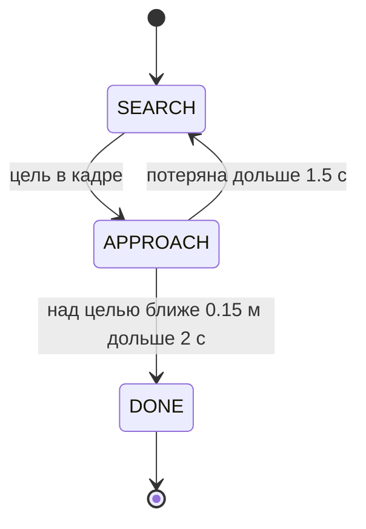

# Поиск объекта в кадре: дрон находит красную площадку

**Цель:** научить дрон с RL-политикой зависания облетать поле, находить цветную цель
бортовой камерой и зависать над ней. Результат: в синхронном режиме сима — 3 из 3 прогонов,
по 50 с каждый, положение цели на полу оценено с точностью до 1 см, дрон завис в 10–14 см
от неё по горизонтали.

Проверено там же, где [01_quickstart.md](01_quickstart.md).

## Минимальная теория

Политика зависания из трека C1 урока 14 умеет одно: удерживать точку. На вход — смещение
до точки в раме корпуса, скорости, ориентация; на выход — тяги четырёх винтов, 50 Гц.
В ROS 2 точка приходит топиком `/target_point`. Обучалась политика на смещениях не больше
0.8 м по каждой оси, поэтому контракт подаёт дальнюю точку «морковкой»: не дальше 0.8 м от
дрона в её сторону. Так политика летит к любой точке, ни разу не выходя за свою полосу
обучения.

Остальное — верхний уровень, нода `drone_search`, действие `/search_target`:



- **SEARCH** — «змейка» над полем 10 × 10 м на высоте 2.5 м, полосы через 3 м. На этой
  высоте камера с углом обзора 80° видит на полу пятно примерно 4 × 5.6 м, так что полосы
  перекрываются.
- **APPROACH** — детектор цвета даёт пиксель центра пятна. Через параметры камеры пиксель
  превращается в луч в оптической раме, через tf `odom → camera_link` **на момент кадра** —
  в луч в мире, а пересечение луча с полом `z = 0` — в точку цели. Над ней на высоте
  `stop_distance` и подаётся `/target_point`.
- **DONE** — дрон над целью.

Дальность до цветного пятна по одному кадру не определить: размер цели неизвестен. Поэтому
детектор цвета публикует только направление (`distance = -1`), а дальность даёт известная
поверхность — пол. Это общий приём: монокулярная камера плюс известная геометрия сцены.

## Запуск

```bash
ros2 launch rl_policy_ros drone_search.launch.py rviz:=true
```

Окно MuJoCo: дрон на высоте 1 м над полем с четырьмя цветными площадками. В RViz2 поменяйте
в дисплее «Детектор ArUco» топик на `/color/debug_image` — там кадр камеры с рамками вокруг
найденных пятен.

Цель — из второго терминала:

```bash
ros2 action send_goal /search_target rl_policy_interfaces/action/ApproachTarget "{label: red, stop_distance: 1.0, timeout: 170}" --feedback
```

## Ожидаемый результат

Замер на машине курса, три прогона:

| прогон | время, с | цель на полу | дрон над целью | по горизонтали, м |
|---|---|---|---|---|
| 1 | 50.0 | (4.00, −3.50) | (4.08, −3.43, 0.99) | 0.101 |
| 2 | 50.3 | (4.00, −3.50) | (4.12, −3.51, 1.01) | 0.122 |
| 3 | 50.6 | (4.00, −3.50) | (4.13, −3.55, 1.04) | 0.141 |

```
Goal finished with status: SUCCEEDED
```

Истинное положение красной площадки в мире
([quad_field.yaml](<../ros2_ws/src/rl_policy_ros/config/worlds/quad_field.yaml>)) —
(4.0, −3.5).

## Разбор: дрон, который переворачивался

Первая версия работала в асинхронном режиме сима: физика шла по настенным часам, политика
успевала или нет. Один прогон — успех за 74 с; затем дрон перевернулся в двух прогонах из
четырёх — внезапно, из ровного полёта: наклон 2.9° на высоте 2.15 м, через 2 с — 172° на полу.

Первая гипотеза — «морковка»: политика никогда не летела долго с постоянным смещением
0.8 м до цели. Проверка — укоротить морковку до 0.4 м. Падения остались (одно из двух). Гипотеза
отвергнута.

Ответ был в логе самой политики, раз в 10 с: `период: медиана 18.0 мс, p99 24.0, максимум 96.0`.
Период управления по времени симуляции доходил до 96 мс: Python-нода подвисала, а физика
тем временем считалась со старой тягой. Моторы дрона отзываются за 20 мс; без управления
80–100 мс его опрокидывает.

Синхронный режим (`lockstep`, по умолчанию) убирает это: сим ждёт ответа на каждом такте.
Три прогона параллельно, под тройной нагрузкой машины, — 3 из 3, период ровно 20.0 мс,
максимум 20.0. Подробнее о двух режимах — в [01_quickstart.md](01_quickstart.md).

## Контрольные проверки

1. Детектор видит цвета: на высоте поиска

   ```bash
   ros2 topic echo /detections
   ```

   печатает метки тех цветов, что сейчас в кадре, у всех `distance: -1.0`.

2. Найденная точка на полу:

   ```bash
   ros2 topic echo /search/target_on_ground
   ```

   в состоянии `APPROACH` — координаты, близкие к (4.0, −3.5).

3. Политика ничего не знает о поиске: в `rqt_graph` у `policy_node` нет подписки на
   `/detections` — цель приходит к ней только как `/target_point`.

4. Отправьте цель `label: green`. Дрон должен зависнуть над зелёной площадкой (2.0, 3.5).
   Этот прогон в статье не замерен — сравните сами с ожидаемыми координатами.

## Итог

- Та же схема, что у шагающего робота: детектор → верхний уровень → одна команда → RL-политика.
  Поменялись только смысл команды (`/target_point` вместо `/cmd_vel`) и источник детекций.
- Пиксель становится точкой в мире через параметры камеры, tf на момент кадра и известную
  поверхность.
- Политику кормят только тем, что она видела в обучении: дальняя цель подаётся морковкой.

Оглавление урока — [README.md](README.md).
