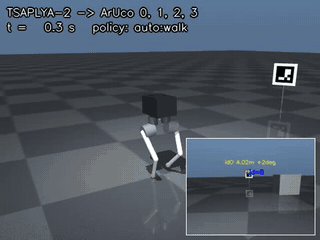
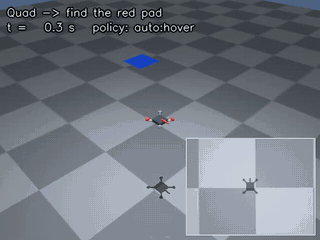
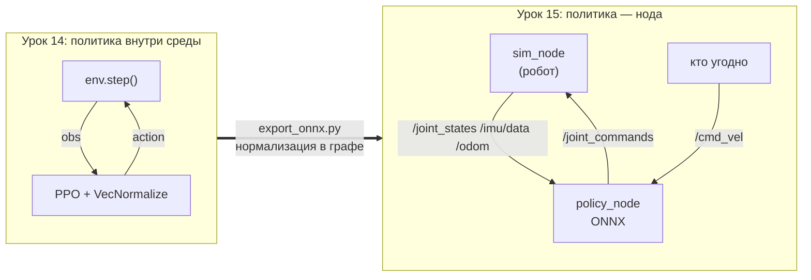
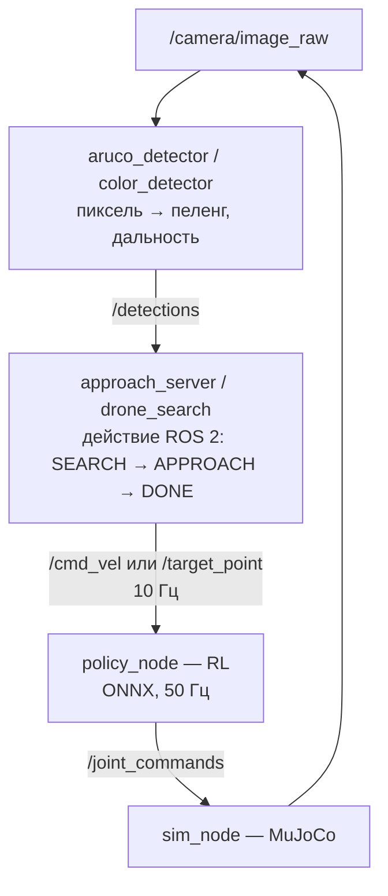
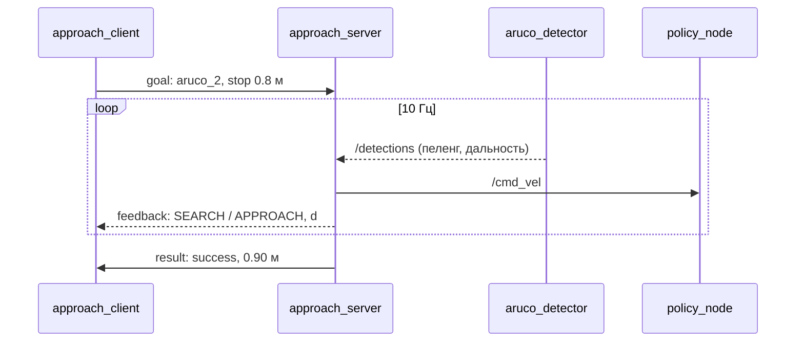
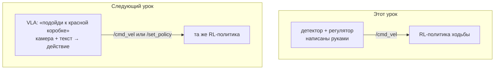

# Урок 15. RL-политики под управлением ROS 2

**Цель:** запустить обученную RL-политику как ноду ROS 2 — без Gym и SB3, только ONNX и
топики — и поставить над ней классическое управление по камере. Результат: двуногий
ЦАПЛЯ-2 обходит четыре ArUco-маркера (4 из 4), дрон находит красную площадку среди
отвлекающих (3 из 3, ошибка 10–14 см), обе политики — из
[урока 14](<../lesson 14 (RL custom models)/README.md>).

Урок устроен как презентация: один экран — одна мысль. Подробности, команды и замеры —
в статьях, ссылки в конце каждого слайда.

---

## 1. Что получится



*ЦАПЛЯ-2 по очереди находит и подходит к маркерам 0, 1, 2, 3. В углу — то, что видит её
камера, с разметкой детектора. Шагает RL-политика, куда шагать — решает регулятор по камере.*



*Дрон облетает поле «змейкой», находит красную площадку и зависает над ней. Винтами правит
RL-политика зависания, маршрут и цель задаёт нода поиска.*

---

## 2. Из урока 14 — в ROS 2



В среде обучения наблюдение собирает `env`. На роботе среды нет — есть топики. Значит, ноде
нужно собрать **тот же самый вектор** из того, что реально публикует робот.

→ [01_quickstart.md](01_quickstart.md)

---

## 3. Контракт — всё, что политика знала кроме весов

| Что | ЦАПЛЯ-2 | Где взять в ROS 2 |
|---|---|---|
| гравитация в раме корпуса (3) | `R.T @ [0,0,-1]` | `/imu/data` orientation |
| угловая скорость × 0.25 (3) | масштаб — часть контракта | `/imu/data` angular_velocity |
| суставы, скорости × 0.05 (16) | порядок суставов важен | `/joint_states` |
| прошлое действие (8) | **двухтактной** давности | помнит нода |
| команда (3) | `wz` через контур курса | `/cmd_vel` + yaw из IMU |
| фаза шага sin, cos (2) | частота зависит от команды | считает нода |

Сверка без ROS ([code/check_contracts.py](code/check_contracts.py)): наблюдение ноды против
наблюдения среды на 500 тактах — расхождение **0.00e+00** у ЦАПЛИ и **9e-16** у дрона.

---

## 4. Три робота — один `policy_node`

| | ЦАПЛЯ-2 | Microduck | Дрон C1 |
|---|---|---|---|
| откуда | legged_robots, r4u | Pollen Robotics, HF | урок 14, трек C1 |
| наблюдение → действие | 35 → 8 | 61 → 14 | 19 → 4 |
| что на выходе | цели 8 суставов | цели 14 суставов | тяги 4 винтов |
| команда | `/cmd_vel` | `/cmd_vel`, `/head_cmd` | `/target_point` |
| ONNX | 177 КБ | 794 КБ × 9 политик | 82 КБ |
| инференс в ноде | ~0.1 мс из 20 | ~0.15 мс из 20 | ~0.1 мс из 20 |

Робот выбирается параметром: `ros2 launch rl_policy_ros walk.launch.py robot:=microduck`.

---

## 5. Иерархия: классика сверху, RL снизу



Верхний уровень решает **куда**, политика — **как**. Связь между ними — одна команда.
Ни один уровень не знает, что внутри другого: детектор ArUco меняется на детектор цвета,
двуногий — на утку, а схема та же.

→ [04_aruco_approach.md](04_aruco_approach.md), [05_drone_search.md](05_drone_search.md)

---

## 6. Подход к маркеру — действие ROS 2



| Маркер | 0 | 1 | 2 | 3 |
|---|---|---|---|---|
| время, с | 8.6 | 10.0 | 11.4 | 21.4 |
| остановка по детектору, м | 0.890 | 0.897 | 0.899 | 0.890 |

Маркер 3 — позади: сначала поиск поворотом на месте, поэтому вдвое дольше.

---

## 7. Поиск дроном — пиксель становится точкой на полу


Красная площадка в мире — (4.00, −3.50). Оценка по камере — (4.00, −3.50) во всех трёх
прогонах. Дрон завис в 10–14 см от неё по горизонтали. Весь поиск — 50 с.

---

## 8. Грабли, найденные по дороге

Каждая — с числом, которым её поймали. Каждая выглядела как «политика плохая».

| Симптом | Причина | Как поймали |
|---|---|---|
| ЦАПЛЯ падает до старта политики | точечные стопы: стоять сама не может | подвес в `sim_node` до первой команды |
| дрон: расхождение 5e-3 в тягах | среда берёт поворот из `xmat`, он на 2 мс старше `qpos` | сверка контракта без ROS |
| двуногий падает через 10 с | сим отставал и «догонял» физику пачками по 60 мс | лог периода политики: p99 54 мс |
| дрон переворачивается из ровного полёта, утка заваливается | Python-нода подвисает до 96 мс, физика идёт со старой командой | тот же лог; лечение — синхронный режим сима, период ровно 20.0 мс |
| дальность до маркера +20 %, вблизи не видно | текстура маркера зеркальная | отражённый кадр детектор узнаёт сразу |
| у утки камера показывает зелёную стену | `head_camera` смотрит назад, внутрь головы | рендер с кубами спереди и сзади |
| утка стоит при команде 0.2 м/с | мёртвая зона политики | исходный скрипт приложения Б: 0.00 м/с тоже |
| в RViz2 пусто | sim time, Fixed Frame, QoS Best Effort | сим пишет `incompatible QoS` |

---

## 9. RL-политика и VLA



| | RL-политика этого урока | VLA |
|---|---|---|
| вход | состояние робота: IMU, суставы, команда | камера + текстовая инструкция (+ состояние) |
| выход | цели суставов или тяги, 50 Гц | действия робота, часто пачкой |
| размер | десятки–сотни тысяч параметров | от 450M (SmolVLA) до 7B (OpenVLA) |
| частота | 50 Гц на CPU, инференс ~0.1 мс | OpenVLA — единицы Гц на GPU; π0 — пачка из 50 действий, до 50 Гц |
| обучение | RL в симуляторе, одна задача | имитация на демонстрациях, много задач |
| что умеет | одно движение, устойчиво | понимает задачу словами, обобщает на новые объекты |

Это не конкуренты, а этажи. Figure Helix прямо так и устроен: медленная модель ~7B на
7–9 Гц решает, что делать, быстрая ~80M на 200 Гц — как двигаться. В этом уроке верхний
этаж написан руками; в следующем его место займёт VLA, а интерфейс — `/cmd_vel`,
`/set_policy`, действия ROS 2 — останется тем же.

*Источники: OpenVLA — [arXiv 2406.09246](https://arxiv.org/abs/2406.09246), её частота на
A100 — [arXiv 2502.19645](https://arxiv.org/abs/2502.19645);
π0 — [Physical Intelligence](https://www.physicalintelligence.company/blog/pi0);
SmolVLA — [arXiv 2506.01844](https://arxiv.org/abs/2506.01844);
Helix — [Figure](https://www.figure.ai/news/helix).*

---

## 10. Задания

| № | Задание | Принято, если |
|---|---|---|
| 1 | Запустите ЦАПЛЮ и проведите её клавиатурой вокруг всех четырёх маркеров | `ros2 topic hz /joint_commands` ≈ 50 Гц, робот не упал |
| 2 | Запишите `ros2 bag` с `/policy/obs` и `/odom` за 30 с ходьбы, постройте график скорости против команды | на графике видно отставание и установившуюся ошибку, числа в отчёте |
| 3 | Добавьте в мир пятый маркер и обойдите все пять клиентом | 5 из 5 `success=True` |
| 4 | Проверьте сторожа: остановите `sim_node` во время ходьбы | в логе `policy_node` — «данные устарели», команды — безопасная поза |
| 5 | Найдите дроном зелёную площадку, затем жёлтую — одним клиентом | обе цели найдены, ошибка меньше 0.2 м |
| 6 | Запустите сценарии с `lockstep:=false`, затем подайте политике задержку: нода-ретранслятор `/joint_states` с задержкой N мс | таблица «режим, задержка → падение / скорость», найден порог для ЦАПЛИ и дрона |
| 7 | Поставьте детектор цвета на ЦАПЛЮ и подведите её к красному ящику | `approach_server` не менялся ни на строчку |
| 8 | Утка: подход к маркеру с учётом мёртвой зоны (`v_min 0.3`) | утка дошла до маркера, видео в отчёте |

---

## Как всё запустить

Проверено с нуля: Windows 11 + WSL2 Ubuntu 22.04 + ROS 2 Humble — свежий клон с GitHub
собирается за 15 с, ЦАПЛЯ из этой сборки идёт 0.48 м/с по команде 0.5. На Ubuntu 24.04 +
Jazzy команды те же, но не проверялись.

### Шаг 1. Пакеты системы

ROS 2 уже стоит ([урок 1](<../lesson 1 (install ROS2 and testing)/README.md>)). Доставляем
сборщик, клавиатурное управление и просмотр картинок:

```bash
sudo apt install python3-colcon-common-extensions ros-$ROS_DISTRO-teleop-twist-keyboard ros-$ROS_DISTRO-rqt-image-view git
```

### Шаг 2. Пакеты Python

MuJoCo, ONNX Runtime и OpenCV — поверх системного Python ROS:

```bash
pip3 install --user mujoco==3.9.0 onnxruntime==1.23.2 opencv-python-headless==4.10.0.84
```

На Ubuntu 24.04 добавьте `--break-system-packages` (pip без venv там запрещён).

### Шаг 3. Репозиторий и сборка

```bash
git clone https://github.com/GeBondar/mobile-robotics-basics.git ~/mobile-robotics-basics
```

```bash
cd ~/mobile-robotics-basics/ros2_ws && source /opt/ros/$ROS_DISTRO/setup.bash && colcon build --symlink-install --packages-select rl_policy_interfaces rl_policy_ros
```

Ожидается `Summary: 2 packages finished`. Собираем только два пакета урока — остальным пакетам
workspace нужны свои зависимости.

### Шаг 4. Окружение — в КАЖДОМ новом терминале

```bash
source /opt/ros/$ROS_DISTRO/setup.bash && source ~/mobile-robotics-basics/ros2_ws/install/setup.bash
```

Без этой строки `ros2 launch rl_policy_ros ...` ответит `Package 'rl_policy_ros' not found`.

### Шаг 5 (только для Microduck). Модель утки

Политики утки лежат в пакете, а модель робота с мешами (23 МБ) — в репозитории авторов:

```bash
git clone https://github.com/pollen-robotics/microduck_rl.git ~/microduck_rl
```

```bash
export MICRODUCK_RL=~/microduck_rl
```

`export` нужен в том терминале, где запускается робот; удобно дописать его в `~/.bashrc`.

### Шаг 6. Сценарии

Каждый — два терминала. В первом робот и всё, что над ним; откроется окно MuJoCo
(`rviz:=true` добавит RViz2). Во втором — то, что задаёт цель.

| | Терминал 1 | Терминал 2 | Что увидите |
|---|---|---|---|
| **А.** ЦАПЛЯ с клавиатуры | `ros2 launch rl_policy_ros walk.launch.py rviz:=true` | `ros2 run teleop_twist_keyboard teleop_twist_keyboard` | `i` — вперёд, `,` — назад, `j`/`l` — поворот, `k` — стоп |
| **Б.** Microduck с клавиатуры | `ros2 launch rl_policy_ros walk.launch.py robot:=microduck` | `ros2 run teleop_twist_keyboard teleop_twist_keyboard` | сначала 5 раз `x` — скорость 0.50 → 0.30 (выше утку не учили, ниже 0.3 она стоит на месте), потом `i` |
| **В.** ЦАПЛЯ идёт к маркерам | `ros2 launch rl_policy_ros aruco.launch.py rviz:=true` | `ros2 run rl_policy_ros approach_client --ros-args -p use_sim_time:=true -p labels:="['aruco_0','aruco_1','aruco_2','aruco_3']"` | четыре строки `RESULT ... success=True` |
| **Г.** Дрон ищет красное | `ros2 launch rl_policy_ros drone_search.launch.py rviz:=true` | `ros2 action send_goal /search_target rl_policy_interfaces/action/ApproachTarget "{label: red, stop_distance: 1.0, timeout: 170}" --feedback` | `Goal finished with status: SUCCEEDED` примерно через 50 с времени симуляции |

Остановить сценарий — Ctrl+C в терминале 1. Перед следующим сценарием остановите предыдущий:
два робота в одном ROS-домене мешают друг другу.

### Полезное в третьем терминале

| Команда | Зачем |
|---|---|
| `ros2 topic hz /joint_commands` | частота политики, должно быть около 50 Гц |
| `ros2 topic echo /policy/obs --once` | вектор, который видит политика |
| `ros2 run rqt_image_view rqt_image_view /aruco/debug_image` | камера робота с разметкой детектора (`/color/debug_image` — у дрона) |
| `ros2 service call /sim/reset std_srvs/srv/Trigger` | робот упал — вернуть в стартовую позу |
| `ros2 service call /set_policy rl_policy_interfaces/srv/SetPolicy "{name: auto}"` | после сброса — снова включить политику |
| `ros2 topic pub --once /sim/push geometry_msgs/msg/Vector3 "{y: 0.4}"` | толкнуть робота |
| `ros2 run rl_policy_ros video_recorder --ros-args -p use_sim_time:=true -p out:=/tmp/run.mp4` | записать ролик; сим запускать с `chase_rate:=15.0` |

### Если не работает

| Симптом | Что делать |
|---|---|
| `ros2 topic list` пустой или виснет, хотя робот в окне двигается | завис демон `ros2`: `ros2 daemon stop; ros2 daemon start`, проверка в обход — `ros2 topic list --no-daemon` |
| в RViz2 пусто | запускайте через `rviz:=true` — там уже `use_sim_time`, Fixed Frame `odom` и Best Effort; почему без этого пусто — [01_quickstart.md](01_quickstart.md) |
| `задайте MICRODUCK_RL` при `robot:=microduck` | не сделан шаг 5 в этом терминале |
| в логе сима `x0.30 реального времени` | рендер программный (WSL) — это нормально: синхронный режим просто замедляет время, поведение робота то же |
| окно MuJoCo не открывается | нет дисплея: запускайте с `viewer:=false` и смотрите в RViz2 |
| робот упал | `/sim/reset`, затем `/set_policy auto` — таблица выше |

Подробно, с ожидаемым выводом и проверками — в статьях ниже.

## Статьи

| Шаг | Статья | Результат |
|---|---|---|
| 1 | [Запуск: ЦАПЛЯ-2 идёт по /cmd_vel](01_quickstart.md) | робот в MuJoCo, политика в ROS 2, клавиатура, RViz2 |
| 2 | Контракт политики: сверка без ROS | пишется; код — [code/check_contracts.py](code/check_contracts.py) |
| 3 | Microduck: девять политик, переключение сервисом | пишется |
| 4 | [Камера и ArUco: подойти к маркеру](04_aruco_approach.md) | 4 из 4 маркеров |
| 5 | [Поиск объекта в кадре: дрон](05_drone_search.md) | красная площадка, 3 из 3, ошибка 10–14 см |

## Пакеты workspace

- [rl_policy_interfaces](<../ros2_ws/src/rl_policy_interfaces>) — `Detection.msg`,
  `SetPolicy.srv`, `ApproachTarget.action`.
- [rl_policy_ros](<../ros2_ws/src/rl_policy_ros>) — `sim_node`, `policy_node`,
  `aruco_detector`, `color_detector`, `approach_server`, `approach_client`, `drone_search`,
  `video_recorder`; контракты, сцены, ONNX, launch-файлы, конфиг RViz2.

## Откуда политики

| Робот | Файл | Источник |
|---|---|---|
| ЦАПЛЯ-2 | `tsaplya2_walk.onnx` | прогон r4u, 206.5 млн шагов (legged_robots); модель `tsaplya2.xml` — та же, что в треке B урока 14 |
| Дрон | `quad_hover.onnx` | трек C1 урока 14, `policies/hover` |
| Microduck | `microduck/*.onnx` | [pollen-robotics/microduck-policies](https://huggingface.co/pollen-robotics/microduck-policies), Apache-2.0 |

ONNX выгружены [code/export_onnx.py](code/export_onnx.py): нормализация VecNormalize вшита
в граф, выход сверен с SB3 (6.6e-07 и 7.7e-07), в метаданных — робот и хэши весов.

## После урока

Следующий урок — VLA: модель, которая смотрит в камеру и понимает задачу словами. Она
займёт верхний этаж из слайда 5 и будет публиковать в тот же `/cmd_vel`.
